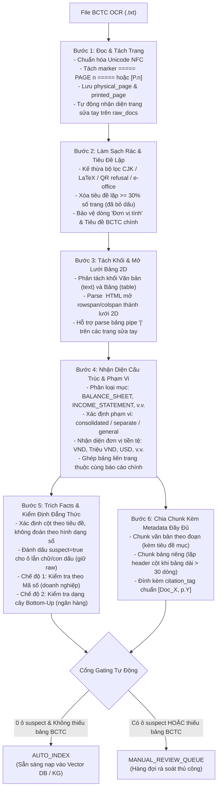

# Thiết Kế Module Document Parser & Ingestion

**Phiên bản:** `1.1.0`  
**Ngày cập nhật:** 28/10/2026  
**Module chính:**
- Schema dữ liệu: [`src/schemas/document_schema.py`](../../src/schemas/document_schema.py)
- Pipeline 6 bước & Gating: [`src/ingestion/document_parser.py`](../../src/ingestion/document_parser.py)
- Script xuất danh sách rà soát: [`src/ingestion/export_manual_review_list.py`](../../src/ingestion/export_manual_review_list.py)
- Dữ liệu JSON đầu ra: [`data/processed_chunks/`](../../data/processed_chunks)

---

## 1. Mục Tiêu & Kiến Trúc Tổng Quan

Trong hệ thống **Multi-Agent Report Writer**, chất lượng phân tích tài chính phụ thuộc hoàn toàn vào độ chính xác và tính toàn vẹn của dữ liệu đầu vào. Các file báo cáo tài chính (BCTC) sau khi quét qua OCR (VLM) thường gặp phải các thách thức lớn:
1. **Mất cấu trúc bảng:** Dữ liệu bảng tài chính bị vỡ `rowspan`/`colspan`, lệch cột giữa Năm nay và Năm trước.
2. **Nhiễu OCR và con dấu:** Con dấu đỏ và chữ ký đè lên số liệu (ví dụ: `'NOA 4.455'`, `'1.5006-C.T.C.P'`, `'(ZZZ6)'`), ký tự chữ Hán (CJK), công thức LaTeX ảo giác.
3. **Mất dấu vết trích dẫn:** Không phân biệt được số trang vật lý của file PDF với số trang in trên giấy, gây sai lệch khi các Agent trích dẫn nguồn (`[Doc_X, p.Y]`).
4. **Không phát hiện được sai số:** Thiếu cơ chế kiểm tra chéo các đẳng thức kế toán cơ bản (Tổng tài sản $\ne$ Tổng nguồn vốn, v.v.).

Module **Document Parser & Ingestion** giải quyết triệt để các vấn đề trên thông qua **Pipeline 6 bước độc lập**, tích hợp cơ chế **Kiểm tra đẳng thức 2 chế độ** và **Cổng kiểm soát chất lượng (Quality Gating)**:



---

## 2. Chi Tiết Thiết Kế 6 Bước

### Bước 1: Đọc và Tách Trang (`step1_read_and_split_pages`)

- **Nhiệm vụ:** Đọc file văn bản, chuẩn hóa ký tự, phân tách tài liệu thành danh sách các trang kèm metadata số trang.
- **Quyết định rút ra từ dữ liệu:**
  1. **Lưu 2 loại số trang riêng biệt:**
     - `physical_page` (`int`): Số trang vật lý khớp chính xác với số trang trong file PDF gốc (trang 1, 2, ...), được dùng làm định danh thống nhất cho nhãn trích dẫn `[Doc_X, p.Y]`.
     - `printed_page` (`Optional[str]`): Số trang in thực tế trên chân giấy (ví dụ: `"Trang 5"`, `"- 5 -"`, `"5/72"`). Do trang bìa, mục lục và một số trang phụ lục thường không in số trang, trường này cho phép nhận giá trị `None`.
  2. **Kế thừa điểm cắt báo cáo kép:** Tái sử dụng bảng tra cứu `BILINGUAL_AND_DUPLICATE_CUTS` từ giai đoạn đếm token để cắt bỏ các trang song ngữ Anh–Việt hoặc bản quy đổi ngoại tệ trùng lặp (ví dụ: `VHM` cắt trang 105 trở đi, `VIC` cắt trang 115 trở đi).
  3. **Đồng bộ thông minh giữa `raw_docs` và `backup_data`:**
     - File trong `data/raw_docs/top_100/` đã được chuyển sang dạng bảng `|` để tối ưu token.
     - Hàm kiểm tra từng trang giữa `raw_docs` và bản gốc trong `backup_data`. Nếu trang nào **đã được người dùng chỉnh sửa tay** trên `raw_docs`, parser sẽ sử dụng trực tiếp nội dung mới sửa; các trang chưa sửa sẽ đọc thẻ `<table>` HTML từ `backup_data` để giữ nguyên các thuộc tính `rowspan`/`colspan`.
     - Mã băm `sha256` được tính trực tiếp từ byte file `raw_docs` để luôn phát hiện sự thay đổi.

### Bước 2: Làm Sạch (`step2_clean_pages`)

- **Nhiệm vụ:** Loại bỏ nhiễu OCR nội tuyến và các dòng tiêu đề/chân trang lặp lại ở đầu hoặc cuối mỗi trang.
- **Quyết định rút ra từ dữ liệu:**
  1. **Tái sử dụng bộ lọc rác VLM/OCR:** Xóa câu thông báo từ chối đọc QR code của mô hình VLM, ký tự chữ Hán (CJK `[\u4e00-\u9fff]`), công thức toán học LaTeX ảo giác (`\( \therefore ... \)`, `\frac`), watermark hệ thống văn phòng điện tử (`eoffice`), và dãy số đếm dòng lề giấy kiểm toán (`1 2 3 ... 23`).
  2. **Nhận diện tiêu đề lặp tự động:** Dòng văn bản ngoài bảng xuất hiện ở $\ge 30\%$ tổng số trang của tài liệu (so khớp trên chuỗi đã bỏ dấu tiếng Việt và chuẩn hóa khoảng trắng) được coi là tiêu đề/chân trang lặp cần xóa (ví dụ: tên ngân hàng, địa chỉ tòa nhà, câu `"Các thuyết minh đính kèm là bộ phận hợp thành..."`).
  3. **Quy tắc bảo vệ tuyệt đối:**
     - **Không coi "Đơn vị tính" là tiêu đề lặp:** Các dòng chứa `đơn vị tính`, `đơn vị:`, `đvt:` luôn được giữ lại vì chúng chứa thông tin đơn vị tiền tệ của bảng số liệu.
     - **Không xóa dòng tiêu đề báo cáo chính:** Các dòng bắt đầu bằng `Bảng cân đối kế toán`, `Báo cáo kết quả hoạt động kinh doanh`, `Báo cáo tình hình tài chính`, v.v. được bảo vệ để không bị mất khi phân loại cấu trúc.

### Bước 3: Tách Khối & Mở Lưới Bảng (`step3_extract_blocks`)

- **Nhiệm vụ:** Tách biệt các đoạn văn xuôi (`text`) và các bảng số liệu (`table`), trải phẳng bảng thành lưới 2D đều đặn.
- **Quyết định rút ra từ dữ liệu:**
  1. **Parse bảng HTML bằng thư viện chuẩn:** Sử dụng `html.parser.HTMLParser` của Python để trích xuất cấu trúc `<tr>`, `<td>`, `<th>`, `rowspan`, `colspan`.
  2. **Mở `rowspan`/`colspan` thông minh (`expand_html_table_to_grid`):**
     - Với dòng tiêu đề cột (2 dòng đầu của bảng): ô có `colspan > 1` được nhân bản giá trị sang các cột con để giữ ngữ cảnh phân nhóm cột (ví dụ: `"31/12/2024"` gộp cho cả cột Số cuối năm và Thuyết minh).
     - Với dòng dữ liệu trong thân bảng: ô có `colspan > 1` chỉ điền văn bản ở ô đầu tiên (`dc == 0`), các ô bên phải được điền chuỗi rỗng `""` để tránh tràn chữ vào cột số liệu gây báo động giả.
  3. **Hỗ trợ bảng dạng pipe `|` (`expand_pipe_table_to_grid`):** Cho phép parse trực tiếp các bảng dạng văn bản phân cách bởi dấu `|` trên các trang mà người dùng đã chỉnh sửa thủ công trên `raw_docs`, tự động căn chỉnh và ghép nối các dòng nhãn bị ngắt đôi.

### Bước 4: Nhận Diện Cấu Trúc (`step4_detect_structure`)

- **Nhiệm vụ:** Xác định loại báo cáo tài chính (`section`), phạm vi lập báo cáo (`scope`), và đơn vị tiền tệ (`unit`).
- **Quyết định rút ra từ dữ liệu:**
  1. **Nhận diện tiêu đề loại báo cáo (`detect_heading_line`):**
     - Chỉ chấp nhận khi tiêu đề là **một dòng riêng biệt**, viết hoa ($\ge 75\%$ ký tự chữ cái viết hoa) hoặc đứng sát mã biểu mẫu chuẩn (`Mẫu B 01 - DN/HN`, `Mẫu B02/TCTD-HN`...).
     - Bắt buộc bắt đầu bằng cụm tên báo cáo chuẩn, không chứa từ nối của câu văn xuôi (`"bao gồm:"`, `"kèm theo"`, `"theo ý kiến"`, `"xem thuyết minh"`), không kết thúc bằng số trang mục lục.
     - So khớp trên chuỗi đã bỏ dấu (`fold_accents`) để chịu được lỗi dấu và lỗi chính tả OCR (ví dụ: `"báo cáo tình bình tài chính"` ở `ABB_2024`, `"báo cáo kết quả hoạt động hợp nhất"`).
     - Các loại báo cáo hỗ trợ: `COVER_OR_TOC`, `MANAGEMENT_REPORT`, `AUDIT_REPORT`, `BALANCE_SHEET`, `OFF_BALANCE_SHEET`, `INCOME_STATEMENT`, `CASH_FLOW`, `NOTES`.
  2. **Xác định phạm vi:** Nhận diện `consolidated` (hợp nhất), `separate` (riêng lẻ / công ty mẹ), hoặc `general` (báo cáo chung).
  3. **Nhận diện đơn vị tiền tệ:** Chuẩn hóa về các mã `VND`, `thousand_VND`, `million_VND`, `billion_VND`, hoặc `USD`.
  4. **Ghép bảng báo cáo liên trang:** Tự động hợp nhất các bảng kéo dài qua nhiều trang (trang 7 sang trang 8) thuộc cùng một mục báo cáo và có cùng số cột, đồng thời loại bỏ các dòng tiêu đề cột lặp lại ở đầu trang tiếp theo.

### Bước 5: Trích Số Liệu & Kiểm Định Đẳng Thức Kế Toán (`step5_extract_facts_and_verify`)

- **Nhiệm vụ:** Trích xuất từng dòng số liệu kế toán thành cấu trúc `FactItem` và kiểm định tính cân đối kế toán.
- **Quyết định rút ra từ dữ liệu:**
  1. **Xác định cột theo tiêu đề cột (`detect_statement_columns`):** Dựa hoàn toàn vào chữ ở tiêu đề cột (`"Mã số"`, `"Thuyết minh"`, `"Chỉ tiêu"`, `"Số cuối năm"`), **không đoán cột Mã số theo hình dạng số**, vì chuỗi `"11"` hay `"24"` có thể là mã số chỉ tiêu hoặc số tham chiếu thuyết minh.
  2. **Đánh dấu số liệu nghi ngờ (`suspect=true`):**
     - Nếu ô số liệu chứa chữ cái hoặc ký tự lạ do con dấu đè/chữ ký (ví dụ: `'NOA 4.455'`, `'1.5006-C.T.C.P'`, `'(ZZZ6)'`), hoặc lỗi phân cách hàng nghìn (`'3.600.855.93'`), hàm `parse_financial_Cell` gắn cờ `suspect=True`, **giữ nguyên chuỗi gốc** trong trường `raw`, và trả về giá trị số là `None`.
     - Tự động lọc bỏ các hậu tố chú thích kế toán hợp lệ đi kèm số liệu như `(Điều chỉnh lại)`, `(Trình bày lại)` để không đánh dấu nghi ngờ sai.
  3. **Hai chế độ kiểm tra đẳng thức kế toán:**
     - **Chế độ 1 — Theo Mã số (`code_based` - Doanh nghiệp sản xuất, thương mại, dịch vụ):**
       - Bảng cân đối kế toán:
         $$\text{Mã 100} = 110 + 120 + 130 + 140 + 150$$
         $$\text{Mã 200} = 210 + 220 + 230 + 240 + 250 + 260$$
         $$\text{Mã 270 (Tổng tài sản)} = 100 + 200$$
         $$\text{Mã 300} = 310 + 330 \quad (\text{hoặc } 310 + 340 \text{ đối với CTCK})$$
         $$\text{Mã 400} = 410 + 430 \quad (\text{hoặc } 410 + 420)$$
         $$\text{Mã 440 (Tổng nguồn vốn)} = 300 + 400$$
         $$\text{Phương trình cân đối cơ bản:} \quad \text{Mã 270} == \text{Mã 440}$$
       - Báo cáo kết quả kinh doanh:
         $$\text{Mã 10} = 01 \mp 02$$
         $$\text{Mã 20} = 10 \mp 11$$
         $$\text{Mã 30} = 20 + 21 \mp 22 + 24 \mp 25 \mp 26$$
         $$\text{Mã 40} = 31 \mp 32$$
         $$\text{Mã 50} = 30 + 40$$
         $$\text{Mã 60} = 50 \mp 51 \mp 52$$
         *Chấp nhận cả 2 quy ước dấu chi phí* (ghi số dương như `FPT` hoặc ghi số âm trong ngoặc `(xxx)` như `VHM`).
     - **Chế độ 2 — Dạng cây Bottom-Up (`tree_based` - Ngân hàng không có cột Mã số):**
       - Thuật toán duyệt từ dưới lên: một dòng có giá trị bằng tổng các dòng con liên tiếp ngay sau nó thì được coi là dòng tổng hợp cấp trên.
       - Kiểm tra 3 đẳng thức cốt lõi:
         1. $\text{Tổng tài sản} = \sum (\text{Các khoản mục cấp 1 của Tài sản})$
         2. $\text{Tổng nguồn vốn} = \sum (\text{Các khoản mục cấp 1 của Nợ phải trả \& Vốn chủ sở hữu})$
         3. $\text{Tổng tài sản} = \text{Tổng nguồn vốn}$

### Bước 6: Chia Chunk Kèm Metadata Đầy Đủ (`step6_chunk_document`)

- **Nhiệm vụ:** Chia tài liệu thành các khối chunk tối ưu cho Vector Search và LLM Reader.
- **Quyết định rút ra từ dữ liệu:**
  1. **Chunk văn bản (`chunk_type="text"`):** Chia theo đoạn văn tự nhiên, kích thước mục tiêu $\sim 1.800$ ký tự, luôn gắn nhãn tiêu đề mục (`[Tên mục]`) ở đầu mỗi chunk để LLM không bị mất ngữ cảnh khi trích dẫn.
  2. **Chunk bảng riêng biệt (`chunk_type="table"`):** Không băm nhỏ bảng vào giữa văn bản. Với bảng dài vượt quá 30 dòng, tự động cắt thành nhiều lát cắt và **lặp lại dòng tiêu đề cột ở đầu mỗi chunk bảng** để các cột số liệu luôn có chú thích rõ ràng.
  3. **Metadata truy xuất toàn diện:** Mỗi chunk chứa đầy đủ:
     - `physical_pages`, `physical_page_start`, `physical_page_end`
     - `printed_pages`
     - `citation_tag`: Nhãn trích dẫn chuẩn, ví dụ `[Doc_FPT_2024_Hopnhat, p.12-13]`
     - `section`, `section_title`, `chunk_type`, `unit`, `scope`, `row_count`.

---

## 3. Đặc Tả Schema Dữ Liệu (`src/schemas/document_schema.py`)

Hệ thống được chuẩn hóa qua 8 Dataclasses với đầy đủ metadata định nghĩa:

### 3.1. `ParsedDocument` (Cấu trúc gốc của 1 file JSON)

| Tên trường | Kiểu dữ liệu | Định nghĩa & Mục đích |
| :--- | :--- | :--- |
| `doc_id` | `str` | Mã định danh duy nhất của tài liệu theo cấu trúc: `{ticker}_{year}_{scope}` |
| `ticker` | `str` | Mã chứng khoán của doanh nghiệp (ví dụ: `FPT`, `VNM`, `ABB`) |
| `fiscal_year` | `int` | Năm tài chính của báo cáo (ví dụ: `2024`) |
| `source_file` | `str` | Đường dẫn tương đối đến file văn bản nguồn đã xử lý |
| `sha256` | `str` | Mã băm SHA-256 của file OCR đầu vào dùng để kiểm tra tính toàn vẹn |
| `parser_version` | `str` | Phiên bản của Document Parser thực hiện xử lý (ví dụ: `1.0.0`) |
| `scope` | `str` | Phạm vi lập báo cáo: `consolidated` (hợp nhất), `separate` (riêng lẻ), `general` (chung) |
| `default_unit` | `str` | Đơn vị tiền tệ mặc định: `VND`, `million_VND`, `billion_VND`, `USD` |
| `quality` | `QualityReport` | Báo cáo kiểm định chất lượng, kết quả đẳng thức kế toán và quyết định Gating |
| `chunks` | `List[ChunkItem]` | Danh sách các đoạn chunk văn bản và bảng số liệu sẵn sàng cho embedding |
| `facts` | `List[FactItem]` | Danh sách các mục số liệu tài chính có cấu trúc trích xuất từ các báo cáo chính |

### 3.2. `QualityReport` (Báo cáo chất lượng & Gating)

| Tên trường | Kiểu dữ liệu | Định nghĩa & Mục đích |
| :--- | :--- | :--- |
| `num_pages` | `int` | Tổng số trang vật lý của tài liệu sau khi đã cắt bỏ trang trùng lặp |
| `num_chunks` | `int` | Tổng số lượng chunk sinh ra từ tài liệu |
| `num_text_chunks` | `int` | Số lượng chunk thuộc loại văn bản thuần túy |
| `num_table_chunks` | `int` | Số lượng chunk thuộc loại bảng số liệu |
| `num_facts` | `int` | Tổng số dòng số liệu tài chính trích xuất được từ các báo cáo chính |
| `garbage_removed` | `Dict[str, int]` | Thống kê số lượng rác VLM/OCR và dòng tiêu đề lặp đã loại bỏ |
| `suspect_cells_count` | `int` | Tổng số ô số liệu bị đánh dấu nghi ngờ do lẫn chữ hoặc con dấu đè |
| `suspect_cells` | `List[Dict[str, Any]]` | Danh sách chi tiết các ô số liệu nghi ngờ kèm vị trí trang và lý do |
| `identity_check_mode` | `str` | Chế độ kiểm tra đẳng thức kế toán áp dụng: `code_based`, `tree_based`, hoặc `none` |
| `identity_status` | `str` | Trạng thái tổng hợp kiểm định đẳng thức: `PASSED`, `FAILED`, `NO_CHECKABLE_TABLES` |
| `identity_checks_total`| `int` | Tổng số phép kiểm tra đẳng thức kế toán đã thực hiện trên tài liệu |
| `identity_checks_passed`| `int` | Số lượng phép kiểm tra đẳng thức kế toán đạt yêu cầu cân đối |
| `identity_checks_failed`| `int` | Số lượng phép kiểm tra đẳng thức kế toán bị lệch |
| `identity_checks` | `List[IdentityCheckResult]` | Danh sách chi tiết kết quả từng phép kiểm tra đẳng thức kế toán |
| `gating_status` | `str` | Quyết định phân luồng: `AUTO_INDEX` (tự động đi tiếp) hoặc `MANUAL_REVIEW_QUEUE` |
| `gating_reasons` | `List[str]` | Danh sách các lý do chi tiết khiến tài liệu bị giữ lại kiểm tra tay |

### 3.3. `ChunkItem` (Khối văn bản/bảng chia nhỏ kèm Citation)

| Tên trường | Kiểu dữ liệu | Định nghĩa & Mục đích |
| :--- | :--- | :--- |
| `chunk_id` | `str` | Định danh duy nhất của chunk: `{doc_id}_chunk_{index:04d}` |
| `chunk_type` | `str` | Loại nội dung của chunk: `text` (văn bản) hoặc `table` (bảng) |
| `text` | `str` | Nội dung văn bản hoặc lưới bảng của chunk |
| `physical_pages` | `List[int]` | Danh sách các trang vật lý (PDF) mà chunk này chiếm giữ |
| `physical_page_start`| `int` | Trang vật lý bắt đầu của chunk |
| `physical_page_end` | `int` | Trang vật lý kết thúc của chunk |
| `printed_pages` | `List[str]` | Danh sách số trang in trên giấy tương ứng (nếu nhận diện được) |
| `citation_tag` | `str` | Nhãn trích dẫn học thuật chuẩn để Agent đưa vào báo cáo: `[Doc_{id}, p.{pages}]` |
| `section` | `str` | Mã phần báo cáo: `BALANCE_SHEET`, `INCOME_STATEMENT`, `NOTES`, v.v. |
| `section_title` | `str` | Tiêu đề đầy đủ của phần báo cáo tương ứng |
| `unit` | `str` | Đơn vị tiền tệ áp dụng cho chunk |
| `scope` | `str` | Phạm vi báo cáo của chunk: `consolidated`, `separate`, `general` |
| `row_count` | `int` | Số dòng dữ liệu trong chunk (nếu là chunk bảng; văn bản = 0) |

### 3.4. `FactItem` (Mục số liệu kế toán trích xuất)

| Tên trường | Kiểu dữ liệu | Định nghĩa & Mục đích |
| :--- | :--- | :--- |
| `report_type` | `str` | Báo cáo nguồn: `BALANCE_SHEET`, `INCOME_STATEMENT`, `CASH_FLOW` |
| `code` | `Optional[str]` | Mã số chỉ tiêu kế toán chuẩn (ví dụ: `110`, `270`, `400`) |
| `stt` | `Optional[str]` | Số thứ tự khoản mục trong bảng (ví dụ: `I`, `II`, `1`, `2`, `a`) |
| `label` | `str` | Tên đầy đủ của khoản mục/chỉ tiêu kế toán |
| `note` | `Optional[str]` | Số tham chiếu thuyết minh BCTC đi kèm chỉ tiêu |
| `current_year` | `Optional[float]`| Giá trị số năm nay (đã chuẩn hóa số âm, None nếu ô nghi ngờ) |
| `prior_year` | `Optional[float]`| Giá trị số năm trước (đã chuẩn hóa số âm, None nếu ô nghi ngờ) |
| `raw_current` | `str` | Chuỗi văn bản gốc chưa qua xử lý ở cột năm nay |
| `raw_prior` | `str` | Chuỗi văn bản gốc chưa qua xử lý ở cột năm trước |
| `suspect` | `bool` | Cờ cảnh báo số liệu nghi ngờ do lẫn chữ cái hoặc con dấu đè |
| `suspect_reason` | `Optional[str]` | Lý do chi tiết đánh dấu số liệu nghi ngờ |
| `unit` | `str` | Đơn vị tiền tệ của số liệu |
| `physical_page` | `int` | Số trang vật lý chứa dòng số liệu này |
| `printed_page` | `Optional[str]` | Số trang in trên giấy chứa dòng số liệu này |

---

## 4. Cơ Chế Gating & Xử Lý Lỗi Rà Soát Thủ Công

### 4.1. Quy Tắc Gating Tự Động

Mỗi tài liệu sau khi parse được đánh giá qua cổng kiểm soát chất lượng tự động:
- **`AUTO_INDEX` (Đạt chuẩn tự động):** Khi tài liệu thỏa mãn đồng thời:
  1. Số ô số liệu nghi ngờ `suspect_cells_count == 0`.
  2. Tìm thấy bảng BCTC chính (`identity_status != "NO_CHECKABLE_TABLES"`).
  3. Các đẳng thức kế toán đạt cân đối hoặc đã được xác nhận kiểm định.
- **`MANUAL_REVIEW_QUEUE` (Hàng đợi rà soát):** Khi tài liệu dính ít nhất 1 ô `suspect=true` hoặc không tìm thấy bảng BCTC chính.

### 4.2. Công Cụ Xuất Danh Sách Rà Soát (`export_manual_review_list.py`)

Khi phát hiện lỗi hoặc nghi ngờ, script trích xuất toàn bộ các mục cần kiểm tra thủ công ra file Excel ([`danh_sach_loi_manual_review.xlsx`](file:///c:/Research%20Dataset/Multi-agent_Report_Writer/evaluation/token_statistics/danh_sach_loi_manual_review.xlsx)) và CSV ([`danh_sach_loi_manual_review.csv`](file:///c:/Research%20Dataset/Multi-agent_Report_Writer/evaluation/token_statistics/danh_sach_loi_manual_review.csv)) với các cột chi tiết:
- `stt`, `doc_id`, `ma_ck`, `nam`, `pham_vi`, `trang_pdf`
- `loai_loi`: `SUSPECT_CELL`, `FAILED_IDENTITY`, `MISSING_STATEMENT_TABLE`
- `loai_bao_cao`, `ma_so`, `ten_chi_tieu`, `cot_du_lieu`, `chuoi_goc_raw`, `don_vi_tinh`, `ly_do_chi_tiet`
- `gia_tri_sua`: **Cột cuối cùng để trống** cho chuyên viên tài chính điền giá trị chỉnh sửa sau khi đối chiếu với bản scan PDF gốc.

---

## 5. Kết Quả Kiểm Định Thực Tế Trên Toàn Bộ Tập Dữ Liệu

Sau các vòng rà soát, tinh chỉnh parser và loại bỏ các công ty có dữ liệu nguồn bị lỗi nặng (con dấu đè mất số, mất bảng BCTC), tập dữ liệu chính thức đã được tối ưu đạt chuẩn chất lượng tuyệt đối:

- **Tổng số công ty:** **37 doanh nghiệp** đại diện hàng đầu thị trường chứng khoán Việt Nam:
  `ABB, ACB, BAB, BSR, BWE, DCM, DHG, DPM, FOX, FPT, GAS, GEE, GEX, GMD, GVR, HAH, HUT, LGC, MCH, MSB, MSN, MVN, NAB, NVB, OIL, PAP, PET, PVI, PVT, QNS, SAB, SJG, SSH, VCR, VEA, VIC, VRE`.
- **Tổng số báo cáo tài chính đã xử lý:** **149 báo cáo**.
- **Tỷ lệ đạt chuẩn Gating:**
  $$\mathbf{149 / 149 \ (100\%) \ \text{đạt} \ AUTO\_INDEX}$$
- **Hàng đợi rà soát thủ công (`MANUAL_REVIEW_QUEUE`):** **0 báo cáo**.
- **Số lượng ô nghi ngờ (`suspect_cells`):** **0 ô**.
- **Số lượng bảng thiếu (`missing_tables`):** **0 bảng**.

Toàn bộ 149 tài liệu JSON chuẩn hóa trong [`data/processed_chunks/`](../../data/processed_chunks) đã sẵn sàng 100% để chuyển sang các giai đoạn tiếp theo: **Embedding**, **Vector Indexing**, và **Knowledge Graph Construction**.

---

## 6. Hướng Dẫn Vận Hành CLI

### 6.1. Chạy Parser cho 1 công ty hoặc 1 năm cụ thể

```powershell
# Chạy cho toàn bộ các năm của FPT
.\.venv\Scripts\python.exe src/ingestion/document_parser.py --input data/raw_docs/top_100/FPT

# Chạy cho 1 năm cụ thể của ABB
.\.venv\Scripts\python.exe src/ingestion/document_parser.py --input data/raw_docs/top_100/ABB/2024
```

### 6.2. Chạy Parser cho toàn bộ thư mục dữ liệu

```powershell
.\.venv\Scripts\python.exe src/ingestion/document_parser.py --input data/raw_docs/top_100
```
*Kết quả từng tài liệu sẽ được lưu tại `data/processed_chunks/{doc_id}.json` và báo cáo tổng hợp lưu tại `data/processed_chunks/_ingestion_summary.json`.*

### 6.3. Xuất danh sách rà soát lỗi thủ công

```powershell
.\.venv\Scripts\python.exe src/ingestion/export_manual_review_list.py
```
*Kết quả xuất ra tại `evaluation/token_statistics/danh_sach_loi_manual_review.xlsx` và `.csv`.*
