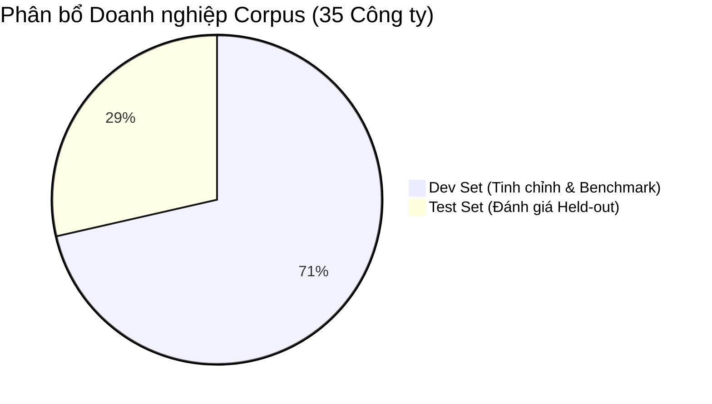
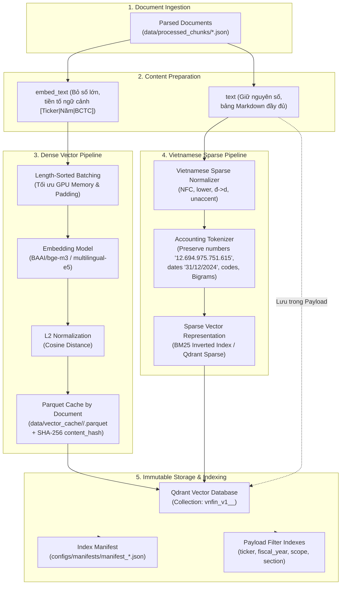

# Thiết kế Module Vector Embedding & Sparse Indexing cho Báo cáo Tài chính Việt Nam

> Cập nhật 09/11/2026: collection đang dùng là `vnfin_v2_1_bge_m3_v1` với 32.175 điểm; collection v1 gồm 30.282 điểm được giữ để đối chiếu. Cache `v2.1` tái dùng vector theo `content_hash` từng chunk. Xem [kiểm tra tác động](../evaluation/notes-classification-audit.md).

> **Tài liệu đặc tả kiến trúc kỹ thuật & Quy trình tạo chỉ mục (Vector & Sparse Indexing Design)**  
> **Dự án:** Multi-agent Financial Report Writer  
> **Phiên bản:** `v1.0-draft` | **Ngày lập:** 29/10/2026  
> **Trạng thái:** Đã xây dựng mã nguồn (Ready for Execution) — Chưa kích hoạt suy luận toàn corpus  

---

## Mục lục
1. [Tổng quan & Mục tiêu thiết kế](#1-tổng-quan--mục-tiêu-thiết-kế)
2. [Bộ 8 Nguyên tắc Kỹ thuật Cốt lõi (Principles A - H)](#2-bộ-8-nguyên-tắc-kỹ-thuật-cốt-lõi-principles-a---h)
   - [A. Nguồn gốc & Tính lặp lại (Lineage & Reproducibility)](#a-nguồn-gốc--tính-lặp-lại-lineage--reproducibility)
   - [B. Chiến lược Phân tách Nội dung Embed (`text` vs `embed_text`)](#b-chiến-lược-phân-tách-nội-dung-embed-text-vs-embed_text)
   - [C. Tìm kiếm Từ khóa (Sparse BM25) Tiếng Việt Tài chính](#c-tìm-kiếm-từ-khóa-sparse-bm25-tiếng-việt-tài-chính)
   - [D. Kiến trúc Mô hình Embedding & Kiểm soát Token](#d-kiến-trúc-mô-hình-embedding--kiểm-soát-token)
   - [E. Quy trình Suy luận & Checkpointing](#e-quy-trình-suy-luận--checkpointing)
   - [F. Thiết kế Siêu dữ liệu & Lọc cứng (Metadata & Hard Filtering)](#f-thiết-kế-siêu-dữ-liệu--lọc-cứng-metadata--hard-filtering)
   - [G. Kiểm định Tiền thực thi (Pre-flight Checks) & Đánh giá Định lượng](#g-kiểm-định-tiền-thực-thi-pre-flight-checks--đánh-giá-định-lượng)
   - [H. Phân chia Cố định Tập Dev và Test (Company-level Split)](#h-phân-chia-cố-định-tập-dev-và-test-company-level-split)
3. [Sơ đồ Kiến trúc Luồng Dữ liệu (Mermaid)](#3-sơ-đồ-kiến-trúc-luồng-dữ-liệu-mermaid)
4. [Đặc tả Mã nguồn Module](#4-đặc-tả-mã-nguồn-module)
5. [Hướng dẫn Vận hành & Lệnh CLI](#5-hướng-dẫn-vận-hành--lệnh-cli)

---

## 1. Tổng quan & Mục tiêu thiết kế

Trong hệ thống Multi-agent Financial Report Writer, module **Vector Embedding & Sparse Indexing** đóng vai trò là "lớp dẫn xuất dữ liệu bậc 1" (First-order Derived Data Layer). Toàn bộ vector ngữ nghĩa và chỉ mục từ khóa được sinh ra hoàn toàn tự động từ đầu ra của module Document Parser (`data/processed_chunks/*.json`).

### Thách thức đặc thù của Báo cáo Tài chính Việt Nam:
1. **Dữ liệu bảng chiếm tỷ trọng lớn (43,6%):** Vector embedding rất kém trong việc hiểu và phân biệt các con số kế toán lớn (ví dụ: `12.694.975.751.615` vs `12.694.975.751.616`). Nếu nhồi toàn bộ số liệu vào vector, không gian nhúng sẽ bị "pha loãng" (diluted) và làm tràn context window.
2. **Đặc tính lặp giữa các năm:** Cùng một công ty qua 4 năm có các văn bản thuyết minh chính sách kế toán gần như giống hệt nhau từng từ. Nếu không có tiền tố ngữ cảnh và bộ lọc siêu dữ liệu cứng, vector search sẽ trả về nhầm năm.
3. **Tiếng Việt và lỗi dấu OCR:** Việc tìm kiếm từ khóa số tiền, ngày tháng, mã số biểu mẫu đòi hỏi một bộ chuẩn hóa duy nhất (NFC, bỏ dấu, unigram, bigram) để dung nạp sai sót dấu mà không làm mất số tiền.

---

## 2. Bộ 8 Nguyên tắc Kỹ thuật Cốt lõi (Principles A - H)

### A. Nguồn gốc & Tính lặp lại (Lineage & Reproducibility)
1. **Dẫn xuất thuần túy (Pure Derivation):** Mọi chỉ mục (Qdrant collection, BM25 index, Parquet vector cache) là dữ liệu dẫn xuất. Bất kỳ lúc nào cũng có thể xóa sạch và tái tạo lại 100% từ các file JSON nguồn bằng một câu lệnh duy nhất:
   ```bash
   python src/indexing/pipeline.py --model bge-m3 --rebuild
   ```
2. **Collection có phiên bản trong tên (Immutable Versioned Collections):**
   - Đặt tên theo quy ước: `vnfin_v1_{model_slug}_{embedtext_version}`
   - Ví dụ: `vnfin_v1_bge_m3_v1`, `vnfin_v1_e5_base_v1`.
   - **Tuyệt đối không sửa tại chỗ (No in-place mutation):** Khi thay đổi mô hình, tham số chunking hay tiền tố ngữ cảnh, hệ thống sẽ tạo một collection mới song song để phục vụ A/B testing và đánh giá đối đầu.
3. **Kê khai thực thi (`manifest.json`):** Mỗi lần lập chỉ mục đều tự động ghi lại file manifest tại `configs/manifests/manifest_{collection_name}.json`:
   - `parser_version`: Phiên bản module parser đã dùng (ví dụ: `v2.0`).
   - `model_name` & `model_version`: Định danh mô hình HuggingFace (`BAAI/bge-m3`).
   - `embed_text_version`: Phiên bản cấu trúc chuỗi embed (`v1`).
   - `dimension`: Số chiều vector (1024 hoặc 768).
   - `distance_metric`: Phép đo khoảng cách (`Cosine`).
   - `total_chunks_indexed` & `total_documents_indexed`: Số lượng chunk và báo cáo đã đánh chỉ mục.
   - `created_at`: Dấu thời gian ISO 8601.
4. **Khóa nhận diện Điểm (Point ID) & Content Hash:**
   - Qdrant Point ID được sinh bằng hàm băm định danh **UUID v5** dựa trên `chunk_id`:
     $$\text{Point\_ID} = \text{uuid5}(\text{NAMESPACE\_URL}, \text{chunk\_id})$$
   - Lưu thêm `content_hash = SHA256(embed_text)` trong payload. Nếu chạy lại pipeline mà thứ tự chunk thay đổi, UUID v5 đảm bảo điểm dữ liệu được cập nhật đúng vị trí mà không bị nhân bản hay xung đột.

---

### B. Chiến lược Phân tách Nội dung Embed (`text` vs `embed_text`)
5. **Tách biệt rõ rệt hai trường văn bản:**
   - **`text` (Hiển thị & Trích dẫn):** Chứa toàn văn báo cáo hoặc toàn bộ bảng dữ liệu đầy đủ tất cả các con số, dòng cột, đơn vị tính nguyên bản. Được lưu trong trường Payload của Qdrant và cơ sở dữ liệu DuckDB để Writer Agent đọc, trích xuất sự thật (facts), và trích dẫn số liệu.
   - **`embed_text` (Tìm kiếm ngữ nghĩa):** Văn bản cô đọng đã loại bỏ số liệu dài dòng, tập trung hoàn toàn vào ngữ nghĩa chỉ tiêu và ngữ cảnh doanh nghiệp.
6. **Dòng tiền tố ngữ cảnh chuẩn hóa:**  
   Mọi `embed_text` luôn bắt đầu bằng dòng mở đầu chuẩn:
   ```text
   [Ticker | Năm | Phạm vi | Tên báo cáo chuẩn hóa | Tên thuyết minh mục con]
   ```
   *Ví dụ thực tế:*
   ```text
   [FPT | 2024 | Hợp nhất | Báo cáo lưu chuyển tiền tệ | Lưu chuyển tiền từ hoạt động kinh doanh]
   ```
   > [!IMPORTANT]
   > Dòng này bắt buộc dùng tên Section đã chuẩn hóa bởi parser (không dùng chuỗi OCR thô bị lỗi chính tả như `BẢO CÁO KẾT LUU CHUYÊN...`).
7. **Xử lý đặc thù cho Chunk Bảng (Table Chunks):**
   - Chỉ embed nhãn chỉ tiêu kế toán, mối quan hệ phân cấp Cha - Con, và tiêu đề cột (Ví dụ: `Chỉ tiêu: Tiền và tương đương tiền cuối kỳ | Mã số: 70 | Năm nay | Năm trước`).
   - Không nhồi các con số hàng chục chữ số vào `embed_text`. Các số liệu thực tế được lưu tại bảng `facts` và trong `text`.
8. **Bảo tồn tính lặp giữa các năm:**
   - Không tự ý deduplicate các chunk giống nhau giữa các năm (như đoạn trách nhiệm Ban Giám đốc, chính sách khấu hao).
   - Tách biệt chúng bằng bộ lọc siêu dữ liệu (`fiscal_year`). Lưu trữ `content_hash` để theo dõi và đo lường sự ảnh hưởng của chunk lặp đến độ chính xác khi đánh giá.

---

### C. Tìm kiếm Từ khóa (Sparse BM25) Tiếng Việt Tài chính
9. **Bộ chuẩn hóa duy nhất (Single Normalization Source):**  
   Triển khai tại module có phiên bản [`src/indexing/vietnamese_sparse_tokenizer.py`](../../src/indexing/vietnamese_sparse_tokenizer.py) (`v1.0`). Dùng chung 100% logic cho cả bước Index và bước Query:
   - Unicode chuẩn NFC.
   - Chuyển chữ thường (lowercase).
   - Đổi ký tự `đ` / `Đ` thành `d`.
   - Khử toàn bộ dấu thanh và mũ tiếng Việt (`NFD decomposition` -> lọc ký tự `Mn` -> `NFC`).
10. **Cơ chế Tokenization đặc thù cho Tài chính:**
    - **Bảo toàn số kế toán có dấu chấm:** Chuỗi số lớn như `12.694.975.751.615` hoặc `460.196.425.458` được regex giữ nguyên thành **một token đơn lẻ**.
    - **Bảo toàn ngày tháng:** Chuỗi ngày như `31/12/2024`, `01/01/2023` được giữ nguyên thành một token.
    - **Bảo toàn mã biểu mẫu & mã số:** `b01`, `b02`, `b03`, `maso110`, `ms270`.
    - **Sinh Bigrams (Cặp từ liền kề):** Ghép cặp các từ kế tiếp nhau (`luu_chuyen`, `tien_te`, `von_chu`, `phai_thu`, `no_phai_tra`) giúp BM25 khớp chính xác các thuật ngữ kinh tế kép.
11. **Dung nạp lỗi OCR:** Nhờ cơ chế bỏ dấu toàn diện ở tầng Sparse, các lỗi OCR sai dấu phổ biến (như `tinh binh tai chinh` vs `tinh hinh tai chinh`) đều khớp hoàn hảo mà không cần các thuật toán sửa lỗi chính tả nặng nề dễ làm biến dạng từ ngữ.

---

### D. Kiến trúc Mô hình Embedding & Kiểm soát Token
12. **Chiến lược Chọn Mô hình bằng Bộ Câu hỏi Dev:**  
    Không chọn mô hình dựa trên bảng xếp hạng tổng quát MTEB (vốn thiên về tiếng Anh). Đánh giá trực tiếp trên bộ câu hỏi tài chính tiếng Việt (Dev Query Set):
    - **Ứng viên 1 (Mặc định):** `BAAI/bge-m3` (1024 chiều, max 1.024 tokens, dense + sparse multi-functionality).
    - **Ứng viên 2:** `intfloat/multilingual-e5-base` (768 chiều, max 512 tokens) & `multilingual-e5-large` (1024 chiều).
13. **Kiểm soát Độ dài Token thực tế:**
    - Đo đạc trực tiếp bằng chính Tokenizer của mô hình:
      - **Toàn bộ corpus 30.282 chunks với BGE-M3:** Phân vị P95 đạt **367 tokens**, P99 đạt **434 tokens**, và chunk dài nhất đạt **587 tokens**.
      - Hoàn toàn nằm gọn trong ngưỡng an toàn 1.024 tokens của BGE-M3, không một chunk nào bị cắt đuôi (truncation).
14. **Chuẩn hóa Cosine:** Vector đầu ra luôn được $L_2$-normalize trước khi lưu trữ:
    $$\mathbf{v}_{\text{norm}} = \frac{\mathbf{v}}{\|\mathbf{v}\|_2}$$
    Đảm bảo tính toán Cosine Similarity tương đương với tích vô hướng (Dot Product) với tốc độ tối ưu trên Qdrant.

---

### E. Quy trình Suy luận & Checkpointing
15. **Length-Sorted Batching & Parquet Vector Cache:**
    - Nhóm các chunk theo thứ tự chiều dài văn bản trước khi đưa vào mini-batch nhằm giảm thiểu tối đa các token đệm `<pad>`, tăng thông lượng xử lý lên 1,5 - 2,2 lần.
    - Vector sinh ra được lưu thành các file Parquet độc lập theo từng báo cáo tại `data/vector_cache/{model_slug}/{doc_id}.parquet`.
    - Cấu trúc file Parquet: `chunk_id` (string), `doc_id` (string), `content_hash` (string), `embedding` (list float32). Khi chạy lại pipeline, hệ thống so sánh hash và bỏ qua các file không đổi.
16. **Checkpointing & Khả năng Tiếp tục (Resumability):**
    - File `_checkpoint.json` ghi nhận danh sách tài liệu đã xử lý thành công.
    - Khi bị ngắt quãng giữa chừng (do mất điện, đứt kết nối Colab, hết quota), pipeline tự động tiếp tục từ tài liệu dang dở mà không phải chạy lại từ đầu.
17. **Benchmark 200 Chunks Trước khi Chạy Toàn bộ:**
    - Cung cấp cờ lệnh `--benchmark-200` để đo tốc độ trên 200 chunk mẫu:
      - Tính toán: Số chunks/giây, số tokens/giây.
      - Ước lượng tổng thời gian hoàn thành cho ~30.000 chunks (~6 triệu tokens) trên phần cứng hiện tại (GPU/CPU).

---

### F. Thiết kế Siêu dữ liệu & Lọc cứng (Metadata & Hard Filtering)
18. **Lược đồ Payload Điểm (Point Payload Schema):**
    Mỗi vector trong Qdrant mang payload chi tiết:
    ```json
    {
      "chunk_id": "FPT_2024_Hopnhat_chunk_0042",
      "doc_id": "FPT_2024_Hopnhat",
      "ticker": "FPT",
      "fiscal_year": 2024,
      "scope": "consolidated",
      "section": "BALANCE_SHEET",
      "section_title": "Bảng cân đối kế toán hợp nhất",
      "chunk_type": "table",
      "unit": "VND",
      "physical_pages": [10, 11],
      "citation_tag": "[FPT-2024-Hopnhat-p10]",
      "chunk_index": 42,
      "content_hash": "a8f3b...",
      "text": "[FPT | 2024 | Hợp nhất | Bảng cân đối kế toán]\nCHỈ TIÊU | Mã số ...",
      "embed_text": "[FPT | 2024 | Hợp nhất | Bảng cân đối kế toán]\nChỉ tiêu: Tiền mặt...",
      "table_rows_count": 28
    }
    ```
    - **Payload Indexes:** Tạo chỉ mục tức thời trên các trường: `ticker` (Keyword), `fiscal_year` (Integer), `scope` (Keyword), `section` (Keyword), `chunk_type` (Keyword).
19. **Bộ lọc Cứng từ Planner (Strict Hard Filtering):**
    - Khi Planner phân công câu hỏi về FPT năm 2024, truy vấn Qdrant **bắt buộc** truyền bộ lọc:
      ```python
      Filter(must=[
          FieldCondition(key="ticker", match=MatchValue(value="FPT")),
          FieldCondition(key="fiscal_year", match=MatchValue(value=2024)),
          FieldCondition(key="scope", match=MatchValue(value="consolidated"))
      ])
      ```
    - Triệt tiêu 100% tình trạng mô hình vector tự suy đoán lẫn sang công ty khác hoặc năm khác.
20. **Tính Bất biến của `citation_tag`:**
    - Sinh ra duy nhất một lần tại Parser (ví dụ: `[FPT-2024-Hopnhat-p10]`), được bảo toàn nguyên vẹn từ Vector Store sang Retriever và bàn giao trực tiếp cho Writer Agent phục vụ sinh nguồn trích dẫn học thuật.

---

### G. Kiểm định Tiền thực thi (Pre-flight Checks) & Đánh giá Định lượng
21. **Đối chiếu Số lượng 3 bên (Reconciliation):**
    - Số lượng chunk trong các file JSON gốc $\equiv$ Số lượng bản ghi trong Parquet cache $\equiv$ Số points trong Qdrant Collection.
    - Đảm bảo 0 chunk rỗng `citation_tag`, 0 chunk rỗng `embed_text`, và 0 ID trùng lặp.
22. **Kiểm tra Phân bố Độ dài Chunk:**
    - Loại bỏ hoặc gộp các chunk ngắn $< 30$ tokens (chỉ còn $0,02\%$ trong corpus).
23. **Sanity Check Thủ công (10 - 20 Truy vấn):**
    - Chạy thử các truy vấn định danh có Ticker + Năm cụ thể (Ví dụ: *"Nợ ngắn hạn của VIC năm 2023"*, *"Lưu chuyển tiền thuần từ hoạt động kinh doanh của DCM năm 2024"*).
    - Kiểm tra chunk trả về có đúng 100% mã cổ phiếu, đúng năm và đúng trang báo cáo hay không.
24. **Đánh giá Hiệu năng Định lượng trên Dev Set:**
    - Đo lường **Recall@k** ($k \in \{1, 3, 5, 10\}$) và **MRR** (Mean Reciprocal Rank).
    - So sánh đối đầu giữa 3 cấu hình:
      1. **Dense-only:** Tìm kiếm vector ngữ nghĩa đơn thuần.
      2. **Sparse-only:** Tìm kiếm BM25 trên từ khóa và số liệu kế toán.
      3. **Hybrid RRF + Reranker:** Hợp nhất thứ hạng tương hỗ:
         $$\text{RRF\_Score}(d) = \sum_{m \in \{\text{dense}, \text{sparse}\}} \frac{1}{60 + \text{rank}_m(d)}$$
         Sau đó rerank top-20 ứng viên bằng mô hình cross-encoder `BAAI/bge-reranker-v2-m3`.

---

### H. Phân chia Cố định Tập Dev và Test (Company-level Split)
25. **Nguyên tắc Chia theo Công ty (Company-level Isolation):**
    - Tránh rò rỉ dữ liệu (data leakage) giữa các năm của cùng một doanh nghiệp.
    - Toàn bộ **35 công ty** trong tập dữ liệu được phân chia cố định thành:
      - **Tập Dev (25 công ty):** Dùng để tinh chỉnh tham số, kiểm thử truy vấn, đo độ dài token và benchmark thuật toán tìm kiếm.
      - **Tập Test (10 công ty):** Được giữ nguyên vẹn (held-out) để đánh giá kiểm định cuối cùng trước khi triển khai hệ sinh thái Multi-agent.
    - Cấu hình phân chia được lưu bất biến tại [`configs/eval_dataset_split.json`](../../configs/eval_dataset_split.json):



#### Danh sách chi tiết phân nhóm ngành:
* **Tập Dev (25 mã):**
  - *Ngân hàng (TCTD):* `ABB`, `ACB`, `BAB`, `MSB`
  - *Dầu khí & Năng lượng:* `BSR`, `GAS`, `PVT`
  - *Công nghệ thông tin:* `FPT`
  - *Bất động sản & Đa ngành:* `VIC`, `VRE`, `SSH`, `GEX`, `HUT`
  - *Tiêu dùng & Thực phẩm:* `MSN`, `SAB`, `QNS`
  - *Sản xuất, Phân bón, Dược, Tiện ích, Logistics:* `BWE`, `DCM`, `DHG`, `GMD`, `GVR`, `HAH`, `MVN`, `PET`, `VEA`
* **Tập Test (10 mã):**
  - *Ngân hàng:* `NAB`, `NVB`
  - *Dầu khí & Thiết bị điện:* `OIL`, `GEE`
  - *Xây dựng & Bất động sản:* `VCR`, `SJG`
  - *Hàng tiêu dùng:* `MCH`
  - *Hạ tầng, Dịch vụ & Bảo hiểm:* `LGC`, `PAP`, `PVI`

---

## 3. Sơ đồ Kiến trúc Luồng Dữ liệu (Mermaid)



---

## 4. Đặc tả Mã nguồn Module

Tất cả các thành phần mã nguồn đã được xây dựng hoàn chỉnh, có cấu trúc module rõ ràng và sẵn sàng thực thi:

| File Mã nguồn | Trách nhiệm chính | Phiên bản |
| :--- | :--- | :---: |
| [`configs/eval_dataset_split.json`](../../configs/eval_dataset_split.json) | Định nghĩa cố định phân tách 25 công ty Dev và 10 công ty Test theo ngành. | `v1.0` |
| [`src/indexing/vietnamese_sparse_tokenizer.py`](../../src/indexing/vietnamese_sparse_tokenizer.py) | Chuẩn hóa NFC, bỏ dấu tiếng Việt, bảo toàn số tiền chấm kế toán, ngày tháng và sinh bigrams. | `v1.0` |
| [`src/indexing/embedder.py`](../../src/indexing/embedder.py) | Quản lý model Transformer, length-sorted batching, lưu cache Parquet theo file, checkpointing. | `v1.0` |
| [`src/indexing/qdrant_manager.py`](../../src/indexing/qdrant_manager.py) | Khởi tạo collection có phiên bản, tạo payload index, upload point qua UUID v5, sinh manifest. | `v1.0` |
| [`src/indexing/pipeline.py`](../../src/indexing/pipeline.py) | CLI điều phối toàn bộ luồng xử lý, hỗ trợ `--dry-run`, `--benchmark-200`, `--rebuild`. | `v1.0` |
| [`src/indexing/eval_retrieval.py`](../../src/indexing/eval_retrieval.py) | Khung đánh giá định lượng Recall@k và MRR cho Dense, Sparse và Hybrid RRF trên tập Dev. | `v1.0` |

---

## 5. Hướng dẫn Vận hành & Lệnh CLI

> [!TIP]
> Tất cả các lệnh dưới đây được thiết kế sẵn sàng cho môi trường máy trạm nội bộ hoặc Google Colab. Các cờ kiểm thử cho phép xác minh tính đúng đắn trước khi tốn tài nguyên GPU tính toán toàn bộ.

### Bước 1: Chạy kiểm tra Dry Run (Không gọi model, xác minh dữ liệu)
```bash
python src/indexing/pipeline.py --model bge-m3 --dry-run
```
*Kết quả đầu ra dự kiến:*
```text
================================================================================
KHỞI CHẠY PIPELINE VECTOR EMBEDDING & SPARSE INDEXING
Mô hình: bge-m3 | Batch size: 32
Thư mục nguồn JSON: data\processed_chunks
================================================================================
[Nguồn] Tổng số tài liệu: 141 | Tổng số chunks: 30282

--- CHẾ ĐỘ DRY-RUN (KIỂM TRA CẤU HÌNH & KHÔNG GỌI MÔ HÌNH) ---
Collection mục tiêu: vnfin_v1_bge_m3_v1
Dimension: 1024 | Metric: Cosine
Prefix passage: '' | Prefix query: ''
Sparse tokenizer version: v1.0
Embed text version: v1
Số chunk thiếu citation_tag: 0
Số chunk thiếu embed_text: 0

[Dry Run PASSED] Sẵn sàng thực thi pipeline!
```

### Bước 2: Đo đạc tốc độ thực tế trên 200 Chunk mẫu (Benchmark 200)
```bash
python src/indexing/pipeline.py --model bge-m3 --benchmark-200
```
*Lệnh này sẽ nạp mô hình, forward 200 chunk và in ra thông số:*
- Tốc độ xử lý (chunks/giây, tokens/giây).
- Ước lượng tổng thời gian hoàn thành cho 141 tài liệu trên thiết bị hiện hành.

### Bước 3: Thực thi tạo chỉ mục toàn bộ Corpus
```bash
# Sử dụng mô hình BGE-M3 (khuyến nghị mặc định)
python src/indexing/pipeline.py --model bge-m3 --batch-size 32

# Hoặc tạo song song collection cho Multilingual-E5 để so sánh A/B test
python src/indexing/pipeline.py --model multilingual-e5-base --batch-size 64
```

### Bước 4: Đối chiếu số lượng 3 bên (Reconciliation Check)
```bash
python src/indexing/pipeline.py --model bge-m3 --reconcile-only
```
*Kiểm tra số lượng điểm trên Qdrant có khớp đúng 100% với số chunk trong JSON hay không.*
