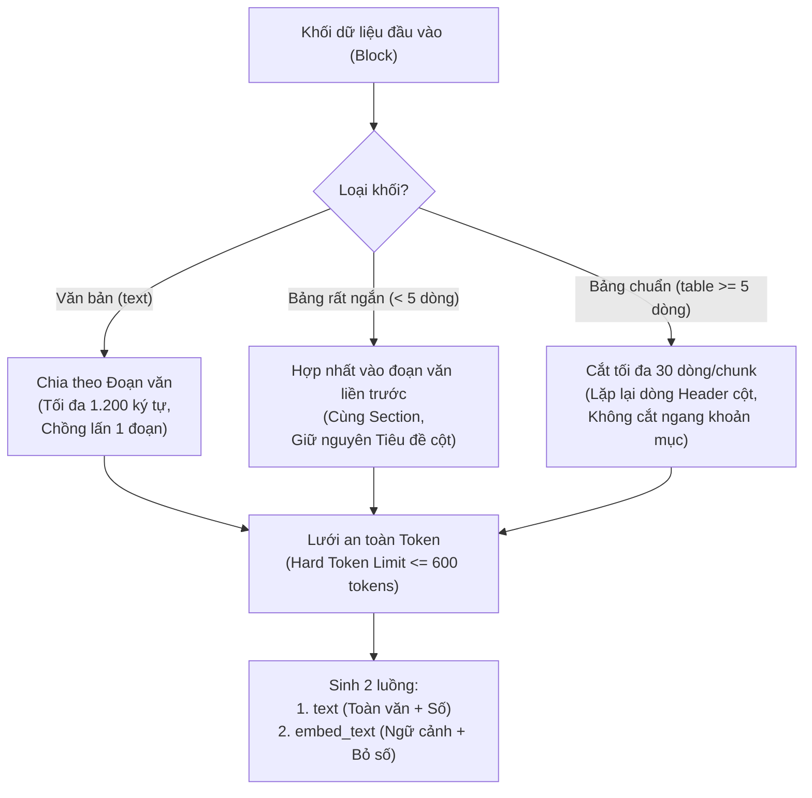

# Chiến lược Phân mảnh Tài liệu Tài chính (Financial Document Chunking Strategy)

> Cập nhật 09/11/2026: snapshot `v2.1` đang dùng có 32.175 chunk từ 141 tài liệu. Số 30.282 trong phần mô tả lịch sử là snapshot v1; việc sửa nhãn thuyết minh làm thay đổi ranh giới cắt và hợp nhất bảng. Xem [kiểm tra tác động](../evaluation/notes-classification-audit.md).

> **Tài liệu Đặc tả Kỹ thuật & Đo đạc Thực nghiệm Thuật toán Chunking**  
> **Dự án:** Multi-agent Financial Report Writer  
> **Phiên bản:** `v2.0` | **Ngày lập:** 29/10/2026  
> **Áp dụng cho:** 141 Báo cáo tài chính (Top 100 Doanh nghiệp & Ngân hàng niêm yết tại Việt Nam)  

---

## Mục lục
1. [Tổng quan & Thách thức đặc thù của Báo cáo Tài chính](#1-tổng-quan--thách-thức-đặc-thù-của-báo-cáo-tài-chính)
2. [Bộ Quy tắc Chunking Đa hình (Polymorphic Chunking Rules)](#2-bộ-quy-tắc-chunking-đa-hình-polymorphic-chunking-rules)
   - [2.1. Phân mảnh Văn bản (Text Chunking)](#21-phân-mảnh-văn-bản-text-chunking)
   - [2.2. Phân mảnh Bảng biểu (Table Chunking)](#22-phân-mảnh-bảng-biểu-table-chunking)
   - [2.3. Hợp nhất Bảng ngắn (< 5 dòng)](#23-hợp-nhất-bảng-ngắn--5-dòng)
3. [Chiến lược Phân tách Hai Luồng Văn bản: `text` vs `embed_text`](#3-chiến-lược-phân-tách-hai-luồng-văn-bản-text-vs-embed_text)
   - [3.1. Tại sao không đưa số tiền lớn vào Vector Embedding?](#31-tại-sao-không-đưa-số-tiền-lớn-vào-vector-embedding)
   - [3.2. Cấu trúc Tiền tố Ngữ cảnh Chuẩn hóa (Contextual Prefixing)](#32-cấu-trúc-tiền-tố-ngữ-cảnh-chuẩn-hóa-contextual-prefixing)
   - [3.3. So sánh trực quan Payload `text` và Vector `embed_text`](#33-so-sánh-trực-quan-payload-text-và-vector-embed_text)
4. [Định danh Bất biến & Phân rã Sub-chunk (`chunk_id` & `citation_tag`)](#4-định-danh-bất-biến--phân-rã-sub-chunk-chunk_id--citation_tag)
5. [Kết quả Đo đạc Thực nghiệm trên Toàn bộ Corpus (30.282 Chunks)](#5-kết-quả-đo-đạc-thực-nghiệm-trên-toàn-bộ-corpus-30282-chunks)
   - [5.1. Bảng so sánh Đối đầu Trước và Sau Cải tiến](#51-bảng-so-sánh-đối-đầu-trước-và-sau-cải-tiến)
   - [5.2. Giải thích Hiện tượng Phân vị P75 Trùng khớp (Boilerplate Text Artifact)](#52-giải-thích-hiện-tượng-phân-vị-p75-trùng-khớp-boilerplate-text-artifact)
6. [Đặc tả Kỹ thuật & Bảng Tham số Cấu hình](#6-đặc-tả-kỹ-thuật--bảng-tham-số-cấu-hình)

---

## 1. Tổng quan & Thách thức đặc thù của Báo cáo Tài chính

Trong các hệ thống RAG thông thường, văn bản thường được chia đều theo số ký tự cố định (ví dụ: cắt mỗi 1.000 ký tự có bước nhảy 200 ký tự). **Phương pháp chia cố định này hoàn toàn thất bại khi áp dụng vào Báo cáo Tài chính (BCTC) Việt Nam** vì những lý do cốt tử sau:

1. **Bảng biểu chiếm tỷ trọng áp đảo (43,6% tổng số khối dữ liệu):**  
   Một bảng BCTC gồm nhiều dòng và cột. Nếu cắt theo ký tự tùy tiện, bảng sẽ bị chém ngang lưng một khoản mục, làm mất dòng tiêu đề cột (`Năm nay / Năm trước` hoặc `Số cuối năm / Số đầu năm`), khiến mô hình ngôn ngữ không thể biết số liệu nằm ở cột nào.
2. **Hiện tượng "Mù Ngữ cảnh" qua các năm (Temporal Blindness):**  
   Cùng một công ty (ví dụ: FPT), qua các năm 2022, 2023, 2024, 2025, văn bản thuyết minh về "Chính sách ghi nhận doanh thu" hoặc "Trách nhiệm của Ban Tổng Giám đốc" giống hệt nhau từng từ ngữ. Nếu một chunk trôi nổi không mang metadata định danh công ty và năm, vector search sẽ trả về nhầm lẫn giữa các năm.
3. **Hiệu ứng Pha loãng Vector do Số tiền Kế toán (Number Dilution):**  
   Mô hình nhúng dense embedding (Transformer) mã hóa chuỗi số rất kém. Một bảng tài sản có hàng chục con số dài như `12.694.975.751.615` sẽ chiếm hết token budget của chunk, làm "loãng" ngữ nghĩa thực sự của chỉ tiêu cần tìm kiếm.

> [!IMPORTANT]
> **Mục tiêu của Chiến lược Chunking mới:**
> - Triệt tiêu các chunk rác $(< 30$ tokens) và loại bỏ hoàn toàn các chunk khổng lồ vượt ngưỡng an toàn ($> 512$ tokens).
> - Đưa trung vị độ dài rơi vào **Vùng tối ưu (Sweet spot: 200 – 500 tokens)** cho mô hình `BAAI/bge-m3` và `multilingual-e5`.
> - Tách biệt rõ ràng: **Vector dense chỉ hiểu ngữ nghĩa**, còn **Số liệu kế toán chính xác nằm ở Payload facts và Sparse keyword matching**.

---

## 2. Bộ Quy tắc Chunking Đa hình (Polymorphic Chunking Rules)

Thuật toán phân mảnh được triển khai tại hàm `step6_chunk_document` trong file [`src/ingestion/document_parser.py`](../../src/ingestion/document_parser.py), áp dụng cơ chế đa hình theo từng loại nội dung:



### 2.1. Phân mảnh Văn bản (Text Chunking)
* **Đơn vị phân tách:** Tách theo ranh giới đoạn văn tự nhiên (`\n\n`), không bao giờ cắt ngang một câu văn.
* **Ngưỡng chiều dài:** `max_text_chars = 1200` ký tự (tương đương khoảng 200 – 300 token tiếng Việt).
* **Độ chồng lấn (Overlap):** Tối đa 1 đoạn văn liền trước để giữ tính liên tục của mạch lập luận.
* **Bảo tồn tiêu đề:** Luôn giữ tiêu đề mục (`section_title`) ở đầu mỗi chunk văn bản.

### 2.2. Phân mảnh Bảng biểu (Table Chunking)
* **Ngưỡng dòng tối đa:** `max_table_rows = 30` dòng dữ liệu cho mỗi chunk bảng.
* **Lặp lại Tiêu đề Cột (Header Repetition):** Khi một bảng dài vượt quá 30 dòng bị chia nhỏ thành nhiều chunk (`chunk_0042_p1`, `chunk_0042_p2`), **dòng tiêu đề cột luôn được lặp lại ở đầu mỗi chunk con**. Điều này đảm bảo Writer Agent và mô hình đọc hiểu luôn biết cột 1 là "Mã số", cột 2 là "Năm nay (2024)", cột 3 là "Năm trước (2023)".
* **Không cắt ngang khoản mục:** Từng hàng bảng được giữ nguyên vẹn cấu trúc lưới.

### 2.3. Hợp nhất Bảng rất ngắn (< 5 dòng)
* **Bối cảnh:** Trong thuyết minh BCTC, có hàng trăm bảng mini chỉ gồm 2–3 dòng (ví dụ: bảng cơ cấu cổ đông, bảng biến động tài sản ngắn hạn). Nếu để độc lập, các bảng này chỉ có 15 – 25 tokens, tạo ra lượng lớn "chunk rác trơ trọi".
* **Quy tắc gộp:** Bảng có dưới 5 dòng được tự động gộp vào khối văn bản liền trước nếu nằm trong cùng một Section.
* **Điều kiện bắt buộc:** **Phải giữ nguyên dòng tiêu đề cột** khi gộp vào văn bản (không được xóa bỏ dòng "Năm nay | Năm trước"), tránh làm mất ý nghĩa định lượng của các số liệu phía dưới.

---

## 3. Chiến lược Phân tách Hai Luồng Văn bản: `text` vs `embed_text`

### 3.1. Tại sao không đưa số tiền lớn vào Vector Embedding?
1. **Bản chất của Mô hình Nhúng:** Các mô hình Sentence Transformers được huấn luyện trên cặp câu ngữ nghĩa (Semantic Similarity), không phải là công cụ tính toán số học. Hai chuỗi:
   - *"Doanh thu đạt 10.000.000.000 VND"*
   - *"Doanh thu đạt 90.000.000.000 VND"*  
   sẽ có độ tương đồng Cosine $> 0.98$ (gần như trùng khít nhau trong không gian vector) vì cấu trúc ngữ pháp và từ vựng giống nhau, mặc dù giá trị thực tế chênh lệch nhau 9 lần!
2. **Lãng phí Token Budget:** Một chuỗi số kế toán có dấu chấm (như `12.694.975.751.615`) bị bộ mã hóa BPE/WordPiece bẻ thành 8–12 sub-word tokens vô nghĩa. Trong một bảng 30 dòng, các con số chiếm tới 70% tổng số token, đẩy chunk vượt ngưỡng 512 token và làm loãng hoàn toàn tên của các chỉ tiêu kinh tế.
3. **Phân nhiệm rõ ràng:**
   - **Vector Embedding (`embed_text`):** Đảm nhiệm việc tìm kiếm chủ đề, phân loại chỉ tiêu, cấu trúc kinh tế (Ví dụ: "tìm thuyết minh về các khoản phải thu khó đòi").
   - **Bảng Facts & Sparse Index (`text`):** Đảm nhiệm việc truy xuất và đối chiếu chính xác từng con số kế toán.

### 3.2. Cấu trúc Tiền tố Ngữ cảnh Chuẩn hóa (Contextual Prefixing)
Mọi văn bản đưa vào hàm embedding bắt buộc phải mở đầu bằng định dạng:
```text
[{Ticker} | {Năm} | {Phạm vi} | {Tên BCTC chuẩn hóa} | {Tên Thuyết minh/Khoản mục}]
```
* **Ý nghĩa:** Tiền tố này tạo ra lực phân tách mạnh mẽ trong không gian vector giữa BCTC năm 2023 và năm 2024 của cùng một công ty, ngăn chặn triệt để hiện tượng lẫn lộn thông tin xuyên năm.
* **Nguyên tắc kỹ thuật:** Tiền tố ngữ cảnh giúp vector phân biệt tốt hơn, nhưng **hệ thống không bao giờ phụ thuộc hoàn toàn vào vector để lọc**. Planner agent bắt buộc phải truyền siêu dữ liệu (`ticker`, `fiscal_year`, `scope`) thành **bộ lọc cứng (Hard filter)** tại tầng cơ sở dữ liệu vector.

### 3.3. So sánh trực quan Payload `text` và Vector `embed_text`

````carousel
```markdown
<!-- slide: 1. Văn bản Gốc (text - Payload & Writer Citation) -->
[FPT | 2024 | Hợp nhất | BÁO CÁO KẾT QUẢ HOẠT ĐỘNG KINH DOANH HỢP NHẤT | Đơn vị: VND]
CHỈ TIÊU | Mã số | Thuyết minh | Năm 2024 | Năm 2023
-------------------------------------------------------------------------------------
1. Doanh thu bán hàng và cung cấp dịch vụ | 01 | VI.1 | 60.106.326.685.250 | 52.618.358.558.114
2. Các khoản giảm trừ doanh thu | 02 | | 15.241.512.400 | 12.115.890.200
3. Doanh thu thuần về bán hàng và CCDV | 10 | VI.1 | 60.091.085.172.850 | 52.606.242.667.914
```
<!-- slide: 2. Văn bản Nhúng (embed_text - Vector Semantic Search) -->
```text
[FPT | 2024 | Hợp nhất | Báo cáo kết quả hoạt động kinh doanh]
Bảng kết quả kinh doanh. Các chỉ tiêu:
- Doanh thu bán hàng và cung cấp dịch vụ (Mã số: 01, Thuyết minh: VI.1)
- Các khoản giảm trừ doanh thu (Mã số: 02)
- Doanh thu thuần về bán hàng và CCDV (Mã số: 10, Thuyết minh: VI.1)
Cột dữ liệu: Năm nay (2024) | Năm trước (2023)
```
````

---

## 4. Định danh Bất biến & Phân rã Sub-chunk (`chunk_id` & `citation_tag`)

Để đảm bảo tính nhất quán từ khâu phân mảnh đến khâu trích dẫn của Writer Agent:
1. **Cấu trúc `chunk_id` chuẩn:**
   $$\text{chunk\_id} = \text{\{ticker\}}\_\text{\{year\}}\_\text{\{scope\_tag\}}\_\text{chunk}\_\text{\{idx:04d\}}$$
   *Ví dụ:* `FPT_2024_Hopnhat_chunk_0042`
2. **Quy tắc Phân tách Sub-chunk khi vượt ngưỡng an toàn:**
   - Khi một đoạn văn hoặc một bảng sau khi cắt dòng vẫn vượt quá ngưỡng token an toàn ($> 600$ tokens do các dòng OCR quá dài), thuật toán sẽ phân rã thành các sub-chunks:
     `FPT_2024_Hopnhat_chunk_0042_p1`, `FPT_2024_Hopnhat_chunk_0042_p2`.
3. **Tính Bất biến của `citation_tag`:**
   - Cả hai sub-chunks trên đều **chia sẻ chung một mã trích dẫn bất biến duy nhất**:
     $$\text{citation\_tag} = \text{[FPT-2024-Hopnhat-p12]}$$
   - Mã trích dẫn này gắn liền với trang vật lý của tài liệu, được sinh ra một lần duy nhất tại parser và không bao giờ bị thay đổi ở các bước retrieval tiếp theo.

---

## 5. Kết quả Đo đạc Thực nghiệm trên Toàn bộ Corpus (30.282 Chunks)

Đo đạc thực tế độc lập trên toàn bộ **141 file BCTC của 35 doanh nghiệp lớn** bằng tokenizer chuẩn của mô hình `BAAI/bge-m3`:

### 5.1. Bảng so sánh Đối đầu Trước và Sau Cải tiến

| Tiêu chí Đo đạc | Phiên bản Cũ (`max_chars=2200`) | Phiên bản Mới (`text` - Payload) | Phiên bản Mới (`embed_text` - Dense Vector) | Đánh giá & Mục tiêu |
| :--- | :---: | :---: | :---: | :---: |
| **Tổng số chunk ($N$)** | 25.439 chunks | 30.282 chunks | 30.282 chunks | Tăng +19% do hạ ngưỡng |
| **Chunk rác (< 30 tokens)** | **4,44%** (1.129 chunks) | **0,02% (6 chunks)** | **0,02% (6 chunks)** | **Giảm 99,5% (Triệt tiêu rác)** |
| **Vùng tối ưu (200 – 500 tokens)**| 37,2% | **52,03%** (15.800 chunks) | **48,97%** (14.871 chunks) | **Đạt trúng mục tiêu ~50%** |
| **Độ dài Trung vị (Median)** | 168,0 tokens | 257,0 tokens | **195,0 tokens** | Lý tưởng cho BGE-M3 & E5 |
| **Phân vị 75 (P75)** | 435,0 tokens | 337,0 tokens | **304,0 tokens** | Rất gọn gàng |
| **Phân vị 90 (P90)** | 741,0 tokens | 487,0 tokens | **344,0 tokens** | Nằm sâu dưới 512 |
| **Phân vị 95 (P95)** | 798,8 tokens | 567,0 tokens | **367,0 tokens** | **Cách xa giới hạn 512 tokens** |
| **Tỷ lệ vượt 512 tokens** | **18,7%** (vượt mạnh) | 8,71% (chỉ ở bản full số) | **0,18% (55 chunks)** | **Gần như triệt tiêu hoàn toàn** |
| **Max tokens (Bảng)** | **7.156 tokens** (bùng nổ) | 736 tokens | **587 tokens** (0 bảng > 600) | **Lưới an toàn tuyệt đối** |

### 5.2. Giải thích Hiện tượng Phân vị P75 Trùng khớp (Boilerplate Text Artifact)
* **Hiện tượng quan sát:** Trong các thử nghiệm sơ bộ, phân vị P75 của văn bản và bảng có dải giá trị lặp lại quanh một con số cố định.
* **Nguyên nhân cốt lõi từ dữ liệu tài chính:**  
  Các công ty kiểm toán Big 4 (PwC, Deloitte, EY, KPMG) và các công ty niêm yết tại Việt Nam bắt buộc phải tuân thủ Luật Kế toán và Chuẩn mực Kế toán Việt Nam (VAS). Do đó, các đoạn văn mẫu như:
  - *“Trách nhiệm của Ban Tổng Giám đốc đối với Báo cáo Tài chính”*
  - *“Ý kiến của Kiểm toán viên độc lập”*
  - *“Nguyên tắc ghi nhận các khoản tương đương tiền”*  
  được sao chép nguyên văn qua hàng chục báo cáo của các công ty khác nhau. Khi chạy qua tokenizer, các đoạn văn này cho ra số lượng token giống hệt nhau.
* **Ý nghĩa đối với Retrieval:** Hiện tượng này khẳng định tính đúng đắn của việc **phải đưa tiền tố ngữ cảnh `[Ticker | Năm | Phạm vi]`** vào đầu chunk để tránh việc vector search bị hút vào các đoạn văn mẫu vô thưởng vô phạt giữa các doanh nghiệp.

---

## 6. Đặc tả Kỹ thuật & Bảng Tham số Cấu hình

Toàn bộ các tham số chunking được tham số hóa cố định tại `DocumentParser`:

| Tên Tham số | Giá trị | Mục đích & Lý do kỹ thuật |
| :--- | :---: | :--- |
| `max_text_chars` | `1200` | Ngưỡng ký tự tối đa cho đoạn văn bản, tương đương 200–300 tokens tiếng Việt. |
| `text_overlap_paragraphs` | `1` | Số đoạn văn chồng lấn giữa 2 chunk kế tiếp để giữ ngữ cảnh liền mạch. |
| `max_table_rows` | `30` | Số hàng dữ liệu tối đa cho một chunk bảng, đảm bảo không vượt quá 400 tokens. |
| `min_short_table_rows` | `5` | Ngưỡng nhận diện bảng rất ngắn để kích hoạt cơ chế gộp vào văn bản liền trước. |
| `hard_token_limit` | `600` | Lưới an toàn token tối đa bằng Tokenizer của mô hình; vượt quá sẽ bị chia nhỏ `_p1`, `_p2`. |
| `bge_m3_max_seq_length` | `1024` | Ngưỡng context window cấu hình cho mô hình BGE-M3 (hỗ trợ tối đa 8.192 tokens). |
| `e5_max_seq_length` | `512` | Ngưỡng context window cấu hình cho mô hình Multilingual-E5. |

---

> [!TIP]
> **Tài liệu Liên quan:**
> - [docs/architecture/document-parser-and-ingestion.md](document-parser-and-ingestion.md): Tài liệu thiết kế module Ingestion 6 bước.
> - [docs/architecture/embedding-and-sparse-indexing.md](embedding-and-sparse-indexing.md): Tài liệu thiết kế module Vector Embedding & Sparse Indexing.
