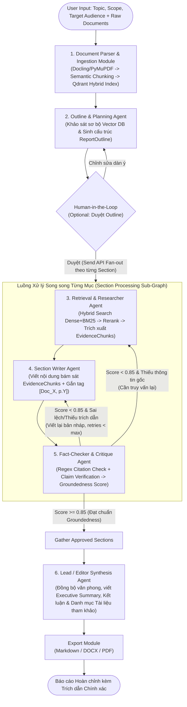

# T1.1: Khảo sát Công nghệ & Lựa chọn Orchestration Framework
**Dự án:** Multi-Agent Framework to Write Report from Documents  
**Giai đoạn:** Phase 1 (Tuần 1: 19/10/2026 – 23/10/2026)  
**Vai trò phụ trách:** System Architect  

---

## 1. Phân tích Bài toán & Yêu cầu Kiến trúc Cốt lõi

Mục tiêu của dự án là xây dựng hệ thống Multi-Agent tự động tổng hợp, phân tích khối lượng tài liệu lớn (PDF, DOCX, Markdown, TXT) để viết báo cáo chuyên sâu (Executive/Technical Reports) đảm bảo **độ trung thực cao (Groundedness)**, **không ảo giác (Zero/Minimal Hallucination)** và **trích dẫn nguồn chính xác đến từng trang/mục (`[Doc_X, p.Y]`)**.

Từ đặc tả 6 Agents của hệ thống, Orchestration Framework được chọn phải giải quyết tốt **5 bài toán kỹ thuật cốt lõi** sau:

1. **Luồng tuần hoàn có điều kiện (Cyclic Feedback Loops):**
   - Bản nháp từ `Section Writer Agent` phải đi qua `Fact-Checker & Critique Agent`.
   - Nếu `groundedness_score < threshold` hoặc phát hiện câu thiếu trích dẫn/sai lệch số liệu, hệ thống phải tự động quay vòng (loop back) về `Section Writer Agent` (để viết lại) hoặc về `Retrieval & Researcher Agent` (để tìm thêm dẫn chứng) với số vòng lặp tối đa (`max_retries`).
2. **Xử lý song song theo cấu trúc dàn ý (Dynamic Fan-out / Fan-in - Map-Reduce):**
   - Một báo cáo gồm $N$ chương/mục (Sections) được sinh động (dynamically) bởi `Outline & Planning Agent`.
   - Hệ thống cần cơ chế chạy song song cụm tác vụ `(Research -> Write <-> Critique)` cho từng section độc lập để giảm độ trễ (latency), sau đó gom kết quả về `Lead / Editor Synthesis Agent`.
3. **Quản lý Trạng thái Định kiểu Chặt chẽ (Strictly Typed Shared State):**
   - Nếu các Agent chỉ giao tiếp qua lịch sử hội thoại tự do (unstructured chat messages), metadata trích dẫn (`doc_id`, `file_name`, `page_number`, `raw_quote`) rất dễ bị rơi rớt hoặc biến dạng qua nhiều bước tóm tắt (Citation Drift).
   - Cần một đối tượng `State` có schema tường minh (`TypedDict` / `Pydantic`) lưu trữ nguyên vẹn các `EvidenceChunk` để `Fact-Checker` đối chiếu trực tiếp với bản nháp.
4. **Human-in-the-Loop (HITL) & Checkpointing (Lưu vết trạng thái):**
   - Hỗ trợ tạm dừng (interrupt) sau khi `Outline & Planning Agent` lập dàn ý để người dùng duyệt/chỉnh sửa trước khi hệ thống tiêu tốn nhiều token cho việc viết toàn bộ báo cáo.
   - Hỗ trợ khôi phục (resume) từ bước bị lỗi mà không phải chạy lại toàn bộ pipeline từ đầu.
5. **Khả năng quan sát & Đánh giá (Observability & Evaluation-ready):**
   - Dễ dàng trích xuất đầu vào/đầu ra (`query`, `retrieved_contexts`, `generated_section`) tại từng Node để chấm điểm tự động bằng **Ragas / DeepEval / TruLens**.

---

## 2. Khảo sát & So sánh các Multi-Agent Orchestration Frameworks

Dưới đây là bảng khảo sát chi tiết 4 framework phổ biến nhất hiện nay đối chiếu trực tiếp với yêu cầu của dự án:

### 2.1. Bảng Ma trận So sánh (Comparison Matrix)

| Tiêu chí đánh giá | Trọng số | **LangGraph** (LangChain) | **CrewAI** (Crews + Flows) | **AutoGen / AG2** (Microsoft) | **LlamaIndex Workflows** |
| :--- | :---: | :--- | :--- | :--- | :--- |
| **1. Kiểm soát vòng lặp (Cyclic Loops)** (`Writer <-> Critique`) | **25%** | **Xuất sắc (10/10)**<br>Thiết kế gốc cho đồ thị có chu trình qua `conditional_edges`. | **Khá (7/10)**<br>Hỗ trợ qua CrewAI Flows (`@router`), nhưng trong nội bộ Crew khó kiểm soát vòng lặp chi tiết. | **Trung bình - Khá (6.5/10)**<br>Dựa vào `GroupChat` / `Swarm` handoff, khó ép điều kiện dừng toán học chặt chẽ. | **Tốt (8.5/10)**<br>Hỗ trợ vòng lặp qua Event-driven steps (`@step`). |
| **2. Bảo toàn State & Citation Metadata** (`TypedDict` / `Pydantic`) | **25%** | **Xuất sắc (10/10)**<br>State-first architecture, reducer quản lý danh sách evidence & draft rõ ràng. | **Khá (7/10)**<br>Truyền ngữ cảnh qua `context` (text) hoặc `output_pydantic`; dễ mất chi tiết khi qua nhiều task. | **Trung bình (6/10)**<br>Message-centric (lịch sử chat chung), dễ loãng context khi tài liệu dài. | **Tốt (8.5/10)**<br>Lưu dữ liệu trong `Context` store và truyền qua các `Event` có kiểu dữ liệu. |
| **3. Xử lý song song từng Section** (Map-Reduce / Sub-graphs) | **20%** | **Xuất sắc (9.5/10)**<br>API `Send()` hỗ trợ tạo nhánh động theo số lượng sections trong Outline. | **Trung bình - Khá (6.5/10)**<br>Hỗ trợ async tasks nhưng fan-out động cho sub-workflow phức tạp hơn. | **Khá (7/10)**<br>Có runtime bất đồng bộ (AutoGen v0.4), nhưng thiết kế Map-Reduce nhiều tầng phức tạp. | **Tốt (8/10)**<br>Hỗ trợ bắn nhiều `Event` song song và gom bằng `collect_events`. |
| **4. Checkpointing, Persistence & Human-in-the-Loop** | **15%** | **Xuất sắc (9.5/10)**<br>Tích hợp sẵn `MemorySaver`, `SqliteSaver`, `PostgresSaver`, `interrupt_before`. | **Khá (7/10)**<br>Có `human_input=True` và lưu state ở mức cơ bản trong Flows. | **Khá (7/10)**<br>`UserProxyAgent` mạnh cho chat tương tác, nhưng lưu/khôi phục state đồ thị phức tạp hơn. | **Khá (7.5/10)**<br>Hỗ trợ serialize `Context` và `InputRequiredEvent`. |
| **5. Tốc độ khởi tạo & Độ dễ học** (Developer Experience) | **15%** | **Khá (7.5/10)**<br>Cần hiểu khái niệm State, Reducers, Nodes, Edges. | **Xuất sắc (9.5/10)**<br>Cấu hình YAML/Python cực nhanh theo Role/Goal/Backstory. | **Khá (7.5/10)**<br>Bản v0.4 thay đổi kiến trúc khá nhiều so với v0.2. | **Tốt (8/10)**<br>Cú pháp Python decorator `@step` quen thuộc. |
| **TỔNG ĐIỂM (Thang 10)** | **100%** | **9.48 / 10** | **7.23 / 10** | **6.68 / 10** | **8.18 / 10** |

---

### 2.2. Phân tích Chi tiết Từng Framework

#### A. LangGraph (Đề xuất chính - Primary Choice)
* **Triết lý thiết kế:** Мо hình hóa hệ thống Multi-Agent dưới dạng **Máy trạng thái hữu hạn có chu trình (Stateful Cyclic Graph)**.
* **Tại sao phù hợp nhất với dự án:**
  1. **Kiểm soát tuyệt đối luồng kiểm duyệt (Critique Loop):** Ta định nghĩa rõ hàm điều hướng `should_regenerate_section(state)` dựa trên `critique_result.groundedness_score`, `critique_result.missing_citations` và `state["revision_count"]`. Không phụ thuộc vào một "Manager LLM" tự suy diễn bước tiếp theo.
  2. **Kiến trúc Sub-graph + `Send` API cho bài toán viết báo cáo nhiều mục:**
     - Đồ thị chính (`MainReportGraph`) sinh `Outline` gồm $N$ mục.
     - Dùng `Send("section_worker_subgraph", section_task)` để khởi chạy $N$ luồng con (`SectionSubGraph`).
     - Mỗi `SectionSubGraph` tự thực hiện chu trình khép kín: `Retrieve -> Write -> Fact-Check -> (Loop nếu chưa đạt) -> Hoàn tất Section`.
     - Cách cô lập này giúp **context window của từng section luôn nhỏ gọn, sạch sẽ**, giảm chi phí token và tăng độ chính xác khi kiểm tra trích dẫn.
  3. **Chống ảo giác từ gốc nhờ Typed State:** Các đoạn tài liệu gốc (`EvidenceChunk`) được lưu thành danh sách đối tượng trong `SectionState`. `Fact-Checker Agent` truy cập trực tiếp vào tập `EvidenceChunk` này để kiểm chứng từng câu của `Section Writer Agent`.

#### B. CrewAI
* **Ưu điểm:** Rất mạnh khi cần dựng prototype nhanh theo mô hình phòng ban (Role, Goal, Backstory).
* **Hạn chế đối với dự án:**
  - Trong dự án viết báo cáo cần kiểm chứng sự thật nghiêm ngặt, việc để các Agent tự "trò chuyện/ủy quyền" (delegation) dễ dẫn đến việc tóm tắt chồng chéo làm mất mã trích dẫn `[Doc_X, p.Y]`.
  - Dù CrewAI đã bổ sung **CrewAI Flows** để điều hướng sự kiện, việc tạo các nhánh con động (dynamic branching cho $N$ mục báo cáo) kèm vòng lặp kiểm định riêng cho từng mục vẫn không tự nhiên và chặt chẽ bằng `StateGraph` + `Send` của LangGraph.

#### C. AutoGen (Microsoft AutoGen v0.4 / AG2)
* **Ưu điểm:** Phù hợp với các bài toán hội thoại mở, tranh biện nhiều chiều (Multi-agent debate) hoặc sinh code & chạy code tự động.
* **Hạn chế đối với dự án:**
  - Cơ chế truyền tin theo lịch sử hội thoại chung (`GroupChat`) khiến lượng token tăng theo cấp số nhân khi đưa nhiều đoạn trích dẫn tài liệu vào cuộc trò chuyện.
  - Khó áp đặt cấu trúc dữ liệu đầu ra cứng nhắc ở từng chặng trung gian so với mô hình biến đổi trạng thái (state mutation) của LangGraph.

---

## 3. Khảo sát & Lựa chọn Toàn bộ Tech Stack theo Từng Phân hệ

Để đồng bộ với **LangGraph** và kế hoạch thực hiện trong 5 tuần, dưới đây là khảo sát và lựa chọn công nghệ cho toàn bộ các tầng trong hệ thống:

### 3.1. Tầng Document Parsing & Chunking (Tuần 1 - Tuần 2)

| Công nghệ | Ưu điểm | Nhược điểm | Quyết định cho dự án |
| :--- | :--- | :--- | :--- |
| **Docling (IBM)** | Chuyển đổi PDF/DOCX sang Markdown cấu trúc cực tốt, nhận diện bảng biểu (Table) và giữ thứ tự đọc (reading order) chính xác; chạy local miễn phí. | Tốc độ xử lý PDF scan/OCR nặng hơn PyMuPDF thuần. | **Lựa chọn chính cho PDF có bảng biểu phức tạp & DOCX.** |
| **PyMuPDF (`pymupdf4llm`)** | Tốc độ cực nhanh, trích xuất Markdown theo từng trang (`page_chunks=True`), giữ chính xác số trang (`page_number`). | Nhận diện bảng phức tạp kém hơn Docling/LlamaParse một chút. | **Lựa chọn chính cho PDF văn bản chuẩn / tốc độ cao.** |
| **LlamaParse** | Chất lượng parse bảng biểu/hình ảnh rất cao. | Phụ thuộc Cloud API, giới hạn quota miễn phí. | **Phương án dự phòng (Optional Fallback)** cho tài liệu cực khó. |

* **Chiến lược Chunking được chọn:**
  - Kết hợp **Markdown Header Text Splitting** (chia theo cấu trúc mục lục tài liệu gốc) + **RecursiveCharacterTextSplitter** (kích thước `800 - 1000 tokens`, overlap `150 tokens`).
  - **Metadata bắt buộc trên mỗi Chunk:**
    ```json
    {
      "doc_id": "Doc_01",
      "file_name": "financial_report_2026.pdf",
      "page_number": 14,
      "section_header": "3.2 Revenue Breakdown",
      "chunk_id": "Doc_01_p14_c02"
    }
    ```

### 3.2. Tầng Vector Database, Embedding & Hybrid Retrieval (Tuần 2)

| Thành phần | Các phương án khảo sát | Lựa chọn đề xuất | Lý do lựa chọn |
| :--- | :--- | :--- | :--- |
| **Vector Store** | Qdrant vs ChromaDB vs FAISS | **Qdrant** (`qdrant-client`) | Hỗ trợ chạy cả chế độ Local Disk (`path="./qdrant_db"`) không cần cài server phức tạp lúc dev, lẫn Docker khi deploy. Hỗ trợ **Hybrid Search (Dense + Sparse/BM25)** và **Metadata Filtering** vượt trội so với FAISS/ChromaDB. |
| **Embedding Model** | `text-embedding-3-small` (OpenAI) vs `BAAI/bge-m3` (Local) | **`text-embedding-3-small`** (Cloud) hoặc **`BAAI/bge-m3`** (Local/Đa ngữ) | `text-embedding-3-small` chi phí cực thấp, hiệu năng tốt. Nếu tài liệu tiếng Việt nhiều hoặc chạy offline, `bge-m3` hỗ trợ tiếng Việt xuất sắc và sinh sẵn cả Dense + Sparse vectors. |
| **Hybrid Search & Reranker** | BM25 + Cross-Encoder / Cohere Rerank | **Reciprocal Rank Fusion (RRF) + Cross-Encoder (`BAAI/bge-reranker-v2-m3` hoặc `Cohere Rerank`)** | Báo cáo chuyên sâu chứa nhiều thuật ngữ chuyên ngành, mã số, tên riêng (cần BM25) bên cạnh ngữ nghĩa (cần Dense). Reranker giúp lọc lấy Top 5-8 chunks chuẩn xác nhất đưa vào Writer Agent. |

### 3.3. Tầng LLM & Structured Output (Tuần 3 - Tuần 4)

Áp dụng chiến lược **Model Routing (Phân tầng mô hình)** để cân bằng giữa chất lượng viết báo cáo, khả năng suy luận và chi phí/độ trễ:

| Agent / Tác vụ | Model đề xuất (Cloud) | Model thay thế (Local - Ollama) | Cơ chế ép kiểu đầu ra |
| :--- | :--- | :--- | :--- |
| **2. Outline & Planning Agent** | `gpt-4o` hoặc `claude-3-5-sonnet` | `llama3.1:70b` / `qwen2.5:32b` | Pydantic Schema (`ReportOutline`) |
| **3. Retrieval & Researcher Agent** (Query expansion & Evidence filtering) | `gpt-4o-mini` | `llama3.1:8b` / `qwen2.5:14b` | Pydantic Schema (`ResearchResult`) |
| **4. Section Writer Agent** | `claude-3-5-sonnet` hoặc `gpt-4o` | `qwen2.5:32b` / `llama3.1:70b` | Pydantic Schema (`SectionDraft`) |
| **5. Fact-Checker & Critique Agent** | `gpt-4o` (ưu tiên khả năng suy luận logic & đối chiếu số liệu) | `qwen2.5:32b` | Pydantic Schema (`CritiqueEvaluation`) |
| **6. Lead / Editor Synthesis Agent** | `claude-3-5-sonnet` hoặc `gpt-4o` | `llama3.1:70b` | Markdown + Metadata |

### 3.4. Tầng Fact-Checking, Evaluation & Guardrails (Tuần 4 - Tuần 5)

1. **Cơ chế Kiểm chứng Nội tuyến (In-Graph Runtime Verification - Tuần 4):**
   - **Bước 1 (Deterministic Regex/Rule Check):** Kiểm tra tự động bằng Python xem mọi đoạn/câu khẳng định số liệu có chứa tag `[Doc_X, p.Y]` hợp lệ và `Doc_X`, `p.Y` có thực sự tồn tại trong danh sách `EvidenceChunk` đã cung cấp cho section đó hay không (chống lỗi LLM tự bịa tên tài liệu/số trang).
   - **Bước 2 (LLM-as-a-Judge Claim Verification):** Tách bản nháp thành các mệnh đề (claims), kiểm tra mức độ được hậu thuẫn (Supported / Partially Supported / Unsupported / Contradicted) so với `EvidenceChunk`. Tính điểm `groundedness_score` (từ `0.0` đến `1.0`). Nếu `< 0.85`, trả về danh sách các câu cần sửa cụ thể cho `Section Writer Agent`.
2. **Framework Đánh giá Tổng thể (Benchmarking - Tuần 5):**
   - Sử dụng **Ragas** kết hợp **DeepEval** để đo bộ chỉ số chuẩn:
     - `Faithfulness` (Độ trung thực / Không ảo giác)
     - `Context Precision` & `Context Recall` (Chất lượng của Retrieval Agent)
     - `Citation Accuracy` (Custom metric đo tỷ lệ trích dẫn đúng trang/tài liệu)

---

## 4. Thiết kế Kiến trúc Hệ thống trên LangGraph (System Architecture)

### 4.1. Sơ đồ Luồng Thực thi Tổng thể (Main Graph & Section Sub-Graph)



---

### 4.2. Thiết kế Schema Trạng thái (`State` & `Pydantic Models`)

Thiết kế tuân thủ chặt chẽ nguyên tắc **Modular & Graph-based** và **Groundedness First** của dự án:

```python
from typing import Annotated, List, Optional, Literal
from typing_extensions import TypedDict
from pydantic import BaseModel, Field
import operator


# 1. Data Models cho Dẫn chứng & Trích dẫn (Groundedness First)
class EvidenceChunk(BaseModel):
    chunk_id: str = Field(..., description="Mã định danh duy nhất của chunk, VD: Doc_01_p14_c02")
    doc_id: str = Field(..., description="Mã tài liệu ngắn gọn dùng để trích dẫn, VD: Doc_01")
    file_name: str = Field(..., description="Tên file gốc, VD: market_report_2026.pdf")
    page_number: int = Field(..., description="Số trang trong tài liệu gốc")
    section_title: Optional[str] = Field(None, description="Tiêu đề mục trong tài liệu gốc")
    content: str = Field(..., description="Nội dung nguyên bản được trích xuất")
    relevance_score: float = Field(..., description="Điểm rerank/similarity")


class SectionPlan(BaseModel):
    section_id: str = Field(..., description="Số thứ tự mục, VD: '1.0', '2.1'")
    title: str = Field(..., description="Tiêu đề mục báo cáo")
    description: str = Field(..., description="Nội dung trọng tâm cần phân tích trong mục này")
    search_queries: List[str] = Field(..., description="Danh sách truy vấn tìm kiếm cho Researcher Agent")


class ClaimVerification(BaseModel):
    claim_text: str = Field(..., description="Câu hoặc mệnh đề trong bản nháp cần kiểm chứng")
    cited_tag: Optional[str] = Field(None, description="Tag trích dẫn được gắn kèm, VD: [Doc_01, p.14]")
    verdict: Literal["SUPPORTED", "PARTIALLY_SUPPORTED", "UNSUPPORTED", "INVALID_CITATION"]
    explanation: str = Field(..., description="Lý do đánh giá và hướng dẫn sửa cụ thể")


class CritiqueResult(BaseModel):
    groundedness_score: float = Field(..., ge=0.0, le=1.0, description="Tỷ lệ mệnh đề được chứng minh hợp lệ")
    is_approved: bool = Field(..., description="True nếu groundedness_score >= threshold và không có lỗi nghiêm trọng")
    action_required: Literal["APPROVE", "REWRITE", "RETRIEVE_MORE"]
    claims_analysis: List[ClaimVerification] = Field(default_factory=list)
    revision_instructions: str = Field("", description="Chỉ dẫn chi tiết để Writer hoặc Researcher sửa lỗi")
    follow_up_queries: List[str] = Field(default_factory=list, description="Truy vấn bổ sung nếu cần RETRIEVE_MORE")


class CompletedSection(BaseModel):
    section_id: str
    title: str
    content: str = Field(..., description="Nội dung đã được kiểm duyệt kèm citation [Doc_X, p.Y]")
    groundedness_score: float
    used_evidences: List[EvidenceChunk]


# 2. LangGraph States
class SectionWorkerState(TypedDict):
    """State riêng biệt cho Sub-Graph xử lý từng mục báo cáo."""
    section_plan: SectionPlan
    evidences: List[EvidenceChunk]
    draft_content: str
    critique: Optional[CritiqueResult]
    revision_count: int
    max_revisions: int
    completed_section: Annotated[List[CompletedSection], operator.add]


class ReportGraphState(TypedDict):
    """State tổng thể của toàn bộ hệ thống Multi-Agent Report Writer."""
    topic: str
    target_audience: str
    report_scope: str
    outline: List[SectionPlan]
    # Reducer operator.add tự động gom kết quả từ các nhánh SectionWorkerState chạy song song
    completed_sections: Annotated[List[CompletedSection], operator.add]
    executive_summary: str
    conclusion: str
    references_section: str
    final_report_markdown: str
```

---

## 5. Đề xuất Cấu trúc Thư mục Dự án (Project Structure)

Để chuẩn bị sẵn sàng cho các Phase tiếp theo (từ Tuần 1 đến Tuần 5), cấu trúc source code được thiết kế theo hướng modular như sau:

```text
Multi-agent_Report_Writer/
├── config/
│   ├── settings.py              # Quản lý cấu hình LLM, VectorDB, Thresholds (Pydantic BaseSettings)
│   └── prompts.yaml             # Quản lý System Prompts cho 6 Agents tập trung
├── data/
│   ├── raw_docs/                # Tài liệu đầu vào (PDF, DOCX, MD, TXT)
│   ├── processed_chunks/        # Cache các chunks đã bóc tách
│   └── outputs/                 # Báo cáo xuất ra (MD, DOCX, PDF)
├── src/
│   ├── schemas/
│   │   ├── state.py             # Định nghĩa ReportGraphState, SectionWorkerState
│   │   └── models.py            # Pydantic models (EvidenceChunk, SectionPlan, CritiqueResult...)
│   ├── ingestion/               # [Tuần 1-2] Module Document Processing
│   │   ├── parser.py            # Docling / PyMuPDF4LLM / python-docx
│   │   ├── chunker.py           # Semantic & Hierarchical Markdown Chunker
│   │   └── indexer.py           # Qdrant Hybrid Indexer (Dense + Sparse BM25)
│   ├── retrieval/               # [Tuần 2] Module Context Retrieval
│   │   ├── hybrid_retriever.py  # Truy vấn kết hợp Dense + BM25
│   │   └── reranker.py          # Cross-Encoder / Cohere Reranker
│   ├── agents/                  # [Tuần 3-4] 6 Core Agents (Nodes trong LangGraph)
│   │   ├── outline_planner.py   # Agent 2: Outline & Planning
│   │   ├── researcher.py        # Agent 3: Retrieval & Researcher
│   │   ├── section_writer.py    # Agent 4: Section Writer
│   │   ├── fact_checker.py      # Agent 5: Fact-Checker & Critique (Regex + LLM Judge)
│   │   └── editor_synthesis.py  # Agent 6: Lead / Editor Synthesis
│   ├── graph/                   # [Tuần 3-4] LangGraph Orchestration
│   │   ├── section_subgraph.py  # Sub-graph (Researcher -> Writer <-> Fact-Checker)
│   │   └── main_graph.py        # Main StateGraph (Planner -> Map-Reduce Sections -> Editor)
│   └── utils/
│       ├── citation_validator.py# Bộ kiểm tra trích dẫn [Doc_X, p.Y] bằng Regex & Metadata
│       └── exporter.py          # Xuất Markdown sang DOCX / PDF
├── evaluation/                  # [Tuần 5] Benchmarking & Evaluation
│   └── evaluate_report.py       # Đánh giá Faithfulness & Relevancy bằng Ragas / DeepEval
├── tests/                       # Unit tests & Integration tests
├── docs/
│   └── orchestration-and-tech-stack.md
├── requirements.txt / pyproject.toml
└── main.py
```

---

## 6. Kết luận & Quyết định Công nghệ Chốt cho Dự án

1. **Orchestration Framework:** Chọn **LangGraph** làm bộ khung điều phối cốt lõi nhờ khả năng kiểm soát vòng lặp kiểm định (`Writer <-> Fact-Checker`), chạy song song từng mục báo cáo (`Send` API), và bảo toàn trạng thái định kiểu (`TypedDict`/`Pydantic`) giúp chống ảo giác trích dẫn.
2. **Document Parsing:** Sử dụng kết hợp **PyMuPDF4LLM** (cho tốc độ & trích xuất chuẩn theo trang) và **Docling / python-docx** (cho tài liệu có bảng biểu phức tạp và file Word).
3. **Vector Store & Retrieval:** Sử dụng **Qdrant** với cơ chế **Hybrid Search (Dense + BM25)** kết hợp **Cross-Encoder Reranking**.
4. **Cơ chế Kiểm định Trích dẫn (Anti-Hallucination):** Kết hợp 2 lớp: **Deterministic Regex Metadata Validation** (kiểm tra sự tồn tại thực tế của `[Doc_X, p.Y]`) + **LLM-as-a-Judge Claim Verification** với ngưỡng duyệt `groundedness_score >= 0.85`.
