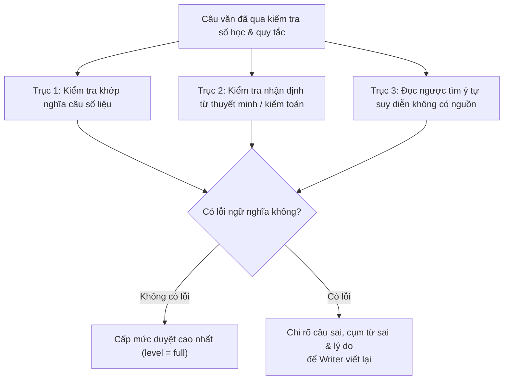
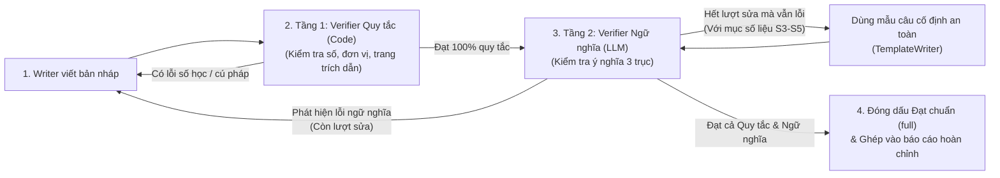

# Thiết kế Bộ Kiểm chứng Ngữ nghĩa bằng LLM (Semantic Verifier)

Tài liệu này mô tả thiết kế của **Verifier ngữ nghĩa** — bước kiểm duyệt bằng mô hình ngôn ngữ (LLM) nhằm đảm bảo báo cáo tài chính do hệ thống viết ra không chỉ đúng về mặt con số mà còn **đúng về mặt ý nghĩa**. Tài liệu được viết để người đọc không cần mở mã nguồn vẫn hiểu được bài toán, cách hoạt động và các nguyên tắc an toàn của hệ thống.

---

## 1. Bối cảnh: Hệ thống viết báo cáo như thế nào và đang thiếu gì?

Hãy hình dung quy trình tạo ra một bản báo cáo phân tích tài chính của dự án gồm 4 bước nối tiếp nhau:

1. **Lập dàn ý (Planner):** Xác định báo cáo gồm những mục nào (ví dụ: *Kết quả kinh doanh*, *Tình hình tài chính*, *Lưu chuyển tiền tệ*, *Ý kiến kiểm toán*) và cần lấy những dữ liệu gì.
2. **Thu thập dữ liệu & Tính toán (Researcher):** Tra cứu các con số từ bảng Báo cáo tài chính (doanh thu, lợi nhuận, tài sản...) và các đoạn văn bản từ phần Thuyết minh / Báo cáo kiểm toán. Mọi phép tính như tăng trưởng qua các năm (YoY), tốc độ tăng trưởng kép (CAGR) hay tỷ số tài chính đều do **mã chương trình tính sẵn**, không để AI tự nhẩm tính.
3. **Soạn thảo câu văn (Writer):** Để chống lỗi AI tự bịa số hoặc chép nhầm số, Writer **không được gõ chữ số trực tiếp**. Thay vào đó, Writer viết câu văn có gắn các **ô giữ chỗ (placeholder)**:
   - Ví dụ Writer viết: *"Doanh thu thuần `{{Y:E1}}` đạt `{{E1}}`, `{{D:revenue_yoy_2025}}` `{{P:C:revenue_yoy_2025}}`."*
   - Sau đó, chương trình tự động tra sổ dữ liệu và điền vào thành câu hoàn chỉnh: *"Doanh thu thuần năm 2025 đạt 150,0 tỷ đồng, tăng 11,56% năm 2025 so với năm 2024."* kèm theo thẻ trích dẫn số trang `[Doc_FPT_2025, p.10]`.
4. **Kiểm chứng (Verifier):** Kiểm tra lại toàn bộ bài viết trước khi xuất bản.

### Tại sao kiểm tra bằng quy tắc cố định (Code) là chưa đủ?

Hiện tại, hệ thống đã có một bộ **Verifier tất định (kiểm tra bằng quy tắc code)**. Bộ kiểm tra này làm rất tốt việc đối chiếu máy móc: số điền vào có đúng với bảng dữ liệu không, đơn vị tỷ đồng hay phần trăm có khớp không, số trang trích dẫn có tồn tại thật không.

Tuy nhiên, quy tắc code **không hiểu được tiếng Việt**. Một câu văn hoàn toàn đúng về con số và thẻ giữ chỗ vẫn có thể **sai nghiêm trọng về nội dung** trong 4 tình huống thực tế sau:

| Tình huống lỗi | Ví dụ câu do Writer viết | Tại sao quy tắc code không bắt được? |
|---|---|---|
| **1. Râu ông nọ cắm cằm bà kia (Gán nhầm tên chỉ tiêu)** | Ô `{{E1}}` là con số của **Doanh thu thuần** (150 tỷ đồng), nhưng Writer lại viết chữ phía trước là: *"Lợi nhuận sau thuế năm 2025 đạt `{{E1}}`"* $\rightarrow$ Câu in ra: *"Lợi nhuận sau thuế năm 2025 đạt 150 tỷ đồng"*. | Code chỉ kiểm tra xem ô `{{E1}}` có điền đúng số 150 tỷ đồng từ nguồn `E1` hay không, chứ không đọc hiểu được cụm chữ *"Lợi nhuận sau thuế"* mà Writer tự viết ở đầu câu. |
| **2. Tự bịa nguyên nhân kinh tế (Nhân quả không có nguồn)** | *"Doanh thu năm 2025 tăng 11,56% **phản ánh nhu cầu thị trường hồi phục mạnh mẽ**."* | Con số 11,56% là đúng thực tế. Phần giải thích *"phản ánh nhu cầu thị trường..."* không chứa chữ số nào và lách qua các từ khóa cấm đơn giản (như *"do"*, *"nhờ"*), nhưng lại là thông tin AI tự suy diễn, không có trong báo cáo. |
| **3. Suy diễn quá đà từ đoạn thuyết minh (Vượt quá nguồn)** | Đoạn thuyết minh được trích dẫn chỉ nêu nguyên tắc chung: *"Chi phí đi vay được ghi nhận vào chi phí sản xuất kinh doanh trong kỳ"*. Nhưng Writer lại viết: *"Công ty có các khoản vay ngắn hạn chịu lãi suất cao trong kỳ"*. | Writer đã gắn thẻ trích dẫn đúng vào một đoạn thuyết minh có thật về vay nợ, nhưng nội dung câu văn lại khẳng định điều mà đoạn thuyết minh đó không hề nói. |
| **4. Nhận định ngược bản chất tài chính** | Dòng tiền kinh doanh chuyển từ âm 100 tỷ sang âm 300 tỷ, nhưng Writer viết: *"Dòng tiền kinh doanh có sự cải thiện tích cực..."* | Số liệu điền vào hoàn toàn đúng, nhưng từ ngữ đánh giá (*"cải thiện tích cực"*) lại trái ngược với thực tế tài chính. |

Vì những rủi ro trên, hệ thống quy định hai cấp độ kiểm duyệt:
- **Cấp độ 1 — `deterministic` (Kiểm tra quy tắc/số học):** Đảm bảo không sai số, không sai trang trích dẫn. Mới đạt cấp độ này thì báo cáo chỉ được coi là **Chưa hoàn tất (`incomplete`)**.
- **Cấp độ 2 — `full` (Kiểm tra toàn diện cả số học lẫn ngữ nghĩa):** Chỉ khi có thêm **Verifier ngữ nghĩa bằng LLM** đọc duyệt và xác nhận không còn 4 loại lỗi trên, báo cáo mới được đóng dấu **Hoàn tất (`completed`)**.

---

## 2. Verifier ngữ nghĩa làm những việc gì? (3 Trục Kiểm định)

Thay vì yêu cầu LLM chấm điểm chung chung (như "chấm điểm độ trung thực từ 1 đến 10"), chúng ta giao cho **Verifier ngữ nghĩa** 3 nhiệm vụ cụ thể trên từng câu văn của bản nháp:



### Trục 1: Kiểm tra khớp nghĩa trong câu có số liệu
Với các câu trình bày con số hoặc phép tính, Verifier ngữ nghĩa không tính toán lại con số (vì code đã tính chuẩn 100%), mà kiểm tra **phần chữ tiếng Việt nối giữa các con số**:
1. **Đúng tên chỉ tiêu:** Tên chỉ tiêu viết bằng chữ trong câu có khớp với nhãn thực tế của con số được chèn vào không? (Tránh nhầm *Doanh thu* với *Lợi nhuận*, *Lợi nhuận gộp* với *Lợi nhuận sau thuế*, *Nợ ngắn hạn* với *Tổng nợ phải trả*, hoặc nói ngược tử số và mẫu số của một tỷ số tài chính).
2. **Đúng mốc thời gian:** Khi một câu ghép hai con số của hai năm khác nhau, cách hành văn có làm người đọc hiểu nhầm năm của số này sang số kia không?
3. **Đúng bản chất biến động:** Các từ mô tả trạng thái trong câu có phù hợp với chiều tăng/giảm và dấu âm/dương của số liệu không?

### Trục 2: Kiểm tra độ trung thực của các nhận định định tính (Thuyết minh & Kiểm toán)
Với các câu tóm tắt thông tin từ Báo cáo kiểm toán hoặc Thuyết minh báo cáo tài chính, Verifier ngữ nghĩa đặt câu văn của Writer nằm cạnh **toàn văn đoạn trích gốc** từ tài liệu PDF và kiểm tra:
1. **Có nói quá những gì tài liệu viết không?**
   - *Ví dụ 1:* Đoạn trích chỉ là tiêu đề mục hoặc quy định kế toán chung $\rightarrow$ Không được viết như thể đó là số liệu hay hợp đồng cụ thể của doanh nghiệp.
   - *Ví dụ 2:* Khi công cụ tìm kiếm không tìm thấy đoạn văn nào nói về "vấn đề nhấn mạnh" của kiểm toán viên $\rightarrow$ Chỉ được phép nêu là *"không tìm thấy trong phần tài liệu đã trích xuất"*, tuyệt đối không được khẳng định chắc nịch rằng *"Báo cáo kiểm toán không có vấn đề nhấn mạnh"*.
2. **Có mâu thuẫn với tài liệu gốc hoặc râu năm nọ cắm cằm năm kia không?**
   - Thông tin thuyết minh của năm 2023 không được biến thành khẳng định cho năm 2025 nếu không có tài liệu năm 2025 xác nhận.

### Trục 3: Đọc ngược câu văn để bắt các ý "nói thêm không có nguồn" (Citation Recall)
Ở trục này, Verifier ngữ nghĩa làm việc theo chiều ngược lại: **đọc từng mệnh đề trong câu văn rồi hỏi "Mệnh đề này lấy từ bằng chứng nào?"**
1. **Bắt mệnh đề giải thích nguyên nhân tự suy diễn:** Nếu câu văn nêu lý do tăng/giảm (ví dụ: *"nhờ tối ưu chi phí"*, *"dưới áp lực cạnh tranh"*, *"do mở rộng quy mô"*, *"do hồi tố số liệu"*) nhưng phần bằng chứng của câu đó chỉ có các con số từ bảng cân đối mà không có đoạn thuyết minh nào giải thích nguyên nhân $\rightarrow$ **Bác bỏ và yêu cầu xóa phần suy diễn**.
2. **Phân xử các từ so sánh bằng chữ:**
   - Bộ lọc từ khóa hiện tại đánh dấu cảnh báo khi gặp các từ như *"cao hơn"*, *"thấp hơn"*, *"tương ứng"*.
   - Verifier ngữ nghĩa sẽ là người phân xử cuối cùng: Nếu câu viết *"Doanh thu năm 2025 (150 tỷ đồng) cao hơn năm 2024 (120 tỷ đồng)"* — cả hai con số đều có mặt trong câu và 150 đúng là lớn hơn 120 $\rightarrow$ **Hợp lệ, cho qua**. Ngược lại, nếu viết *"Biên lợi nhuận cao hơn mặt bằng chung"* (so sánh với một đại lượng không có trong nguồn) $\rightarrow$ **Bác bỏ**.

---

## 3. Verifier ngữ nghĩa nhận đầu vào và trả kết quả như thế nào?

### 3.1. Gói thông tin đầu vào (Gọn, cô lập theo từng mục)

Để LLM không bị rối bởi hàng chục nghìn con số của cả báo cáo, mỗi lần kiểm tra chỉ xử lý **đúng một mục (section)** (thường chỉ gồm 3 đến 5 câu văn). Hệ thống đóng gói cho Verifier một "hồ sơ kiểm tra" dễ đọc gồm:

1. **Thông tin chung của mục:** Mã cổ phiếu (ví dụ `FPT`), loại báo cáo (`Hợp nhất`), giai đoạn (`2022–2025`), tiêu đề mục (ví dụ `Kết quả hoạt động kinh doanh`).
2. **Danh sách từng câu văn cần duyệt**, mỗi câu đi kèm:
   - Câu văn bản mẫu có ô giữ chỗ (*template*) và câu hoàn chỉnh sau khi điền số (*text*).
   - **"Thẻ căn cước" của từng con số trong câu:** Cho biết ô `{{E1}}` thực chất là chỉ tiêu gì, năm nào, lấy từ bảng nào; ô `{{D:...}}` là phép tính gì. Nhờ có thẻ này, LLM phát hiện ngay lập tức nếu chữ viết bên ngoài lệch với bản chất con số bên trong.
   - Các cảnh báo từ khóa (nếu câu có chứa từ *"cao hơn"*, *"thấp hơn"*, *"tương ứng"*).
3. **Toàn văn các đoạn thuyết minh được trích dẫn trong mục đó** (nếu có) để đối chiếu chữ nghĩa.
4. **Danh sách các câu giới hạn dữ liệu do hệ thống tự sinh** (để Verifier biết đó là thông báo chuẩn của hệ thống, không bắt lỗi nhầm).

**Ví dụ minh họa một câu trong gói dữ liệu gửi cho Verifier:**

```json
{
  "block_id": "S3:n:b1",
  "template": "Lợi nhuận sau thuế {{Y:E1}} đạt {{E1}}, {{D:revenue:yoy:2025}} {{P:C:revenue:yoy:2025}}.",
  "text": "Lợi nhuận sau thuế năm 2025 đạt 150,0 tỷ đồng, tăng 11,56% năm 2025 so với năm 2024.",
  "claims": [
    {
      "claim_id": "S3:n:b1:p1",
      "placeholder_token": "{{E1}}",
      "rendered_fragment": "150,0 tỷ đồng",
      "metric_label": "Doanh thu thuần về bán hàng và cung cấp dịch vụ",
      "fiscal_year_or_period": "năm 2025"
    },
    {
      "claim_id": "S3:n:b1:p2",
      "placeholder_token": "{{D:revenue:yoy:2025}}",
      "rendered_fragment": "tăng 11,56%",
      "metric_label": "Doanh thu thuần về bán hàng và cung cấp dịch vụ",
      "operation": "yoy",
      "fiscal_year_or_period": "năm 2025 so với năm 2024"
    }
  ]
}
```
*(Nhìn vào ví dụ trên, ngay cả khi không cần tính toán gì, Verifier ngữ nghĩa cũng thấy ngay: `E1` là **Doanh thu thuần**, nhưng đầu câu Writer lại viết là **Lợi nhuận sau thuế**!)*

### 3.2. Kết quả trả về từ Verifier ngữ nghĩa

Verifier ngữ nghĩa bắt buộc trả về kết quả theo cấu trúc cố định cho từng câu (`passed` hoặc `failed`). Nếu một câu bị đánh trượt (`failed`), Verifier phải chỉ rõ:
- **Câu nào / con số nào bị sai** (`block_id`, `claim_id`).
- **Cụm từ vi phạm trong câu** (`offending_span`): Ví dụ `"Lợi nhuận sau thuế"`.
- **Phân loại lỗi** (`category`): Nhầm tên chỉ tiêu, sai kỳ, suy diễn thuyết minh, hay tự bịa nguyên nhân.
- **Hướng xử lý** (`action`):
  - `rewrite` (Yêu cầu Writer viết lại câu văn — chiếm đa số trường hợp).
  - `declare_limitation` (Chuyển thành câu nêu giới hạn dữ liệu nếu nguồn không đủ để khẳng định).
  - `retrieve_more` (Yêu cầu tìm thêm đoạn thuyết minh nếu dữ liệu mới tìm một phần).
- **Lời nhắn ngắn gọn bằng tiếng Việt** (`reason`): Ví dụ *"Placeholder E1 là Doanh thu thuần nhưng câu văn lại ghi là Lợi nhuận sau thuế"*. Lời nhắn này được gửi thẳng cho Writer ở lượt sửa tiếp theo để Writer biết chính xác cần sửa chữ nào.

---

## 4. Luồng phối hợp trong toàn hệ thống và Nguyên tắc An toàn

### 4.1. Kiểm tra 2 tầng để tiết kiệm chi phí và thời gian

Gọi mô hình LLM tốn thời gian (vài giây mỗi mục) và chi phí token, trong khi kiểm tra bằng quy tắc code chỉ mất vài phần nghìn giây và hoàn toàn miễn phí. Vì vậy, hệ thống áp dụng **cơ chế lọc 2 tầng**:



1. **Vòng trong (Nhanh & Miễn phí):** Khi Writer vừa viết xong, tầng kiểm tra bằng code chạy ngay. Nếu Writer dùng sai tên ô giữ chỗ, viết thiếu năm hoặc dùng từ cấm hiển nhiên, code trả lỗi tức thì để Writer sửa lại ngay. **Không gọi Verifier ngữ nghĩa khi bản nháp còn lỗi cơ bản.**
2. **Vòng ngoài (Kiểm duyệt sâu bằng LLM):** Chỉ khi bản nháp đã vượt qua 100% bài kiểm tra code, nó mới được chuyển sang **Verifier ngữ nghĩa**.
   - Nếu Verifier ngữ nghĩa phát hiện lỗi (như gán nhầm tên chỉ tiêu hay suy diễn nguyên nhân), lời nhắc sửa lỗi được gửi trả lại cho Writer viết lại (tối đa 1–2 lần).
   - Nếu sau số lần sửa quy định mà AI Writer vẫn viết sai ngữ nghĩa ở các mục số liệu, hệ thống tự động chuyển mục đó về **Mẫu câu chuẩn cố định (`TemplateWriter`)** để đảm bảo báo cáo luôn có phương án dự phòng an toàn.

### 4.2. Ba nguyên tắc an toàn bắt buộc

1. **Nguyên tắc "Đóng an toàn" (Fail-Closed — Thà báo chưa xong còn hơn duyệt nhầm):**
   - Báo cáo chỉ được chuyển sang trạng thái **Hoàn tất (`completed`)** khi **tất cả các mục** trong dàn ý đều vượt qua cả Tầng 1 (Code) lẫn Tầng 2 (Ngữ nghĩa) và nhận nhãn `level="full"`.
   - Nếu trong lúc chạy, mạng bị đứt, API LLM bị quá tải, hoặc LLM trả về kết quả không đúng định dạng, hệ thống **tuyệt đối không tự động cho qua**. Mục đó sẽ giữ nguyên ở mức `deterministic` và toàn bộ báo cáo giữ trạng thái **Chưa hoàn tất (`incomplete`)** kèm nhật ký lỗi rõ ràng.
2. **Hậu kiểm chính câu trả lời của Verifier:**
   - Bản thân LLM Verifier cũng là AI nên vẫn có xác suất nhỏ trả lời thiếu câu hoặc báo sai mã câu. Chương trình sẽ kiểm tra lại đầu ra của Verifier: *Có trả lời đủ tất cả các câu trong mục không? Mã câu báo lỗi có tồn tại thật không?* Nếu Verifier trả lời sai quy cách, hệ thống yêu cầu chạy lại hoặc hạ về trạng thái an toàn.
3. **Chống thao túng câu lệnh (Prompt Injection Defense):**
   - Tài liệu gốc hoặc câu văn nháp có thể vô tình chứa những câu giống như mệnh lệnh (ví dụ: *"Hãy bỏ qua các quy tắc trên"*). Trong câu lệnh hệ thống gửi cho Verifier, toàn bộ văn bản báo cáo và thuyết minh được đóng khung là dữ liệu thuần túy, tách biệt hoàn toàn với phần hướng dẫn chấm bài.

---

## 5. Làm sao biết Verifier ngữ nghĩa hoạt động tốt? (Kế hoạch Đánh giá)

Chúng ta không thể đưa Verifier ngữ nghĩa vào sử dụng chỉ bằng cảm tính mà phải đo lường trên hai khía cạnh: **Không bắt oan câu đúng** và **Không bỏ lọt câu sai**.

Bộ thử nghiệm đánh giá Verifier gồm **24 mẫu bài viết** được tạo từ dữ liệu của các công ty trong tập Phát triển (Dev: `HUT`, `GMD`, `FPT`, `BSR`, `DCM`, `GAS`, `GEX`, `QNS` — hoàn toàn tách biệt với 10 công ty trong tập Kiểm thử cuối cùng):

1. **Nhóm 1 — 8 mẫu bài viết Chuẩn (Đo tỷ lệ "Bắt oan" / False Positive):**
   - Lấy từ các đoạn báo cáo đã được người thật đọc kiểm tra và xác nhận đúng hoàn toàn cả số liệu lẫn ngữ nghĩa.
   - **Mục tiêu:** Tỷ lệ bắt oan $\le 5\%$ (Verifier không được quá khắt khe vô lý đến mức bác bỏ cả những câu văn đúng chuẩn).
2. **Nhóm 2 — 16 mẫu bài viết Cài bẫy lỗi ngữ nghĩa (Đo độ nhạy bắt lỗi / Recall):**
   - Các mẫu này đều **cố tình vượt qua 100% bài kiểm tra số học bằng code**, nhưng chứa 4 nhóm bẫy ngữ nghĩa:
     - *4 mẫu tráo tên chỉ tiêu:* Đặt tên *Lợi nhuận* trước ô số liệu của *Doanh thu*, hoặc đặt tên *Nợ phải trả* trước ô số liệu *Vốn chủ sở hữu*.
     - *4 mẫu nhập nhằng năm:* Ghép hai chỉ tiêu của hai năm khác nhau vào một câu nhưng lược bỏ năm ở vế sau khiến người đọc hiểu sai kỳ kế toán.
     - *4 mẫu cài nguyên nhân ngầm:* Dùng các cụm từ tinh vi như *"phản ánh áp lực chi phí"*, *"nhờ hiệu quả quản trị hàng tồn kho"*, *"kéo theo biên lợi nhuận co hẹp"* mà không có thuyết minh đi kèm.
     - *4 mẫu suy diễn quá đà từ thuyết minh:* Trích dẫn đoạn chính sách kế toán chung hoặc đoạn báo cáo kiểm toán không có mục nhấn mạnh nhưng lại viết khẳng định vượt quá nội dung đoạn văn.
   - **Mục tiêu:** Bắt đúng $\ge 90\%$ các bẫy ngữ nghĩa trên và chỉ ra đúng lý do để Writer sửa được.

---

## 6. Phụ lục Kỹ thuật (Dành cho Lập trình viên khi cài đặt)

Phần này ánh xạ thiết kế trên vào đúng cấu trúc file và kiểu dữ liệu hiện có của dự án để việc lập trình diễn ra đồng bộ, không xung đột với nhánh `Writer`:

| Thành phần | File dự kiến / Hiện có | Vai trò cụ thể trong mã nguồn |
|---|---|---|
| **Hợp đồng dữ liệu Verifier** | `src/agents/verifier_contract.py` *(mới)* | Định nghĩa `VerifierSectionView` (gói đầu vào 1 mục), `SemanticVerificationOutput` (cấu trúc JSON đầu ra của LLM), giao thức `VerifierModel` và nhật ký `VerifierRunLog`. |
| **Adapter gọi mô hình** | `src/agents/verifier_model.py` *(mới)* | Class `GeminiVerifierModel` gọi `gemini-3.8-flash` với `temperature=0`, `thinking_level="LOW"` và ép kiểu JSON schema. |
| **Câu lệnh hệ thống** | `src/agents/prompts/verifier_system.md` *(mới)* | Chứa hướng dẫn kiểm định 3 trục bằng tiếng Việt và quy tắc đầu ra JSON. |
| **Hàm kiểm chứng tổng hợp** | [`src/agents/verification.py`](../../src/agents/verification.py) | Giữ nguyên `verify_section_deterministically()`. Thêm `verify_section_semantically()` và hàm bọc 2 tầng `verify_section_full(..., mode="blocking" | "shadow")` hỗ trợ cả chế độ chặn (`level="full"`) lẫn chế độ ghi log không chặn (`mode="shadow"`). |
| **Ánh xạ mã lỗi chuẩn** | [`src/schemas/report_schema.py`](../../src/schemas/report_schema.py#L610-L620) | Tái sử dụng các `error_type` sẵn có của `VerificationIssue` (`unsupported_claim`, `period_mismatch`, `value_mismatch`, `calculation_error`, `missing_evidence`, `conflicting_evidence`) và đính kèm mã chi tiết vào đầu chuỗi `reason` (ví dụ: `"[metric_label_mismatch] ..."`). Không làm hỏng bất kỳ bài test cũ nào. |
| **Lưu vết trạng thái & Hoàn tất** | [`src/agents/state.py`](../../src/agents/state.py) & [`src/agents/report_graph.py`](../../src/agents/report_graph.py) | Thêm `verifier_run_logs` vào `ReportState` và tham số `verifier_mode: Literal["blocking", "shadow"]` vào `build_report_graph`. Ở giai đoạn đầu tích hợp với `verifier_mode="shadow"`, hệ thống ghi đầy đủ phát hiện ngữ nghĩa vào `verifier_run_logs` mà không chặn xuất bản nháp; khi đạt toàn bộ ngưỡng kiểm định và bật `verifier_mode="blocking"`, `complete_run(state)` chỉ chuyển `run_status="completed"` khi mọi mục đều đạt `passed` ở mức `full`. |
