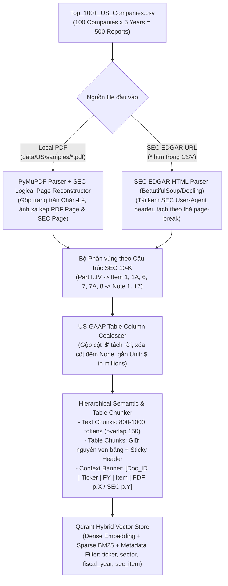

# T1.2: Đặc tả Bộ Dữ liệu US Form 10-K & Thiết kế Pipeline Tiền xử lý – Chunking
**Dự án:** Multi-Agent Framework to Write Report from Documents  
**Tên bộ dữ liệu:** Top 100+ US Companies SEC Form 10-K Corpus (5-Year Longitudinal Dataset)  
**Tác giả tổng hợp:** Tự tổng hợp từ hệ thống lưu trữ chính thức **U.S. SEC EDGAR**  
**Đường dẫn Index CSV:** [data/US/Top_100+_US_Companies.csv](file:///c:/Research%20Dataset/Multi-agent_Report_Writer/data/US/Top_100+_US_Companies.csv)  
**Tài liệu mẫu phân tích:** [data/US/samples/nvda-20210131.pdf](file:///c:/Research%20Dataset/Multi-agent_Report_Writer/data/US/samples/nvda-20210131.pdf) *(NVIDIA Corporation – FY2021 Form 10-K)*  
**Giai đoạn:** Phase 1 – Task T1.2 (Chuẩn bị dữ liệu tài liệu mẫu, RAG & Chunking)

---

## 1. Thông tin Tổng quan & Định danh Bộ Dữ liệu

### 1.1. Bảng Thông số Kỹ thuật (Dataset Metadata)

| Thuộc tính | Chi tiết |
| :--- | :--- |
| **Tên bộ dữ liệu** | **Top 100+ US Companies 5-Year SEC Form 10-K Dataset** |
| **Nguồn dữ liệu gốc** | Hệ thống **EDGAR** của Ủy ban Chứng khoán và Sàn giao dịch Hoa Kỳ (**U.S. Securities and Exchange Commission – SEC**) |
| **Phương thức thu thập** | Tự tổng hợp và chuẩn hóa danh mục 100 tập đoàn vốn hóa lớn nhất Hoa Kỳ kèm liên kết trực tiếp đến 5 kỳ báo cáo `Form 10-K` gần nhất của từng doanh nghiệp |
| **Ngôn ngữ** | Tiếng Anh (`en` – Chuẩn thuật ngữ tài chính, kế toán **US GAAP** và pháp lý SEC) |
| **Quy mô toàn bộ** | **500 báo cáo thường niên (`Form 10-K`)** của **100 tập đoàn niêm yết hàng đầu** (5 năm liên tiếp / công ty) |
| **Khoảng thời gian** | **FY2020 / FY2021 – FY2025 / FY2026** (Chuỗi thời gian 5 năm liên tục từ cột `1st (Furthest)` đến `5th (Closest)`) |
| **Độ phủ ngành nghề** | **11 nhóm ngành chuẩn GICS** (*Technology, Healthcare, Financials, Industrials, Consumer Discretionary, Consumer Staples, Communication Services, Energy, Materials, Utilities, Real Estate*) |
| **Định dạng dữ liệu** | **100% Digital-Native (Văn bản điện tử gốc):** Truy cập dưới dạng `.htm` (Inline XBRL/HTML trên SEC EDGAR) hoặc kết xuất sang `.pdf` văn bản số (như mẫu `nvda-20210131.pdf`) |
| **Độ chính xác số liệu** | **100% (Zero OCR Noise):** Không qua quét ảnh/OCR nên không có lỗi chính tả nhận diện ký tự, không có nhiễu con dấu hay chữ ký đè lên bảng số liệu |

---

### 1.2. Thống kê Phân bố theo Nhóm Ngành (Sector Distribution)

Qua phân tích trực tiếp file [Top_100+_US_Companies.csv](file:///c:/Research%20Dataset/Multi-agent_Report_Writer/data/US/Top_100+_US_Companies.csv), 100 doanh nghiệp (tương ứng 500 báo cáo 10-K) được phân bổ vào 11 nhóm ngành kinh tế như sau:

| STT | Nhóm ngành (GICS Sector) | Số công ty | Số báo cáo 10-K | Các mã chứng khoán (Tickers) tiêu biểu trong Dataset |
| :-: | :--- | :---: | :---: | :--- |
| 1 | **Technology** | **32** | 160 | `NVDA`, `AAPL`, `MSFT`, `AVGO`, `MU`, `AMD`, `PLTR`, `INTC`, `CSCO`, `ORCL`, `PANW`, `AMAT`, `DELL`, `LRCX`, `CRWD`, `CRM`, `QCOM`... |
| 2 | **Healthcare** | **16** | 80 | `LLY`, `JNJ`, `ABBV`, `UNH`, `MRK`, `TMO`, `AMGN`, `GILD`, `ABT`, `PFE`, `DHR`, `ISRG`, `VRTX`, `BMY`, `MDT`, `SYK` |
| 3 | **Financials** | **15** | 75 | `BRK.B`, `JPM`, `V`, `MA`, `BAC`, `MS`, `GS`, `WFC`, `AXP`, `C`, `SCHW`, `CB`, `SPGI`, `PGR`, `COF` |
| 4 | **Industrials** | **9** | 45 | `CAT`, `GE`, `RTX`, `DE`, `UNP`, `BA`, `LMT`, `UBER`, `UPS` |
| 5 | **Consumer Discretionary** | **8** | 40 | `AMZN`, `TSLA`, `HD`, `MCD`, `TJX`, `BKNG`, `LOW`, `SBUX` |
| 6 | **Consumer Staples** | **7** | 35 | `WMT`, `COST`, `KO`, `PG`, `PM`, `PEP`, `MO` |
| 7 | **Communication Services** | **6** | 30 | `GOOGL`, `META`, `NFLX`, `DIS`, `VZ`, `TMUS` |
| 8 | **Energy** | **4** | 20 | `CVX`, `COP`, `MPC`, `VLO` |
| 9 | **Materials** | **1** | 5 | `LIN` (Linde plc) |
| 10 | **Utilities** | **1** | 5 | `NEE` (NextEra Energy) |
| 11 | **Real Estate** | **1** | 5 | `WELL` (Welltower Inc.) |
| | **TỔNG CỘNG** | **100** | **500** | **5 kỳ báo cáo thường niên liên tiếp / công ty** |

---

## 2. Cấu trúc Tổ chức Dữ liệu & Quy ước Trích xuất Metadata

### 2.1. Cấu trúc Schema của File Điều phối [`Top_100+_US_Companies.csv`](file:///c:/Research%20Dataset/Multi-agent_Report_Writer/data/US/Top_100+_US_Companies.csv)
Mỗi dòng trong file CSV đại diện cho một tập đoàn với 8 trường dữ liệu chuẩn:
- `Ticker`: Mã cổ phiếu niêm yết trên NYSE / Nasdaq (VD: `NVDA`, `AAPL`, `MSFT`).
- `Name`: Tên pháp nhân đầy đủ của doanh nghiệp (VD: `NVIDIA Corporation`).
- `Sector`: Nhóm ngành GICS.
- `1st (Furthest)` $\rightarrow$ `5th (Closest)`: 5 đường dẫn URL chuẩn dẫn thẳng tới file báo cáo `Form 10-K` trên kho lưu trữ SEC EDGAR qua 5 năm tài chính liên tiếp.

### 2.2. Giải phẫu Cấu trúc URL SEC EDGAR & Tự động hóa Metadata
Mỗi URL trong file CSV đều tuân theo cấu trúc định danh của SEC:
```text
https://www.sec.gov/Archives/edgar/data/1045810/000104581021000010/nvda-20210131.htm
                                        └──┬──┘ └────────┬───────┘ └──┬┘└───┬───┘
                                          CIK     Accession Number  Ticker Period End Date (YYYYMMDD)
```
Từ mỗi dòng CSV và tên file (như `nvda-20210131.pdf`), `Document Parser Agent` tự động bóc tách bộ Metadata chuẩn mà không cần gọi LLM:
- `doc_id`: `"NVDA_10K_20210131"` (hoặc ngắn gọn cho tag trích dẫn: `Doc_NVDA_FY21`)
- `ticker`: `"NVDA"`
- `company_name`: `"NVIDIA Corporation"`
- `sector`: `"Technology"`
- `cik`: `"0001045810"`
- `period_end_date`: `"2021-01-31"` (`FY2021`)

---

## 3. Phân tích Chuyên sâu Báo cáo Mẫu: `nvda-20210131.pdf` (NVIDIA FY2021 Form 10-K)

Để thiết kế bộ Parser và Chunker chính xác, báo cáo mẫu [nvda-20210131.pdf](file:///c:/Research%20Dataset/Multi-agent_Report_Writer/data/US/samples/nvda-20210131.pdf) (*Báo cáo thường niên Form 10-K của NVIDIA cho năm tài chính kết thúc ngày 31/01/2021*) đã được mổ xẻ toàn diện.

### 3.1. Thông số Kỹ thuật của File Mẫu `nvda-20210131.pdf`
* **Dung lượng:** `3,205,800 bytes` (~3.21 MB).
* **Trình tạo PDF (Producer):** `Skia/PDF m156` (Kết xuất trực tiếp từ file HTML gốc trên SEC EDGAR qua trình duyệt Chromium/Edge).
* **Tổng số trang vật lý (PDF Pages):** **137 trang** (Tương ứng với **84 trang đánh số logic** trong mục lục gốc của báo cáo 10-K).
* **Bối cảnh kinh doanh đặc biệt của kỳ báo cáo FY2021:** Đây là năm bản lề lịch sử của NVIDIA khi hoàn tất thương vụ mua lại **Mellanox Technologies** (~7 tỷ USD), ra mắt kiến trúc GPU **Ampere (A100)**, công bố thỏa thuận mua lại **Arm**, và lần đầu tiên tái cấu trúc báo cáo thành 2 mảng chiến lược: **Graphics** và **Compute & Networking** (Data Center).

### 3.2. Bản đồ Cấu trúc 4 Phần – 16 Items Chuẩn SEC Form 10-K trong `nvda-20210131.pdf`

Khác với Báo cáo tài chính Việt Nam (chỉ có bảng số liệu và thuyết minh kế toán), một báo cáo **Form 10-K** trong dataset này là một **bộ hồ sơ toàn diện kết hợp Chiến lược kinh doanh + Phân tích rủi ro + Giải trình của Ban Giám đốc (MD&A) + Báo cáo tài chính kiểm toán**:

| Phần / Mục (SEC Item) | Trang Mục lục (SEC Page) | Trang Vật lý (PDF Page) | Nội dung cốt lõi trong báo cáo `nvda-20210131.pdf` | Giá trị cho Agent Viết Báo cáo |
| :--- | :---: | :---: | :--- | :--- |
| **Cover Page & TOC** | p. 1 – 2 | p. 1 – 3 | Thông tin pháp lý, mã niêm yết `NVDA` (Nasdaq), 620 triệu cổ phiếu phổ thông đang lưu hành, Bảng mục lục. | Xác thực định danh tài liệu & lập chỉ mục chương mục. |
| **PART I – Item 1. Business** | p. 4 – 12 | p. 7 – 24 | Mô hình kinh doanh *Accelerated Computing*, 4 thị trường mục tiêu (*Gaming, Data Center, Professional Visualization, Automotive*), chiến lược phần mềm CUDA & AI, nhân sự (18.975 nhân viên). | Nguồn dữ liệu cho chương **Tổng quan Doanh nghiệp, Sản phẩm & Vị thế Cạnh tranh**. |
| **PART I – Item 1A. Risk Factors** | p. 13 – 25 | p. 25 – 51 | Phân tích chi tiết các rủi ro: phụ thuộc đối tác đúc chip (TSMC, Samsung), rủi ro gián đoạn chuỗi cung ứng, rủi ro pháp lý thương vụ mua Arm, cạnh tranh gay gắt, an ninh mạng. | Nguồn dữ liệu trực tiếp cho chương **Đánh giá Rủi ro Chiến lược & Vận hành**. |
| **PART I – Items 1B, 2, 3, 4** | p. 26 | p. 51 | Tài sản trụ sở chính tại Santa Clara, trung tâm R&D và các vấn đề pháp lý. | Thông tin bổ trợ vận hành & pháp lý. |
| **PART II – Item 5 & Item 6. Selected Financial Data** | p. 27 – 28 | p. 52 – 55 | Bảng dữ liệu tài chính chọn lọc chuỗi **5 năm liên tiếp (FY2017 – FY2021)**: Doanh thu tăng từ `$6,910M` (FY17) lên `$16,675M` (FY21). | Cực kỳ hữu ích để `Researcher Agent` lấy ngay bức tranh tăng trưởng dài hạn 5 năm. |
| **PART II – Item 7. MD&A** *(Management's Discussion & Analysis)* | p. 29 – 38 | p. 55 – 73 | **Trái tim phân tích của 10-K:** Ban Giám đốc giải thích nguyên nhân doanh thu tăng 53% (`$16,675M`), mảng *Compute & Networking* tăng 109% (`$6,841M`), mảng *Graphics* tăng 29% (`$9,834M`), phân tích biên lợi nhuận gộp (62.3% vs 62.0%) và thanh khoản. | Giúp `Section Writer Agent` trả lời câu hỏi **"TẠI SAO số liệu tăng/giảm?"** dựa trên dẫn chứng thật. |
| **PART II – Item 8. Financial Statements & Notes** | p. 40, 44 – 78 | p. 79 – 133 | Báo cáo kiểm toán độc lập (PwC), 5 Bảng báo cáo tài chính hợp nhất và **17 Bản thuyết minh chi tiết (Note 1 – Note 17)**. | Nguồn số liệu kiểm toán chuẩn xác cho mọi bảng biểu và kiểm định `Fact-Checker`. |
| **PART III & PART IV (Items 10–16 & Signatures)** | p. 41 – 86 | p. 77 – 79, 133 – 137 | Quản trị công ty, thù lao ban điều hành, danh mục phụ lục hợp đồng và chữ ký xác nhận của CEO Jensen Huang & CFO Colette Kress. | Kiểm chứng tính pháp lý của báo cáo. |

---

### 3.3. Kiểm định Chi tiết Số liệu Tài chính trong `Item 8` của `nvda-20210131.pdf`

Tất cả các bảng báo cáo tài chính hợp nhất của NVIDIA đều sử dụng đơn vị **`$ in millions` (Triệu USD)** và đạt độ khớp toán học tuyệt đối 100%:

1. **Ý kiến Kiểm toán Độc lập – PwC (`PDF p. 79–82` | `SEC p. 44–45`):**
   - Ý kiến chấp nhận toàn phần (*Unqualified Opinion*) cho cả Báo cáo tài chính hợp nhất và Hệ thống kiểm soát nội bộ đối với báo cáo tài chính (*Internal Control over Financial Reporting - ICFR*).
   - Nêu rõ 1 *Critical Audit Matter (CAM)*: Định giá tài sản vô hình (`$1,690M` công nghệ phát triển và `$1,140M` quan hệ khách hàng) từ thương vụ mua lại Mellanox.

2. **Báo cáo Kết quả Kinh doanh – Consolidated Statements of Income (`PDF p. 85` | `SEC p. 47`):**
   - **Revenue (Doanh thu):** **`$16,675M`** (FY21) so với `$10,918M` (FY20) và `$11,716M` (FY19) $\rightarrow$ Tăng trưởng **+52.7% YoY**.
   - **Cost of revenue (Giá vốn):** `$6,279M` $\rightarrow$ **Gross profit (Lợi nhuận gộp):** **`$10,396M`** ($\text{Kiểm tra: } 16,675 - 6,279 = 10,396$).
   - **Operating expenses (Chi phí hoạt động):** **`$5,864M`** (gồm `R&D: $3,924M` + `SG&A: $1,940M`).
   - **Income from operations (Lợi nhuận hoạt động):** **`$4,532M`** ($\text{Kiểm tra: } 10,396 - 5,864 = 4,532$).
   - **Net income (Lợi nhuận ròng sau thuế):** **`$4,332M`** (tăng +54.9% từ `$2,796M` năm FY20); **Diluted EPS:** **`$6.90/share`**.

3. **Bảng Cân đối Kế toán – Consolidated Balance Sheets (`PDF p. 87` | `SEC p. 49`):**
   - **Total Current Assets (Tài sản ngắn hạn):** **`$16,055M`** (trong đó Tiền & Chứng khoán khả mại ngắn hạn: `$847M + $10,714M = $11,561M`; Phải thu khách hàng: `$2,429M`; Hàng tồn kho: `$1,826M`).
   - **Tài sản dài hạn nổi bật:** `Goodwill: $4,193M` (tăng từ `$618M`), `Intangible assets, net: $2,737M` (tăng từ `$49M` do hợp nhất Mellanox).
   - **Total Assets (Tổng Tài sản):** **`$28,791M`** (tăng +66.3% so với `$17,315M` đầu năm).
   - **Total Liabilities (Tổng Nợ phải trả):** **`$11,898M`** (gồm Nợ ngắn hạn `$3,925M`, Nợ vay dài hạn `$5,964M`, Nợ thuê hoạt động & dài hạn khác `$2,009M`).
   - **Total Shareholders' Equity (Vốn chủ sở hữu):** **`$16,893M`** (trong đó Lợi nhuận giữ lại `Retained earnings: $18,908M`, Cổ phiếu quỹ `Treasury stock: $(10,756)M`).
   - **Phương trình cân đối kế toán:**
     $$\text{Total Assets } (\$28,791\text{M}) = \text{Total Liabilities } (\$11,898\text{M}) + \text{Shareholders' Equity } (\$16,893\text{M})$$

4. **Báo cáo Lưu chuyển Tiền tệ – Consolidated Statements of Cash Flows (`PDF p. 89` | `SEC p. 51`):**
   - **Operating Cash Flow (Dòng tiền HĐKD):** Dương **`$5,822M`** (cao hơn cả Net Income `$4,332M`, cho thấy chất lượng lợi nhuận và khả năng tạo tiền mặt cực mạnh).
   - **Investing Cash Flow (Dòng tiền đầu tư):** Âm **`$(19,675)M`** (chi `$(8,524)M` tiền mặt mua lại Mellanox và `$(19,308)M` mua chứng khoán khả mại).
   - **Financing Cash Flow (Dòng tiền tài chính):** Dương **`$3,804M`** (phát hành trái phiếu thu về `$4,968M`, trả cổ tức `$(395)M`).

5. **Hệ thống 17 Bản Thuyết minh (`Note 1` – `Note 17`, `PDF p. 90–131` | `SEC p. 52–77`):**
   - Mỗi khoản mục trên Bảng cân đối kế toán và Báo cáo KQKD đều được giải trình chi tiết trong 17 Notes. Ví dụ: **Note 17 – Segment Information (`PDF p. 127–131`)** bóc tách doanh thu theo sản phẩm và khu vực địa lý (Đài Loan `$4,552M`, Trung Quốc `$3,886M`, Mỹ `$3,217M`...).

---

## 4. Ba Đặc trưng Kỹ thuật Thực tế của File PDF Kết xuất từ SEC EDGAR & Giải pháp Xử lý

Qua kiểm thử trích xuất trực tiếp trên `nvda-20210131.pdf` bằng `PyMuPDF`, mặc dù văn bản **sạch 100% không có lỗi OCR**, có **3 đặc trưng kỹ thuật quan trọng** do quá trình chuyển đổi từ SEC `.htm` sang `.pdf` mà Pipeline bắt buộc phải xử lý:

### 4.1. Hiện tượng 1: "Tràn trang Chẵn – Lẻ" (`HTML-to-PDF Page Spillover` làm 84 trang SEC thành 137 trang PDF)
* **Thực tế phát hiện trong `nvda-20210131.pdf`:**
  - Trong file `.htm` gốc trên SEC EDGAR, mỗi trang logic của báo cáo bắt đầu bằng link neo `"Table of Contents"` và kết thúc bằng **số thứ tự trang gốc (`1`..`84`) kèm lệnh CSS ngắt trang cứng (`page-break-after: always`)**.
  - Khi trình duyệt Chromium/Edge kết xuất sang PDF khổ dọc, chiều dài của 1 trang SEC thường vượt quá 1 trang giấy PDF khoảng 1–4 dòng. Hệ quả là:
    - Có **4 trang PDF trắng hoàn toàn** (`PDF p. 2, 4, 54, 109`).
    - Có **48 trang PDF rất ngắn (`< 250 ký tự`)**, trong đó nhiều trang chẵn (`PDF p. 8, 10, 12, 14, 18, 22, 28, 32, 34...`) **chỉ chứa duy nhất 1 con số là số trang chân trang (`"4"`, `"5"`, `"6"`, `"7"`)** hoặc 1–2 dòng văn bản cuối câu bị đẩy sang trang sau trước khi gặp lệnh `page-break-after`!
* **Giải pháp Kỹ thuật – Bộ tái cấu trúc Trang Logic SEC (`SEC Logical Page Reconstructor`):**
  1. Tự động phát hiện các mốc trang mới bắt đầu bằng chuỗi neo `"Table of Contents"` ở dòng đầu trang PDF.
  2. Nếu trang PDF tiếp theo không bắt đầu bằng `"Table of Contents"` (tức là phần đuôi bị tràn sang từ trang SEC trước đó), thuật toán **tự động nối ngược (stitch back) nội dung trang PDF tràn đó vào trang SEC trước**, trích xuất số trang gốc ở dòng cuối làm `sec_page_number` và loại bỏ các trang rỗng.
  3. Lưu song song cả 2 số trang trong Metadata của mọi `EvidenceChunk`:
     - `pdf_page`: Số trang vật lý của file PDF (`1..137`, ví dụ `PDF p.85` cho Bảng KQKD).
     - `sec_page`: Số trang in trong mục lục báo cáo 10-K (`1..84`, ví dụ `SEC p.47` cho Bảng KQKD).

### 4.2. Hiện tượng 2: Tách cột ký hiệu tiền tệ `$` và cột đệm trống trong Bảng HTML-to-PDF (`Split Currency Column`)
* **Thực tế phát hiện khi chạy `page.find_tables()` trên `PDF p.85` và `PDF p.87`:**
  - Các bảng kế toán trên SEC EDGAR đặt dấu `$` ở một ô riêng và con số ở ô bên cạnh, xen kẽ bởi các cột đệm căn lề. Khi `PyMuPDF` đọc bảng ở `PDF p.85`, một bảng có 4 cột logic (`Line Item | FY21 | FY20 | FY19`) bị tách thành **9 cột**:
    - Dòng đầu tiên: `['Revenue', '$', '16,675', '', '$', '10,918', '', '$', '11,716']`
    - Dòng thứ hai (không có dấu `$`): `['Cost of revenue', '6,279', None, '', '4,150', None, '', '4,545', None]`
  - Nếu để nguyên ma trận 9 cột này chuyển sang Markdown Table, các con số ở dòng không có dấu `$` sẽ bị lệch cột so với dòng có dấu `$`.
* **Giải pháp Kỹ thuật – Thuật toán Gộp Cột Bảng Tài chính (`US-GAAP Table Column Coalescer`):**
  1. Trong mỗi dòng của bảng, nếu một ô chỉ chứa ký hiệu `$` (hoặc dấu mở ngoặc `(`), tự động gộp nó vào ô số ngay bên phải (`"$" + "16,675" -> "$16,675"`).
  2. Loại bỏ toàn bộ các cột đệm mà tất cả các dòng đều rỗng (`None` hoặc `""`).
  3. Chuẩn hóa ra bảng Markdown sạch đẹp đúng 4 cột (`| Line Item | Jan 31, 2021 | Jan 26, 2020 | Jan 27, 2019 |`).

### 4.3. Hiện tượng 3: Kế thừa Đơn vị Tính ở Đầu Bảng (`Unit Scale Inheritance: $ in millions`)
* **Thực tế:** Ở đầu các bảng tài chính của Mỹ luôn có dòng chú thích đơn vị tính trong ngoặc đơn: `(In millions, except per share data)`. Bản thân con số trong bảng chỉ viết ngắn gọn là `$16,675`.
* **Giải pháp Kỹ thuật:** Khi chia chunk cho bất kỳ bảng nào trong `Item 7` và `Item 8`, bộ Chunker bắt buộc trích xuất dòng `(In millions...)` ngay dưới tiêu đề bảng và gắn cố định vào **Sticky Header Banner** của mọi chunk thuộc bảng đó:
  ```text
  [Doc: NVDA_FY2021_10K | PDF p.85 (SEC p.47) | Section: Item 8 - Consolidated Statements of Income | Unit: $ in millions, except per share data]
  ```
  Điều này giúp `Section Writer Agent` và `Fact-Checker Agent` không bao giờ nhầm lẫn giữa **triệu USD (`$16,675 million = $16.675 billion`)** và đơn vị USD thông thường.

---

## 5. Thiết kế Kiến trúc Pipeline Tiền xử lý & Chunking cho Dataset US Form 10-K

Pipeline hỗ trợ **Chế độ Kép (Dual-Source Ingestion)**: vừa có thể đọc trực tiếp từ **file PDF local** (như `data/US/samples/nvda-20210131.pdf`), vừa có thể tải trực tiếp **file `.htm` gốc từ URL trong `Top_100+_US_Companies.csv`**:



---

## 6. Thiết kế Các Kịch bản Viết Báo cáo Mẫu trên Dataset `Top_100+_US_Companies.csv`

Nhờ cấu trúc 100 công ty $\times$ 5 năm liên tiếp chia theo 11 ngành GICS trong [Top_100+_US_Companies.csv](file:///c:/Research%20Dataset/Multi-agent_Report_Writer/data/US/Top_100+_US_Companies.csv), hệ thống Multi-Agent có thể thực hiện 3 mẫu báo cáo phân tích chuẩn Phố Wall (Institutional Equity Research Reports):

1. **Kịch bản 1 – Báo cáo Phân tích Toàn diện 1 Tập đoàn (`Single-Company Deep-Dive Report` - Bắt đầu ngay với `nvda-20210131.pdf`):**
   - **Đầu vào:** File [nvda-20210131.pdf](file:///c:/Research%20Dataset/Multi-agent_Report_Writer/data/US/samples/nvda-20210131.pdf).
   - **Cấu trúc báo cáo sinh ra:**
     - *Section 1: Executive Summary & Financial Highlights* (Tổng hợp từ Item 1, Item 6, Item 7).
     - *Section 2: Business Model, Segment Performance (Graphics vs. Compute & Networking) & Mellanox Acquisition* (Tổng hợp từ Item 1, Item 7, Note 2 & Note 17).
     - *Section 3: Comprehensive Financial Statement Analysis (Income Statement, Balance Sheet Liquidity & Cash Flows)* (Tổng hợp từ Item 8).
     - *Section 4: Key Risk Factors & Governance/Audit Assessment* (Tổng hợp từ Item 1A, Item 8 PwC Report & Note 13).
2. **Kịch bản 2 – Báo cáo Phân tích Chuỗi Thời gian 5 Năm của NVIDIA (`5-Year Longitudinal Transformation Report: NVDA FY2021 – FY2025`):**
   - **Đầu vào:** 5 báo cáo 10-K của `NVDA` từ cột `1st (Furthest)` đến `5th (Closest)` trong dòng 2 của [Top_100+_US_Companies.csv](file:///c:/Research%20Dataset/Multi-agent_Report_Writer/data/US/Top_100+_US_Companies.csv#L2).
   - **Mục tiêu:** Phân tích sự bùng nổ lịch sử của NVIDIA từ thời điểm mua Mellanox (FY2021, doanh thu `$16.68B`) đến kỷ nguyên GenAI/Blackwell (FY2025).
3. **Kịch bản 3 – Báo cáo So sánh Ngang ngành Bán dẫn & AI (`Semiconductor Peer Comparison Report`):**
   - **Đầu vào:** Các báo cáo 10-K cùng kỳ của `NVDA`, `AMD`, `INTC`, `AVGO`, `MU` trong nhóm ngành `Technology` từ [Top_100+_US_Companies.csv](file:///c:/Research%20Dataset/Multi-agent_Report_Writer/data/US/Top_100+_US_Companies.csv).
   - **Mục tiêu:** Kiểm thử khả năng chạy song song các nhánh `SectionWorkerState` trên **LangGraph** để lập bảng so sánh doanh thu, biên lợi nhuận gộp (Gross Margin), chi phí R&D/Revenue và rủi ro chuỗi cung ứng giữa các đối thủ.
