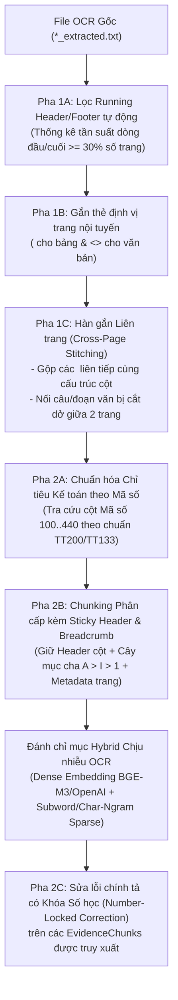

# T1.2: Đặc tả Bộ Dữ liệu & Thiết kế Pipeline Tiền xử lý – Chunking
**Dự án:** Multi-Agent Framework to Write Report from Documents  
**Tên bộ dữ liệu:** TiniX Vietnam OCR Annual Financial Statements (2015–2025)  
**Nguồn chính thức:** [tinixai/ocr_annual_financials (Hugging Face)](https://huggingface.co/datasets/tinixai/ocr_annual_financials)  
**Giai đoạn:** Phase 1 – Task T1.2 (Chuẩn bị dữ liệu tài liệu mẫu, RAG & Chunking)

---

## 1. Thông tin Tổng quan & Định danh Bộ Dữ liệu

### 1.1. Bảng Thông số Kỹ thuật (Dataset Metadata)

| Thuộc tính | Chi tiết |
| :--- | :--- |
| **Tên định danh (Dataset ID)** | `tinixai/ocr_annual_financials` |
| **Đơn vị phát hành** | [TiniX AI](https://tinix.ai/) |
| **Ngôn ngữ** | Tiếng Việt (`vi` – Đơn ngữ, đã lọc bỏ các báo cáo tiếng Anh) |
| **Miền dữ liệu (Domain)** | Báo cáo tài chính thường niên đã kiểm toán của doanh nghiệp niêm yết tại Việt Nam |
| **Quy mô toàn bộ** | **18.231** báo cáo tài chính từ **1.491** mã chứng khoán (Stock Tickers) |
| **Khoảng thời gian** | **2015 – 2025** (11 năm tài chính) |
| **Phân nhóm doanh nghiệp** | 4 nhóm ngành: **Corporate** (Đa số), **Bank** (VCB, BID, ACB, TCB, MBB...), **Securities** (SSI, VND, HCM, VCI...), **Insurance** (BVH, PVI, BMI, BIC...) |
| **Định dạng lưu trữ** | Bao gồm 2 nhánh song song: `pdf_files/` (PDF gốc, phần lớn là bản scan) và `ocr_results/` (File văn bản `.txt` chứa kết quả OCR kèm thẻ bảng HTML) |
| **Tổng dung lượng gốc** | ~194 GB (cả PDF + TXT); riêng nhánh văn bản `ocr_results/*.txt` chỉ chiếm tỷ trọng rất nhỏ (vài trăm MB) |
| **Độ chính xác công bố** | Đạt **~95%** tính riêng trên dữ liệu số và bảng biểu kế toán |
| **Giấy phép (License)** | `CC BY-NC 4.0` (Creative Commons Attribution Non-Commercial 4.0 International) |

### 1.2. Trích dẫn Khoa học Chuẩn (BibTeX)

```bibtex
@dataset{tinix_ocr_annual_financials,
  author    = {TiniX AI},
  title     = {TiniX Vietnam OCR Annual Financial Statements (2015--2025)},
  year      = {2026},
  publisher = {Hugging Face},
  url       = {https://huggingface.co/datasets/tinixai/ocr_annual_financials}
}
```

---

## 2. Cấu trúc Tổ chức & Phạm vi Khai thác trong Dự án

### 2.1. Cấu trúc Thư mục Phân cấp trên Kho Lưu trữ
Bộ dữ liệu được tổ chức theo cấu trúc cây 3 tầng: **`{Mã_Chứng_Khoán} / {Năm_Báo_Cáo} / {Tên_Báo_Cáo}`**:

```text
tinixai/ocr_annual_financials/
├── ocr_results/                                  <-- [PHẠM VI SỬ DỤNG CHÍNH CỦA PROJECT]
│   ├── A32/
│   │   ├── 2017/
│   │   │   └── A32_Baocaotaichinh_2017_Kiemtoan/
│   │   │       └── A32_Baocaotaichinh_2017_Kiemtoan_extracted.txt
│   │   └── 2018/
│   │       └── A32_Baocaotaichinh_2018_Kiemtoan/
│   │           └── A32_Baocaotaichinh_2018_Kiemtoan_extracted.txt
│   ├── FPT/
│   ├── HPG/
│   ├── HTG/
│   │   └── 2022/
│   │       └── HTG_Baocaotaichinh_2022_Kiemtoan_Hopnhat/
│   │           └── HTG_Baocaotaichinh_2022_Kiemtoan_Hopnhat_extracted.txt
│   └── VCB/
└── pdf_files/                                    <-- [BỎ QUA ĐỂ TỐI ƯU DUNG LƯỢNG]
    └── ... (194 GB PDF scan gốc)
```

### 2.2. Quyết định Phạm vi Khai thác (Scope Decision)
* **Chỉ sử dụng nhánh `ocr_results/*.txt`:** Do các file PDF gốc phần lớn là ảnh scan (có chữ ký tươi, con dấu đỏ của công ty kiểm toán) và chiếm tới ~194 GB, dự án chỉ tải có chọn lọc các file văn bản `*_extracted.txt` qua `huggingface_hub` (`snapshot_download` với `allow_patterns=["ocr_results/<TICKER>/**"]`).
* **Trích xuất Metadata tự động từ Đường dẫn File:**
  Từ đường dẫn `ocr_results/{ticker}/{year}/{folder_name}/{file_name}_extracted.txt`, hệ thống tự động sinh Metadata chuẩn cho từng tài liệu:
  - `doc_id`: `"{ticker}_{year}_{report_tag}"` (Ví dụ: `A32_2017_KT`, `HTG_2022_KTHN`)
  - `ticker`: Mã chứng khoán (`A32`, `FPT`, `HPG`, `VCB`...)
  - `fiscal_year`: Năm tài chính (`2017`, `2022`...)
  - `is_audited`: `True` nếu tên file chứa `Kiemtoan`
  - `report_scope`: `"Hopnhat"` (Báo cáo hợp nhất), `"Congtyme"` (Báo cáo công ty mẹ / riêng), hoặc `"Chung"`

---

## 3. Đặc tả Cấu trúc Nội dung Bên trong File OCR (`*_extracted.txt`)

Qua khảo sát trực tiếp nội dung thực tế (ví dụ: `A32_Baocaotaichinh_2017_Kiemtoan_extracted.txt`), mỗi file văn bản OCR có cấu trúc định dạng chuẩn gồm **3 đặc trưng kỹ thuật quan trọng**:

### 3.1. Dấu Phân Trang Tường Minh (`===== PAGE X =====`)
* Đầu mỗi trang được đánh dấu bằng chuỗi cố định:
  ```text
  ===== PAGE 1 =====
  ... nội dung trang 1 ...
  ===== PAGE 2 =====
  ... nội dung trang 2 ...
  ```
* **Ý nghĩa đối với dự án:** Cho phép xác định chính xác tuyệt đối số trang (`page_number`) của mọi con số và nhận định để gắn mã trích dẫn `[Doc_X, p.Y]` mà không gặp sai số lệch trang.

### 3.2. Bố cục 5 Phần Chuẩn của Báo cáo Tài chính
Một file `*_extracted.txt` hoàn chỉnh thường bao gồm tuần tự 5 phần:
1. **Trang bìa & Mục lục** (Trang 1–2): Tên công ty, đơn vị kiểm toán, kỳ kế toán và bảng mục lục phân trang.
2. **Báo cáo của Ban Điều hành / Ban Giám đốc** (Trang 2–4): Đặc điểm hoạt động, vốn điều lệ, ngành nghề kinh doanh, danh sách HĐQT/Ban Điều hành/Ban Kiểm soát, cam kết trách nhiệm.
3. **Báo cáo Kiểm toán Độc lập** (Trang 4–5): Ý kiến của kiểm toán viên (Chấp nhận toàn phần, Ngoại trừ...), căn cứ kiểm toán.
4. **Hệ thống 3 Bảng Báo cáo Tài chính Cốt lõi** (Trang 6–11):
   - *Bảng cân đối kế toán* (Tài sản ngắn hạn, Tài sản dài hạn, Nợ phải trả, Vốn chủ sở hữu).
   - *Báo cáo kết quả hoạt động kinh doanh* (Doanh thu, Giá vốn, Chi phí, Lợi nhuận trước/sau thuế, EPS).
   - *Báo cáo lưu chuyển tiền tệ* (Dòng tiền từ HĐKD, HĐ đầu tư, HĐ tài chính).
5. **Bản Thuyết minh Báo cáo Tài chính** (Từ trang 10–12 đến hết báo cáo, thường dài 20–40 trang): Giải trình chi tiết chính sách kế toán và bảng số liệu chi tiết cho từng khoản mục (đối chiếu qua cột `Thuyết minh`).

### 3.3. Định dạng Bảng Biểu HTML Nội tuyến (`<table><tr><td>`)
Các bảng số liệu kế toán được đóng gói dưới dạng HTML Table nằm xen kẽ với văn bản thuần:
```html
<table>
  <tr><td>Chi tiên(1)</td><td>Másố(2)</td><td>Thuyếtminh(3)</td><td>Số cuối năm(4)</td><td>Số đầu năm(5)</td></tr>
  <tr><td>A. TÀI SẢN NGẮN HẠN</td><td>100</td><td></td><td>374.126.689.644</td><td>343.278.704.305</td></tr>
  <tr><td>I. Tiền và các khoản tương đương tiền</td><td>110</td><td></td><td>145.658.316.125</td><td>139.773.542.715</td></tr>
  <tr><td>1. Tiền</td><td>111</td><td>1</td><td>50.952.816.125</td><td>10.068.042.715</td></tr>
</table>
```
* Hỗ trợ cả thuộc tính gộp ô như `<td rowspan="2">` hoặc `<td colspan="...">`.
* Số âm trong kế toán được biểu diễn đúng chuẩn bằng dấu ngoặc đơn: `(12.592.587.802)`.

---

## 4. Phân tích Chất lượng Dữ liệu & Hai Thách thức Kỹ thuật Cốt lõi

Mặc dù chất lượng nhận diện số liệu và cấu trúc bảng đạt ~95%, việc sử dụng trực tiếp văn bản OCR thô sẽ gặp **2 thách thức lớn** nếu dùng phương pháp chunking thông thường:

### 4.1. Thách thức 1: Nhiễu Chính tả OCR Tiếng Việt (~3–5% trên văn bản chữ)
Quan sát trực tiếp từ dữ liệu thực tế cho thấy các dạng lỗi OCR điển hình sau:
* **Lỗi dấu thanh & nguyên âm tiếng Việt có nét gần giống nhau trên bản scan:**
  - `"Chi tiên"` (đúng: `"Chỉ tiêu"`), `"tỉnh hình"` (đúng: `"tình hình"`), `"chuẩn mục"` (đúng: `"chuẩn mực"`), `"gian lập"` (đúng: `"gian lận"`), `"nhằm lẫn"` (đúng: `"nhầm lẫn"`), `"bào hộ"` (đúng: `"bảo hộ"`), `"Chù tịch"` (đúng: `"Chủ tịch"`).
* **Lỗi dính chữ (Missing Whitespace) ở tiêu đề cột hẹp:**
  - `"Másố(2)"` (đúng: `"Mã số (2)"`), `"Thuyếtminh(3)"` (đúng: `"Thuyết minh (3)"`).
* **Tại sao không thể xử lý bằng Regex tìm-thay-thế thủ công?**
  Vì lỗi OCR phát sinh ngẫu nhiên theo chất lượng giấy scan và phông chữ của từng công ty trong suốt 10 năm (2015–2025). Một bộ quy tắc Regex viết tay sẽ luôn bỏ sót lỗi mới. Ngược lại, nếu dùng mô hình sinh văn bản sửa lỗi tự do mà không có cơ chế khóa, mô hình có nguy cơ làm thay đổi số liệu kế toán.

### 4.2. Thách thức 2: Các Thành phần bị Ngắt trang (`Cross-Page Split Elements`)
Khi một bảng kế toán dài hoặc một đoạn văn thuyết minh kéo dài qua ranh giới `===== PAGE k =====` sang `===== PAGE k+1 =====`, cấu trúc dữ liệu bị đứt gãy do **3 thành phần chèn giữa**:
1. **Chân trang (Page Footer):** Số trang in của báo cáo gốc nằm lẻ loi ở dòng cuối trang $k$ (ví dụ: `4`).
2. **Dấu ngắt trang:** `===== PAGE 7 =====`.
3. **Tiêu đề đầu trang lặp lại (Running Header):** Đầu trang $k+1$ lặp lại 4–6 dòng thông tin công ty, tên báo cáo và lặp lại cả dòng tiêu đề cột của bảng (`Chỉ tiêu | Mã số | Thuyết minh...`).

**Hệ quả nếu không xử lý:**
- Đoạn văn ở cuối trang 3 (`"7. Hội đồng Quản trị và Ban điều hành"`) bị tách rời khỏi phần tiếp theo ở đầu trang 4 (`"Các thành viên Ban Kiểm soát"`).
- Ở trang 7 của *Bảng cân đối kế toán*, bảng bắt đầu ngay bằng dòng `"II. Tài sản cố định"` mà bị mất tiêu đề mục cha cấp 1 là `"B. TÀI SẢN DÀI HẠN"` (vốn nằm ở dòng cuối của trang 6).

---

## 5. Thiết kế Pipeline Tiền xử lý & Smart Chunking Chuyên biệt

Để giải quyết triệt để 2 thách thức trên, module Ingestion của dự án được thiết kế theo kiến trúc **2 pha xử lý tự động**:



### 5.1. Giải thuật Xử lý Thành phần Ngắt trang (Cross-Page Reconstruction)

1. **Bước 1 – Tự động loại bỏ Running Header/Footer bằng Thống kê Nội bộ File (`Dynamic Header/Footer Profiling`):**
   - Duyệt qua tất cả $P$ trang trong file, trích xuất 5 dòng đầu tiên và 2 dòng cuối cùng của mỗi trang.
   - Chuẩn hóa khoảng trắng/dấu và tính tần suất xuất hiện. Mọi dòng xuất hiện ở biên trang với tần suất $\ge 30\%$ tổng số trang (hoặc dòng cuối chỉ chứa số nguyên dương biểu thị số trang in) được tự động nhận diện là nhiễu đầu/cuối trang và loại bỏ, thay thế bằng thẻ đánh dấu vị trí trang `<PAGE_BREAK page="k">`.
2. **Bước 2 – Hợp nhất Bảng HTML Liên trang (`Cross-Page Table Merging`):**
   - Trước khi xóa ranh giới trang, mỗi dòng `<tr>` trong bảng ở trang $k$ được gắn thuộc tính `<tr data-page="k">`.
   - Nếu cuối trang $k$ kết thúc bằng `</table>` và đầu trang $k+1$ (sau khi đã bỏ Running Header và tên bảng lặp lại) bắt đầu bằng `<table>` có cùng số lượng cột:
     - Kiểm tra 1–2 dòng `<tr>` đầu tiên của bảng ở trang $k+1$; nếu chứa từ khóa tiêu đề cột hoặc ký hiệu đánh số cột `(1), (2), (3), (4), (5)` thì loại bỏ dòng tiêu đề lặp đó.
     - Ghép nối toàn bộ các dòng `<tr data-page="k+1">` vào bảng đang mở của trang $k$.
3. **Bước 3 – Hàn gắn Đoạn văn Liên trang (`Cross-Page Paragraph Stitching`):**
   - Nếu dòng văn bản cuối trang $k$ không kết thúc bằng dấu kết câu (`.`, `;`, `:`) hoặc dòng đầu trang $k+1$ bắt đầu bằng chữ thường / ký hiệu danh sách cùng cấp (`-`, `+`, `a)`, `b)`), bộ Parser nối liền hai đoạn văn qua marker `<<PAGE_k+1>>`.
4. **Bước 4 – Chunking Phân cấp có Kế thừa Tiêu đề (`Sticky Header & Breadcrumb Stack`):**
   - Duyệt qua bảng đã gộp với một ngăn xếp lưu trạng thái mục cha theo cấp bậc kế toán:
     - `Level 1`: Chữ cái in hoa (`A.`, `B.`) — VD: `B. TÀI SẢN DÀI HẠN`
     - `Level 2`: Số La Mã (`I.`, `II.`, `III.`) — VD: `II. Tài sản cố định`
     - `Level 3`: Số Ả Rập (`1.`, `2.`, `3.`) — VD: `1. Tài sản cố định hữu hình`
   - Khi chia một bảng lớn thành nhiều chunk (mỗi chunk khoảng `600–900 tokens`), mỗi chunk đều được tự động đính kèm:
     1. **Context Banner:** `[Doc: A32_2017 | Trang: 6-7 | Đường dẫn: BẢNG CÂN ĐỐI KẾ TOÁN > B. TÀI SẢN DÀI HẠN > II. Tài sản cố định]`
     2. **Sticky Table Header:** Dòng tiêu đề cột chuẩn (`| Chỉ tiêu | Mã số | Thuyết minh | Số cuối năm | Số đầu năm |`).
     3. **Page Range chính xác:** Tính từ giá trị `min(data-page)` đến `max(data-page)` của các dòng `<tr>` có mặt trong chunk đó.

### 5.2. Giải thuật Xử lý Lỗi Chính tả OCR Hệ thống (3 Lớp Bảo vệ)

1. **Lớp 1 – Chuẩn hóa Chỉ tiêu Bảng theo Từ điển Mã số Kế toán Chuẩn (`Accounting Code Canonicalization`):**
   - Trong các bảng kế toán Việt Nam, cột **Mã số** (`100`, `110`, `111`, `112`, `120`... `440`) là định danh chuẩn theo quy định của Bộ Tài chính.
   - Khi parse dòng `<tr>`, nếu cột thứ 2 là một Mã số hợp lệ, hệ thống tự động đối chiếu với từ điển danh mục chỉ tiêu chuẩn để khôi phục tên chỉ tiêu chính xác 100% (ví dụ Mã `110` $\rightarrow$ `"I. Tiền và các khoản tương đương tiền"`), đồng thời chuẩn hóa luôn dòng header cột (`Chỉ tiêu | Mã số | Thuyết minh | Số cuối năm | Số đầu năm`).
2. **Lớp 2 – Đánh chỉ mục Chịu nhiễu OCR (`OCR-Resilient Hybrid Indexing`):**
   - Không phụ thuộc vào bộ tách từ tiếng Việt truyền thống (dễ bị gãy khi chữ bị dính hoặc sai dấu).
   - Kết hợp **Dense Subword Embedding (`BAAI/bge-m3` hoặc `text-embedding-3-small`)** với **Sparse Subword / Character N-gram Vector** và **Metadata Filter (`ticker`, `fiscal_year`)**. Nhờ cơ chế Subword/Char N-gram, truy vấn `"tình hình tài chính"` vẫn khớp chính xác với đoạn văn bị lỗi OCR `"tỉnh hình tài chính"`.
3. **Lớp 3 – Sửa lỗi Ngữ cảnh có Khóa Số học (`Number-Locked Contextual Correction`):**
   - Thực hiện bằng mô hình Seq2Seq tiếng Việt [`bmd1905/vietnamese-correction-v2`](https://huggingface.co/bmd1905/vietnamese-correction-v2) hoặc LLM nhẹ (`gpt-4o-mini` / `Qwen2.5`) trên các `EvidenceChunk` được truy xuất, đi kèm **Guardrail Bất biến Số học**:
     - **Masking:** Thay thế mọi chuỗi số (`\d+(?:[.,]\d+)*`), ngày tháng, phần trăm bằng token khóa `<<NUM_i>>` trước khi sửa lỗi.
     - **Levenshtein Edit-Distance Filter:** Chỉ chấp nhận các từ được sửa có khoảng cách chỉnh sửa nhỏ (sửa dấu thanh, tách 2 từ bị dính khoảng trắng) và từ chối mọi sự thay đổi làm thêm/bớt mệnh đề.
     - **Unmasking & Verification:** Khôi phục lại `<<NUM_i>>` và kiểm tra mảng số trước/sau phải trùng khớp 100%.

---

## 6. Thiết kế Tập Dữ liệu Mẫu Chuẩn (Golden Subset) cho Dự án

Thay vì tải toàn bộ 18.231 báo cáo, dự án định nghĩa một **Tập dữ liệu mẫu chuẩn (Golden Subset)** gồm **~25–30 báo cáo** (`ocr_results/*.txt`) trải đều các nhóm ngành trong giai đoạn **2020–2024** để phục vụ phát triển, kiểm thử và demo 3 kịch bản báo cáo thực tế:

| Kịch bản Báo cáo Mục tiêu | Mã Chứng khoán Chọn lọc | Giai đoạn | Mục đích Kiểm thử Hệ thống Multi-Agent |
| :--- | :--- | :---: | :--- |
| **1. Báo cáo Phân tích Chuyên sâu 1 Doanh nghiệp qua Nhiều Năm** (*Longitudinal Financial Analysis*) | **`FPT`** (Công nghệ), **`HPG`** (Sản xuất công nghiệp), **`A32`** (Da giày - Dệt may) | 2020 – 2024 | Kiểm thử khả năng tổng hợp chuỗi thời gian (doanh thu, lợi nhuận, cơ cấu nợ qua các năm) và gắn trích dẫn phân biệt rõ `[Doc_FPT_2022, p.6]` với `[Doc_FPT_2023, p.6]`. |
| **2. Báo cáo So sánh Ngang ngành** (*Sector Peer Comparison Report*) | **`VCB`, `TCB`, `MBB`** (Nhóm Ngân hàng) hoặc **`SSI`, `VND`** (Nhóm Chứng khoán) | 2022 – 2024 | Kiểm thử khả năng chạy song song (`Send` API trên LangGraph) để đối chiếu các chỉ số tài chính giữa nhiều doanh nghiệp cùng ngành mà không bị lẫn số liệu. |
| **3. Báo cáo Đánh giá Rủi ro Kiểm toán & Thuyết minh Chuyên sâu** (*Audit & Footnote Deep-Dive*) | **`HTG`, `VNM`, `MWG`** | 2021 – 2024 | Kiểm thử khả năng liên kết chéo từ bảng Cân đối kế toán (cột `Thuyết minh`) xuống phần chi tiết trong *Bản thuyết minh báo cáo tài chính* ở các trang sau. |
