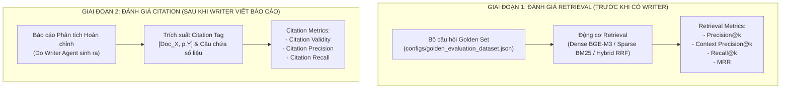
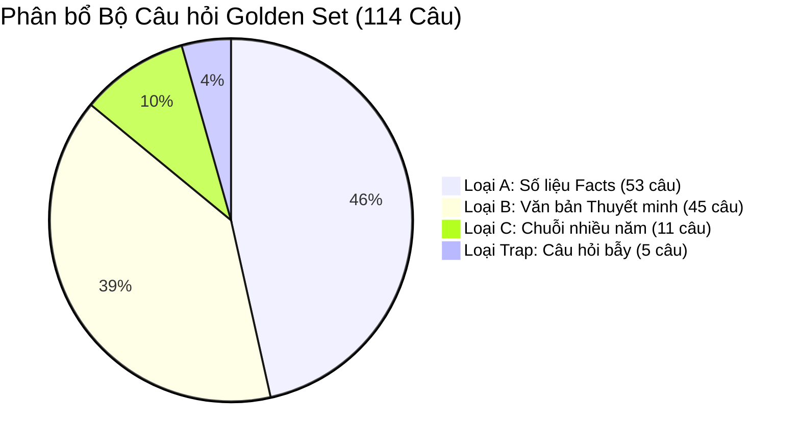

# Khung Đánh giá Hiệu năng Retrieval & Độ Chính xác Trích dẫn (Retrieval & Citation Evaluation Framework)

> Cập nhật 09/11/2026: snapshot đang dùng có 32.175 chunk từ 141 tài liệu; các số 30.282 phía dưới là bối cảnh của benchmark v1. Bộ nhãn DEV đã được ánh xạ cơ học sang chunk ID mới; tập TEST vẫn niêm phong. Xem [kiểm tra tác động](notes-classification-audit.md).

> **Tài liệu Đặc tả Kỹ thuật & Hướng dẫn Đánh giá Độc lập (Evaluation Protocol)**  
> **Dự án:** Multi-agent Financial Report Writer  
> **Phiên bản:** `v1.0` | **Ngày lập:** 30/10/2026  
> **Phạm vi kiểm định:** 141 Báo cáo tài chính (35 doanh nghiệp niêm yết)  

---

## Mục lục
1. [Tổng quan Kiến trúc Đánh giá Hai Giai đoạn](#1-tổng-quan-kiến-trúc-đánh-giá-hai-giai-đoạn)
2. [Đặc tả Công thức Toán học các Chỉ số](#2-đặc-tả-công-thức-toán-học-các-chỉ-số)
   - [2.1. Chỉ số Đánh giá Retrieval (Giai đoạn Tiền-Writer)](#21-chỉ-số-đánh-giá-retrieval-giai-đoạn-tiền-writer)
   - [2.2. Chỉ số Đánh giá Citation (Giai đoạn Hậu-Writer)](#22-chỉ-số-đánh-giá-citation-giai-đoạn-hậu-writer)
3. [Thiết kế Bộ Câu hỏi Kiểm chuẩn (Golden Evaluation Set)](#3-thiết-kế-bộ-câu-hỏi-kiểm-chuẩn-golden-evaluation-set)
   - [3.1. Phân loại 4 Nhóm Câu hỏi (Loại A, B, C và Bẫy)](#31-phân-loại-4-nhóm-câu-hỏi-loại-a-b-c-và-bẫy)
   - [3.2. Phân chia Cố định Tập Dev và Test (Company-level Isolation)](#32-phân-chia-cố-định-tập-dev-và-test-company-level-isolation)
4. [Quy tắc Gán nhãn "Liên quan" (Ground Truth Integrity)](#4-quy-tắc-gán-nhãn-liên-quan-ground-truth-integrity)
5. [Thiết kế Ma trận Đối đầu 4 Cấu hình (Retrieval Configurations)](#5-thiết-kế-ma-trận-đối-đầu-4-cấu-hình-retrieval-configurations)
6. [Đặc tả Mã nguồn Module & Hướng dẫn Vận hành CLI](#6-đặc-tả-mã-nguồn-module--hướng-dẫn-vận-hành-cli)
7. [Các Cạm bẫy Cần Tránh khi Đánh giá (Evaluation Pitfalls)](#7-các-cạm-bẫy-cần-tránh-khi-đánh-giá-evaluation-pitfalls)

---

## 1. Tổng quan Kiến trúc Đánh giá Hai Giai đoạn

Để đảm bảo hệ thống Multi-agent không sinh ra số liệu ảo giác (hallucination) và luôn trích dẫn nguồn có thể kiểm chứng được, quy trình đánh giá được chia làm hai giai đoạn độc lập:



* **Giai đoạn 1 (Retrieval Evaluation):** Kiểm tra xem động cơ tìm kiếm có đưa đúng các chunk bằng chứng lên đầu hay không. Giai đoạn này chạy độc lập với LLM, hoàn toàn bằng code và số liệu toán học.
* **Giai đoạn 2 (Citation Evaluation):** Kiểm tra xem khi Writer Agent viết bài, các trích dẫn `[Doc_X, p.Y]` có trỏ đúng tài liệu, đúng trang thực tế và đoạn văn trích dẫn có thực sự chứa con số được khẳng định hay không.

---

## 2. Đặc tả Công thức Toán học các Chỉ số

### 2.1. Chỉ số Đánh giá Retrieval (Giai đoạn Tiền-Writer)

Gọi $G$ là tập hợp các mã chunk đúng (Ground Truth Chunk IDs) của một câu hỏi, và $R_k = [c_1, c_2, \dots, c_k]$ là danh sách $k$ chunk được hệ thống trả về theo thứ tự xếp hạng từ cao xuống thấp.

#### 1. Precision@k
Đo lường tỷ lệ các chunk thực sự liên quan nằm trong top-$k$:
$$\text{Precision@}k = \frac{\sum_{i=1}^k \mathbb{I}(c_i \in G)}{k}$$

#### 2. Context Precision@k
Đo lường mức độ ưu tiên: Các chunk liên quan có được đẩy lên các vị trí cao nhất (hạng 1, 2, 3) hay bị trôi xuống dưới.  
Công thức tính bằng giá trị trung bình của Precision tại các vị trí $i$ có chunk liên quan, chia cho tổng số chunk liên quan tìm được trong top-$k$:
$$\text{Context Precision@}k = \frac{1}{\sum_{i=1}^k \mathbb{I}(c_i \in G)} \sum_{i=1}^k \left( \text{Precision@}i \times \mathbb{I}(c_i \in G) \right)$$
*(Nếu không có chunk liên quan nào trong top-$k$, giá trị bằng $0.0$).*

> [!NOTE]
> **Context Precision** và **Recall** bắt buộc phải đọc cùng nhau: Nếu Context Precision đạt $1.0$ nhưng Recall chỉ đạt $0.2$, nghĩa là hệ thống xếp chunk đúng lên đầu nhưng đã bỏ sót phần lớn các bằng chứng cần thiết khác của bảng BCTC.

#### 3. Recall@k
Đo lường độ bao phủ: Hệ thống có tìm đủ tất cả các chunk bằng chứng cần thiết hay không:
$$\text{Recall@}k = \frac{|R_k \cap G|}{|G|}$$

#### 4. MRR (Mean Reciprocal Rank)
Nghịch đảo của thứ hạng xuất hiện của chunk đúng đầu tiên:
$$\text{MRR} = \begin{cases} \frac{1}{\min \{i \mid c_i \in G\}}, & \text{nếu } \exists c_i \in G \\ 0, & \text{ngược lại} \end{cases}$$

---

### 2.2. Chỉ số Đánh giá Citation (Giai đoạn Hậu-Writer)

Sau khi Writer Agent sinh ra báo cáo markdown, module [`CitationEvaluator`](../../src/evaluation/metrics.py) sẽ quét toàn văn báo cáo:

#### 1. Citation Validity (Tính Hợp lệ Tuyệt đối)
Kiểm tra xem mã tài liệu `Doc_X` có tồn tại trong danh mục 141 file hay không, và số trang `p.Y` có thực sự nằm trong phạm vi trang vật lý của tài liệu đó không:
$$\text{Citation Validity} = \frac{\text{Số trích dẫn có Doc\_X tồn tại và trang Y hợp lệ}}{\text{Tổng số trích dẫn trong bài viết}}$$
*(Mục tiêu hệ thống: Phải đạt **$100\%$**, vì đây là điều kiện kiểm tra code thuần túy).*

#### 2. Citation Precision (Độ Xác thực của Bằng chứng)
Trong các trích dẫn mà báo cáo đưa ra cho một câu khẳng định, có bao nhiêu trích dẫn thật sự chứa con số hoặc sự kiện kinh tế được nêu:
$$\text{Citation Precision} = \frac{\text{Số trích dẫn mà nội dung chunk chứa con số trong câu}}{\text{Tổng số trích dẫn được đưa ra}}$$

#### 3. Citation Recall (Độ Bao phủ Trích dẫn Số liệu)
Trong toàn bộ các câu văn có khẳng định về số liệu kế toán (ví dụ: `60.091 tỷ`, `12,5%`), bao nhiêu câu văn có gắn thẻ trích dẫn nguồn `[Doc_X, p.Y]`:
$$\text{Citation Recall} = \frac{\text{Số câu khẳng định số liệu có trích dẫn}}{\text{Tổng số câu khẳng định số liệu trong báo cáo}}$$

---

## 3. Thiết kế Bộ Câu hỏi Kiểm chuẩn (Golden Evaluation Set)

Bộ câu hỏi kiểm chuẩn gồm **114 câu hỏi** được lưu trữ bất biến tại [`configs/golden_evaluation_dataset.json`](../../configs/golden_evaluation_dataset.json).



### 3.1. Phân loại 4 Nhóm Câu hỏi
1. **Loại A: Câu hỏi Số liệu từ Facts (53 câu - 46,5%):**
   - Sinh tự động từ bảng `facts` sạch đã qua kiểm định đẳng thức kế toán.
   - Tập trung vào các chỉ tiêu trọng yếu: Doanh thu thuần (mã 10), Lợi nhuận gộp (mã 20), Chi phí lãi vay (mã 23), Lợi nhuận trước thuế (mã 50), Lợi nhuận sau thuế (mã 60), Tiền và tương đương tiền (mã 110), Hàng tồn kho (mã 140), Tổng tài sản (mã 270), Nợ phải trả (mã 300), Vay nợ tài chính (mã 320, 338), Vốn chủ sở hữu (mã 400).
   - Chunk đúng: Là chunk bảng chứa dòng đó (được ánh xạ chính xác qua `physical_page` và mã số/nhãn trong text).
2. **Loại B: Câu hỏi Văn bản Thuyết minh & Báo cáo (45 câu - 39,5%):**
   - Sinh từ các chunk văn bản dài $> 300$ ký tự thuộc các phần: Thuyết minh chính sách kế toán, Ý kiến kiểm toán viên độc lập, Trách nhiệm Ban Giám đốc, Giao dịch bên liên quan, Quản trị rủi ro thanh khoản & tỷ giá.
   - Được diễn đạt lại một cách tự nhiên (paraphrased), nêu rõ mã cổ phiếu và năm, không sao chép nguyên văn để tránh việc BM25 thắng giả tạo.
3. **Loại C: Câu hỏi Chuỗi Thời gian Nhiều năm (11 câu - 9,6%):**
   - Khảo sát sự thay đổi của một chỉ tiêu (Doanh thu, Lợi nhuận) qua chuỗi 3–4 năm liên tiếp (ví dụ: giai đoạn 2022–2024 của DCM, HAH, GVR).
   - `gold_chunk_ids`: Chứa tập hợp chunk đúng của từng năm tương ứng. Kiểm tra khả năng kết hợp bằng chứng của Planner và Retriever.
4. **Loại Trap: Câu hỏi Bẫy Out-of-Domain (5 câu - 4,4%):**
   - Hỏi về các công ty không nằm trong corpus (FOX, DPM, VCB) hoặc hỏi sự kiện hoàn toàn không tồn tại (thương vụ sáp nhập tại Mỹ của QNS).
   - Kỳ vọng hệ thống: `gold_chunk_ids: []`. Hệ thống phải báo không tìm thấy thay vì cố gắng nhặt một chunk bất kỳ.

---

### 3.2. Phân chia Cố định Tập Dev và Test (Company-level Isolation)

Tuân thủ nghiêm ngặt nguyên tắc cô lập theo cấp độ công ty từ [`configs/eval_dataset_split.json`](../../configs/eval_dataset_split.json):
* **Tập DEV (25 công ty):** **79 câu hỏi (69,3%)** — Dùng để chạy thử nghiệm, tinh chỉnh tham số trọng số RRF, threshold reranker.
* **Tập TEST (10 công ty):** **35 câu hỏi (30,7%)** — Được niêm phong (held-out), **chỉ chạy đúng 1 lần duy nhất** khi kết thúc dự án để báo cáo số liệu khách quan.

---

## 4. Quy tắc Gán nhãn "Liên quan" (Ground Truth Integrity)

Để chỉ số Precision và Recall phản ánh đúng năng lực hệ thống, các quy tắc gán nhãn sau được thực thi tự động:
1. **Liên quan theo Chunk có Bằng chứng:** Một chunk chỉ được đưa vào `gold_chunk_ids` khi nó thực sự chứa dòng số liệu hoặc câu văn trả lời cho câu hỏi. Chunk cùng section nhưng ở trang khác không có bằng chứng bị tính là sai.
2. **Bảo tồn Chồng lấn (Overlap):** Khi 2 chunk liền nhau cùng chứa đoạn văn bằng chứng (do bước chunking có overlap 1 đoạn), thuật toán đưa **cả hai chunk vào `gold_chunk_ids`**, tránh việc người dùng bị phạt Precision oan uổng khi retriever bốc trúng một trong hai.
3. **Bảo tồn Sub-chunks (`_p1`, `_p2`):** Nếu một bảng dài bị phân rã thành `chunk_0042_p1` và `chunk_0042_p2`, cả hai đều được công nhận là chunk hợp lệ.
4. **Văn bản Mẫu Lặp lại qua các Năm:** Gắn kèm `content_hash` để giám sát xem retriever có lấy nhầm chunk có nội dung giống hệt nhưng sai năm hay không.

---

## 5. Thiết kế Ma trận Đối đầu 4 Cấu hình (Retrieval Configurations)

Hệ thống tiến hành so sánh đối đầu 4 cấu hình trên cùng một tập câu hỏi:

| STT | Tên Cấu hình | Mô tả Kỹ thuật | Mục đích Thực nghiệm |
| :---: | :--- | :--- | :--- |
| **1** | **`dense_only`** | Tìm kiếm vector ngữ nghĩa đơn thuần trên Qdrant bằng mô hình `bge-m3` + Bộ lọc cứng (Ticker, Year). | Thiết lập đường cơ sở (Baseline) ngữ nghĩa. |
| **2** | **`sparse_only`** | Tìm kiếm từ khóa bằng bộ Okapi BM25 tiếng Việt tài chính + Bộ lọc cứng (Ticker, Year). | Thiết lập đường cơ sở (Baseline) từ khóa & số liệu. |
| **3** | **`hybrid_filtered`** | **Cấu hình Chính:** Hợp nhất thứ hạng RRF giữa Dense và Sparse + Bộ lọc cứng Metadata. | Đánh giá năng lực của kiến trúc cốt lõi đề xuất. |
| **4** | **`hybrid_no_filter`** | Hợp nhất RRF nhưng **tắt toàn bộ bộ lọc cứng** (để mô hình tự mò giữa 30.282 chunks). | **Đo lường mức độ nhiễu và chứng minh bộ lọc siêu dữ liệu là bắt buộc.** |

---

## 6. Đặc tả Mã nguồn Module & Hướng dẫn Vận hành CLI

Tất cả các thành phần mã nguồn đã được đóng gói hoàn chỉnh trong thư mục [`src/evaluation/`](../../src/evaluation):

| File Mã nguồn | Chức năng chi tiết |
| :--- | :--- |
| [`src/evaluation/metrics.py`](../../src/evaluation/metrics.py) | Cung cấp các hàm toán học: `precision_at_k`, `context_precision_at_k`, `recall_at_k`, `mrr`, và class `CitationEvaluator`. |
| [`src/evaluation/bm25_searcher.py`](../../src/evaluation/bm25_searcher.py) | Bộ máy tìm kiếm Okapi BM25 thuần Python, bảo toàn số kế toán có dấu chấm, ngày tháng, mã số biểu mẫu. |
| [`src/evaluation/generate_golden_dataset.py`](../../src/evaluation/generate_golden_dataset.py) | Kịch bản tự động sinh 114 câu hỏi kiểm chuẩn (DEV/TEST, Loại A/B/C/Trap). |
| [`src/evaluation/retrieval_benchmark.py`](../../src/evaluation/retrieval_benchmark.py) | Bộ điều phối chạy benchmark tự động qua 4 cấu hình và xuất file JSON báo cáo. |

### Lệnh chạy Benchmark Đánh giá Retrieval:

#### 1. Chạy đánh giá trên tập DEV (Chế độ Local mặc định):
```powershell
.\.venv\Scripts\python.exe src/evaluation/retrieval_benchmark.py
```
*Lệnh này sẽ chạy kiểm thử trên 79 câu hỏi tập DEV, in ra bảng điểm chi tiết cho cả 4 cấu hình và phân rã theo Loại câu hỏi (A, B, C, Trap).*

#### 2. Chạy đánh giá trên Qdrant Cloud (nếu muốn):
```powershell
.\.venv\Scripts\python.exe src/evaluation/retrieval_benchmark.py --cloud
```

#### 3. Chạy đánh giá cuối cùng trên toàn bộ (bao gồm tập TEST):
```powershell
.\.venv\Scripts\python.exe src/evaluation/retrieval_benchmark.py --eval-test
```

---

## 7. Các Cạm bẫy Cần Tránh khi Đánh giá (Evaluation Pitfalls)

1. **Không đặt ngưỡng kỳ vọng trước khi có Baseline:** Hãy luôn chạy cấu hình `dense_only` và `sparse_only` trước để ghi nhận con số thực tế, sau đó mới so sánh mức độ cải thiện của `hybrid_filtered`.
2. **Tuyệt đối không tinh chỉnh tham số trên tập TEST:** Mọi thử nghiệm về tham số $k$, trọng số RRF, cutoff chỉ được thực hiện trên 79 câu hỏi tập DEV.
3. **Tránh bẫy "BM25 thắng giả tạo":** Khi đặt câu hỏi Loại B, phải diễn đạt bằng từ đồng nghĩa thay vì copy nguyên văn tiêu đề chunk.
4. **Không bỏ qua cấu hình `hybrid_no_filter`:** Đây là cấu hình quan trọng nhất trong báo cáo để chứng minh rằng: Nếu không có bộ lọc cứng Ticker và Year từ Planner, retrieval trên báo cáo tài chính sẽ bị ô nhiễm bởi các đoạn văn mẫu giống nhau giữa các công ty.
