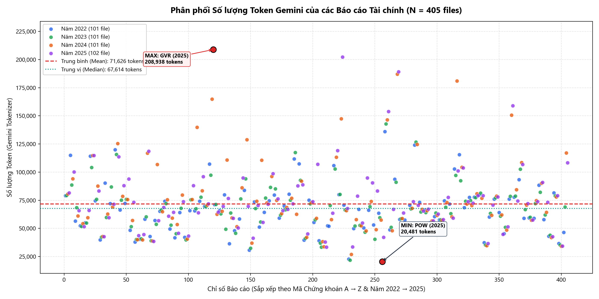
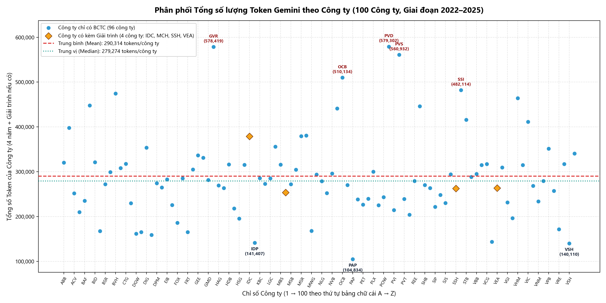

# Báo cáo Thống kê & Phân tích Token theo Chuẩn Google Gemini — Bộ Dữ liệu BCTC Top 100 Doanh nghiệp Niêm yết Việt Nam (2022–2025)

**Dự án:** Multi-Agent Framework to Write Report from Documents  
**Bộ dữ liệu khảo sát:** `data/raw_docs/top_100` (100 mã chứng khoán, giai đoạn 2022–2025, 410 file `.txt`)  
**Mô hình Tokenizer chuẩn:** `gemini-2.5-flash` (`gemma3_cleaned_262144_v2.spiece.model` — Google Gen AI SDK `google-genai`)  
**Tài liệu tham chiếu:** [Tìm hiểu và tính mã thông báo - Gemini API | Google AI for Developers](https://ai.google.dev/gemini-api/docs/tokens?hl=vi)  
**Script thực thi:** [src/utils/count_gemini_tokens.py](../../src/utils/count_gemini_tokens.py)

---

## 1. Tổng quan Phương pháp Đo lường Token

Dựa trên tài liệu chính thức của **Google AI for Developers**, các mô hình thuộc họ Gemini xử lý văn bản đầu vào thông qua bộ tách từ **SentencePiece** (subword tokenization):
* **Quy tắc ước lượng tham khảo (cho văn bản tiếng Anh):** `1 token ≈ 4 ký tự` (hoặc `100 tokens ≈ 60–80 từ`).
* **Đo lường chính xác bằng SDK `google-genai`:**
  - Sử dụng `LocalTokenizer(model_name="gemini-2.5-flash").count_tokens(text)` để tách từ trực tiếp bằng mô hình SentencePiece chuẩn của Gemini (`gemma3_cleaned_262144_v2.spiece.model`), cho kết quả khớp **100%** với hàm `client.models.count_tokens()` trên máy chủ Gemini API.
* **Đặc thù trên văn bản BCTC tiếng Việt kèm bảng HTML (`<table><tr><td>`):**
  - Qua đo đạc thực nghiệm trên toàn bộ **77,738,563 ký tự** của 410 file trong `top_100`, tổng số token Gemini thực tế là **29,031,422 tokens**.
  - Tỷ lệ quy đổi thực tế đối với BCTC tiếng Việt + HTML Table là:
    $$\text{1 token Gemini} \approx \mathbf{2.68\text{ ký tự}} \quad (\text{cao hơn }\sim 49.4\%\text{ so với ước lượng } 4\text{ ký tự/token của tiếng Anh})$$
  - Nguyên nhân: Tiếng Việt có hệ thống dấu thanh/nguyên âm UTF-8 đa byte và cấu trúc bảng kế toán chứa mật độ cao các cặp thẻ HTML (`<tr>`, `<td>`, `</td>`) cùng chuỗi số kế toán ngăn cách bằng dấu chấm (`145.658.316.125`).

---

## 2. Kết quả Tổng hợp Cốt lõi

### 2.1. Bảng Chỉ số Tổng quan Toàn Tập Dữ liệu

| Chỉ tiêu Thống kê | Giá trị Chính xác (Gemini Tokens) | Ghi chú / Chi tiết Đối chiếu |
| :--- | ---: | :--- |
| **Tổng số lượng file văn bản (`.txt`)** | **410 files** | Gồm **405** file BCTC và **5** file `giai_trinh_lien_quan.txt` |
| **Tổng số lượng ký tự toàn tập dữ liệu** | **77,738,563 ký tự** | Trung bình **191,892 ký tự / file BCTC** |
| **Tổng số token trên toàn bộ dữ liệu (410 files)** | **29,031,422 tokens** | Quy tắc ước lượng `len/4` chỉ ra `19,434,641` tokens (thấp hơn thực tế 33.1%) |
| ├── *Tổng số token của 405 file BCTC* | **29,008,706 tokens** | Chiếm **99.92%** tổng dung lượng token toàn bộ dữ liệu |
| └── *Tổng số token của 5 file giải trình đi kèm* | **22,716 tokens** | Chiếm **0.08%** (`IDC/2024`, `MCH/2024`, `SSH/2024`, `SSH/2025`, `VEA/2025`) |
| **Số token trung bình của 1 báo cáo (405 file BCTC)** | **71,626.43 tokens / file** | Độ lệch chuẩn ($\sigma$): `27,613.38` tokens |
| **Số token trung bình của 1 báo cáo hoàn chỉnh (404 BCTC)** | **71,803.73 tokens / báo cáo** | Khi gộp 2 phần `p1` + `p2` của `POW/2025` thành 1 báo cáo năm 2025 |
| **Số token trung bình của 1 công ty (100 công ty)** | **290,314.22 tokens / công ty** | Tính đủ báo cáo 4 năm (2022–2025) + giải trình liên quan nếu có ($\sigma = 94,036.30$) |
| **Số token trung bình của 1 công ty (Chuẩn 4 báo cáo chính)** | **288,791.49 tokens / công ty** | Khi loại trừ 4 bản `Riengle` phụ đi kèm cùng năm với bản `Hopnhat` tại `NTP`, `NVB` |
| **Báo cáo tốn NHIỀU token nhất (Max)** | **208,938 tokens** | `GVR/2025/GVR_2025_BCTC_Kiemtoan_Hopnhat_extracted.txt` (`595,481` ký tự) |
| **Báo cáo tốn ÍT token nhất (Min - Xét theo file đơn lẻ)** | **20,481 tokens** | `POW/2025/POW_2025_BCTC_Kiemtoan_Hopnhat_p1_extracted.txt` (`57,681` ký tự) |
| **Báo cáo tốn ÍT token nhất (Min - Xét báo cáo nguyên vẹn)** | **21,695 tokens** | `PAP/2023/PAP_2023_BCTC_Kiemtoan_extracted.txt` (`58,804` ký tự) |
| **Công ty tốn NHIỀU token nhất (Tổng 4 năm)** | **579,302 tokens** | **`PVD`** (Tổng Công ty Cổ phần Khoan và Dịch vụ Khoan Dầu khí) |
| **Công ty tốn ÍT token nhất (Tổng 4 năm)** | **104,834 tokens** | **`PAP`** (Công ty Cổ phần Dầu khí Đầu tư Khai thác Cảng Phước An) |

---

### 2.2. Phân vị Thống kê (Percentiles Distribution)

| Phân vị (Percentile) | Cấp Báo cáo BCTC (`N = 405 files`) | Cấp Công ty 4 Năm (`N = 100 công ty`) | Ý nghĩa Phân tích Dung lượng Ngữ cảnh |
| :--- | ---: | ---: | :--- |
| **Min (`P0`)** | `20,481` tokens | `104,834` tokens | Báo cáo / Công ty gọn nhẹ nhất |
| **Phân vị thứ 10 (`P10`)** | `41,729` tokens | `171,121` tokens | 10% báo cáo có độ dài dưới `~42k` tokens |
| **Tứ phân vị thứ nhất (`P25` - Q1)** | `55,017` tokens | `233,468` tokens | 25% báo cáo nhỏ hơn `55k` tokens |
| **Trung vị (`P50` - Median)** | **`67,614` tokens** | **`279,274` tokens** | Điểm giữa của phân phối (ít chịu ảnh hưởng bởi cực trị) |
| **Trung bình cộng (`Mean`)** | **`71,626` tokens** | **`290,314` tokens** | Trung bình số học toàn tập |
| **Tứ phân vị thứ ba (`P75` - Q3)** | `79,187` tokens | `317,507` tokens | 75% báo cáo có dung lượng dưới `~79k` tokens |
| **Phân vị thứ 90 (`P90`)** | `106,917` tokens | `418,418` tokens | Nhóm 10% báo cáo phức tạp (Tập đoàn đa ngành, Ngân hàng) |
| **Phân vị thứ 95 (`P95`)** | `118,964` tokens | `475,004` tokens | Nhóm 5% báo cáo rất dài (`>118k` tokens/báo cáo) |
| **Max (`P100`)** | `208,938` tokens | `579,302` tokens | Báo cáo / Công ty lớn nhất toàn bộ dữ liệu |

---

## 3. Phân tích Chi tiết theo Năm Tài chính & Loại Tài liệu

### 3.1. Phân bố Token của Báo cáo Tài chính theo Năm (2022–2025)

| Năm Tài chính | Số lượng File BCTC | Tổng số Token | Trung bình (`Mean`) | Trung vị (`Median`) | Thấp nhất (`Min`) | Cao nhất (`Max`) |
| :---: | :---: | ---: | ---: | ---: | ---: | ---: |
| **2022** | 101 | `6,830,539` | `67,629.10` | `65,749.0` | `22,770` (`PAP`) | `136,058` (`PVD`) |
| **2023** | 101 | `6,820,156` | `67,526.30` | `66,809.0` | `21,695` (`PAP`) | `142,962` (`PVD`) |
| **2024** | 101 | `7,664,825` | `75,889.36` | `68,688.0` | `26,845` (`PAP`) | `187,084` (`PVS`) |
| **2025** | 102 | `7,693,186` | `75,423.39` | `71,120.0` | `20,481` (`POW p1`) | `208,938` (`GVR`) |
| **Toàn bộ** | **405** | **`29,008,706`** | **`71,626.43`** | **`67,614.0`** | **`20,481`** | **`208,938`** |

> [!NOTE]
> Dung lượng trung bình của các BCTC giai đoạn **2024–2025** (`~75.6k tokens/báo cáo`) tăng khoảng **+11.9%** so với giai đoạn **2022–2023** (`~67.6k tokens/báo cáo`), phản ánh xu hướng thuyết minh báo cáo tài chính ngày càng chi tiết hơn ở các doanh nghiệp Top 100.

### 3.2. Phân bố Token theo Phân loại Tài liệu (`doc_type`)

| Phân loại Tài liệu (`doc_type`) | Số lượng File | Tổng số Token | Tỷ trọng (%) | Trung bình (`Mean`) | Trung vị (`Median`) | Min | Max |
| :--- | :---: | ---: | :---: | ---: | ---: | ---: | ---: |
| **`BCTC_Hopnhat`** (BCTC Hợp nhất) | 368 | `27,162,508` | 93.56% | `73,811.16` | `69,522.0` | `30,662` | `208,938` |
| **`BCTC_Kiemtoan`** (BCTC Đơn lẻ / Tổng hợp) | 24 | `1,219,234` | 4.20% | `50,801.42` | `46,944.0` | `21,695` | `85,189` |
| **`BCTC_Riengle`** (BCTC Riêng / Công ty mẹ) | 11 | `564,354` | 1.94% | `51,304.91` | `49,849.0` | `33,252` | `82,113` |
| **`BCTC_Hopnhat_Part`** (`POW/2025` p1 & p2) | 2 | `62,610` | 0.22% | `31,305.00` | `31,305.0` | `20,481` | `42,129` |
| **`GiaiTrinh`** (`giai_trinh_lien_quan.txt`) | 5 | `22,716` | 0.08% | `4,543.20` | `3,855.0` | `2,683` | `7,797` |
| **Tổng cộng** | **410** | **`29,031,422`** | **100.00%** | **`70,808.35`** | **`67,385.0`** | **`2,683`** | **`208,938`** |

### 3.3. Danh sách 5 File Giải trình Liên quan (`giai_trinh_lien_quan.txt`)

| STT | Mã CK | Năm | Đường dẫn Tương đối | Số Ký tự | Số Token Gemini |
| :---: | :---: | :---: | :--- | ---: | ---: |
| 1 | `IDC` | 2024 | `IDC/2024/giai_trinh_lien_quan.txt` | `8,911` | **`2,683`** |
| 2 | `SSH` | 2024 | `SSH/2024/giai_trinh_lien_quan.txt` | `11,477` | **`3,605`** |
| 3 | `MCH` | 2024 | `MCH/2024/giai_trinh_lien_quan.txt` | `11,959` | **`3,855`** |
| 4 | `SSH` | 2025 | `SSH/2025/giai_trinh_lien_quan.txt` | `15,594` | **`4,776`** |
| 5 | `VEA` | 2025 | `VEA/2025/giai_trinh_lien_quan.txt` | `31,270` | **`7,797`** |

---

## 4. Biểu đồ Phân phối Số lượng Token (Scatter Plots)

### 4.1. Phân phối Số lượng Token của các Báo cáo Tài chính (`N = 405 files`)
Biểu đồ dưới đây thể hiện phân phối số lượng token của toàn bộ 405 file BCTC theo thứ tự mã chứng khoán (`A → Z`) và phân màu theo 4 năm tài chính (`2022`–`2025`):

* **File ảnh gốc:** [data/outputs/scatter_tokens_by_report.png](file:///C:/Research%20Dataset/Multi-agent_Report_Writer/data/outputs/scatter_tokens_by_report.png)
* **Nhận xét trực quan:**
  - Phần lớn các báo cáo tập trung dày đặc trong dải **50,000 – 90,000 tokens** (xung quanh đường Trung bình `71,626` tokens và Trung vị `67,614` tokens).
  - Các báo cáo vượt ngưỡng **150,000 tokens** thuộc về các tập đoàn đa ngành có nhiều công ty con/liên kết hoặc định chế tài chính lớn như `GVR`, `OCB`, `PVS`, `SSI`, `VHM`, `PVD`.

---

### 4.2. Phân phối Tổng Số lượng Token theo Công ty (`N = 100 công ty`)
Biểu đồ dưới đây mô tả tổng số lượng token của từng doanh nghiệp trong 100 công ty (tổng hợp cả 4 năm báo cáo `2022`–`2025` và cộng gộp `giai_trinh_lien_quan.txt` đối với 4 mã `IDC`, `MCH`, `SSH`, `VEA` được đánh dấu bằng hình thoi màu cam):

* **File ảnh gốc:** [data/outputs/scatter_tokens_by_company.png](file:///C:/Research%20Dataset/Multi-agent_Report_Writer/data/outputs/scatter_tokens_by_company.png)
* **Nhận xét trực quan:**
  - Tổng dung lượng 4 năm của một doanh nghiệp dao động từ **`104,834` tokens (`PAP`)** đến **`579,302` tokens (`PVD`)**, với mức trung bình đạt **`290,314` tokens/công ty**.
  - Với giới hạn cửa sổ ngữ cảnh (Context Window) **1,000,000 tokens** của `gemini-2.5-flash` / `gemini-2.5-pro`, toàn bộ 4 năm BCTC của bất kỳ công ty nào trong Top 100 cũng chiếm từ **10.5% đến 57.9%** context window nếu đưa nguyên văn (raw full-text) vào 1 lần gọi; tuy nhiên việc áp dụng **Smart Chunking + Hybrid RAG** theo thiết kế ở Task T1.2 sẽ giúp giảm lượng token truyền vào mỗi Agent xuống chỉ còn **~5,000 – 15,000 tokens/turn**, tối ưu chi phí và tránh hiện tượng *Lost-in-the-Middle*.

---

## 5. Bảng Xếp hạng Top 10 Cao nhất & Thấp nhất

### 5.1. Top 10 Báo cáo Tài chính tốn NHIỀU Token nhất

| Hạng | Mã CK | Năm | Tên File Báo cáo | Số Ký tự | Số Token Gemini |
| :---: | :---: | :---: | :--- | ---: | ---: |
| **1** | **`GVR`** | 2025 | `GVR_2025_BCTC_Kiemtoan_Hopnhat_extracted.txt` | `595,481` | **`208,938`** |
| **2** | **`OCB`** | 2025 | `OCB_2025_BCTC_Kiemtoan_Hopnhat_extracted.txt` | `551,687` | **`202,334`** |
| **3** | **`PVS`** | 2025 | `PVS_2025_BCTC_Kiemtoan_Hopnhat_extracted.txt` | `517,127` | **`189,132`** |
| **4** | **`PVS`** | 2024 | `PVS_2024_BCTC_Kiemtoan_Hopnhat_extracted.txt` | `535,131` | **`187,084`** |
| **5** | **`SSI`** | 2024 | `SSI_2024_BCTC_Kiemtoan_Hopnhat_extracted.txt` | `495,434` | **`181,014`** |
| **6** | **`GVR`** | 2024 | `GVR_2024_BCTC_Kiemtoan_Hopnhat_extracted.txt` | `466,417` | **`164,862`** |
| **7** | **`VHM`** | 2025 | `VHM_2025_BCTC_Kiemtoan_Hopnhat_extracted.txt` | `520,766` | **`158,983`** |
| **8** | **`PVD`** | 2025 | `PVD_2025_BCTC_Kiemtoan_Hopnhat_extracted.txt` | `394,422` | **`153,801`** |
| **9** | **`VHM`** | 2024 | `VHM_2024_BCTC_Kiemtoan_Hopnhat_extracted.txt` | `495,753` | **`150,644`** |
| **10** | **`OCB`** | 2024 | `OCB_2024_BCTC_Kiemtoan_Hopnhat_extracted.txt` | `418,653` | **`147,480`** |

### 5.2. Top 10 Báo cáo Tài chính tốn ÍT Token nhất

| Hạng | Mã CK | Năm | Tên File Báo cáo | Số Ký tự | Số Token Gemini |
| :---: | :---: | :---: | :--- | ---: | ---: |
| **1** | **`POW`** | 2025 | `POW_2025_BCTC_Kiemtoan_Hopnhat_p1_extracted.txt` *(Phần 1)* | `57,681` | **`20,481`** |
| **2** | **`PAP`** | 2023 | `PAP_2023_BCTC_Kiemtoan_extracted.txt` *(Báo cáo nguyên vẹn ngắn nhất)* | `58,804` | **`21,695`** |
| **3** | **`PAP`** | 2022 | `PAP_2022_BCTC_Kiemtoan_extracted.txt` | `60,159` | **`22,770`** |
| **4** | **`PAP`** | 2024 | `PAP_2024_BCTC_Kiemtoan_extracted.txt` | `73,005` | **`26,845`** |
| **5** | **`IDP`** | 2022 | `IDP_2022_BCTC_Kiemtoan_Hopnhat_extracted.txt` | `78,502` | **`30,662`** |
| **6** | **`IDP`** | 2023 | `IDP_2023_BCTC_Kiemtoan_Hopnhat_extracted.txt` | `85,291` | **`32,484`** |
| **7** | **`NTP`** | 2023 | `NTP_2023_BCTC_Kiemtoan_Riengle_extracted.txt` | `85,216` | **`33,252`** |
| **8** | **`NTP`** | 2025 | `NTP_2025_BCTC_Kiemtoan_Riengle_extracted.txt` | `84,502` | **`33,368`** |
| **9** | **`PAP`** | 2025 | `PAP_2025_BCTC_Kiemtoan_extracted.txt` | `88,536` | **`33,524`** |
| **10** | **`NTP`** | 2024 | `NTP_2024_BCTC_Kiemtoan_Riengle_extracted.txt` | `87,698` | **`33,712`** |

---

### 5.3. Top 10 Công ty có Tổng Số Token NHIỀU nhất (2022–2025)

| Hạng | Mã CK | Số File | Tổng Số Ký tự | Token BCTC | Token Giải trình | Tổng Token Gemini | Trung bình / Năm |
| :---: | :---: | :---: | ---: | ---: | ---: | ---: | ---: |
| **1** | **`PVD`** | 4 | `1,513,434` | `579,302` | `0` | **`579,302`** | `144,825.50` |
| **2** | **`GVR`** | 4 | `1,606,983` | `578,419` | `0` | **`578,419`** | `144,604.75` |
| **3** | **`PVS`** | 4 | `1,531,687` | `560,932` | `0` | **`560,932`** | `140,233.00` |
| **4** | **`OCB`** | 4 | `1,384,290` | `510,134` | `0` | **`510,134`** | `127,533.50` |
| **5** | **`SSI`** | 4 | `1,257,434` | `482,114` | `0` | **`482,114`** | `120,528.50` |
| **6** | **`BVH`** | 4 | `1,273,662` | `474,630` | `0` | **`474,630`** | `118,657.50` |
| **7** | **`VHM`** | 4 | `1,473,643` | `464,096` | `0` | **`464,096`** | `116,024.00` |
| **8** | **`BCM`** | 4 | `1,199,866` | `447,959` | `0` | **`447,959`** | `111,989.75` |
| **9** | **`SAB`** | 4 | `1,198,714` | `445,942` | `0` | **`445,942`** | `111,485.50` |
| **10** | **`NVL`** | 4 | `1,189,144` | `441,003` | `0` | **`441,003`** | `110,250.75` |

### 5.4. Top 10 Công ty có Tổng Số Token ÍT nhất (2022–2025)

| Hạng | Mã CK | Số File | Tổng Số Ký tự | Token BCTC | Token Giải trình | Tổng Token Gemini | Trung bình / Năm |
| :---: | :---: | :---: | ---: | ---: | ---: | ---: | ---: |
| **1** | **`PAP`** | 4 | `280,504` | `104,834` | `0` | **`104,834`** | `26,208.50` |
| **2** | **`VSH`** | 4 | `373,789` | `140,110` | `0` | **`140,110`** | `35,027.50` |
| **3** | **`IDP`** | 4 | `367,167` | `141,407` | `0` | **`141,407`** | `35,351.75` |
| **4** | **`VCR`** | 4 | `391,036` | `143,846` | `0` | **`143,846`** | `35,961.50` |
| **5** | **`DNH`** | 4 | `422,558` | `159,219` | `0` | **`159,219`** | `39,804.75` |
| **6** | **`DGW`** | 4 | `422,713` | `161,563` | `0` | **`161,563`** | `40,390.75` |
| **7** | **`DHG`** | 4 | `430,121` | `165,358` | `0` | **`165,358`** | `41,339.50` |
| **8** | **`FRT`** | 4 | `415,508` | `165,435` | `0` | **`165,435`** | `41,358.75` |
| **9** | **`BMP`** | 4 | `431,962` | `167,575` | `0` | **`167,575`** | `41,893.75` |
| **10** | **`MWG`** | 4 | `433,249` | `168,028` | `0` | **`168,028`** | `42,007.00` |

---

## 6. Danh mục Tệp Kết quả Đầu ra

Toàn bộ dữ liệu thống kê chi tiết và hình ảnh trực quan được lưu trữ tại [data/outputs](file:///C:/Research%20Dataset/Multi-agent_Report_Writer/data/outputs):
1. [token_stats_all_files.csv](file:///C:/Research%20Dataset/Multi-agent_Report_Writer/data/outputs/token_stats_all_files.csv): Thống kê chi tiết số ký tự, token ước lượng (`4 chars/token`) và token chuẩn Gemini cho từng file trong 410 files.
2. [token_stats_reports_merged.csv](file:///C:/Research%20Dataset/Multi-agent_Report_Writer/data/outputs/token_stats_reports_merged.csv): Thống kê cấp báo cáo hoàn chỉnh (404 báo cáo, đã gộp `POW/2025` phần 1 + phần 2).
3. [token_stats_companies.csv](file:///C:/Research%20Dataset/Multi-agent_Report_Writer/data/outputs/token_stats_companies.csv): Thống kê tổng hợp theo 100 mã chứng khoán.
4. [scatter_tokens_by_report.png](file:///C:/Research%20Dataset/Multi-agent_Report_Writer/data/outputs/scatter_tokens_by_report.png): Biểu đồ Scatter Plot phân phối số lượng token của các báo cáo.
5. [scatter_tokens_by_company.png](file:///C:/Research%20Dataset/Multi-agent_Report_Writer/data/outputs/scatter_tokens_by_company.png): Biểu đồ Scatter Plot phân phối tổng số lượng token của 100 công ty.
