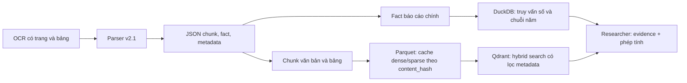
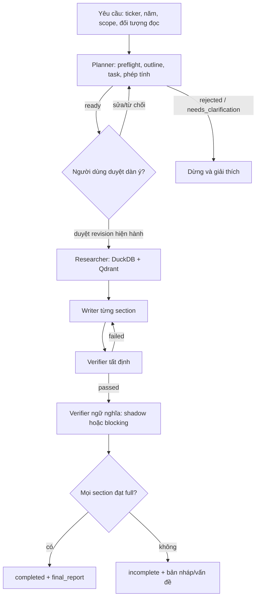

# Multi-Agent Report Writing Framework: báo cáo tổng hợp dự án

**Thời điểm đối chiếu:** 13/11/2026. **Đối tượng đọc:** mentor và đồng nghiệp. **Phạm vi:** triển khai báo cáo tài chính doanh nghiệp Việt Nam trên corpus đang dùng; các khảo sát công nghệ và dữ liệu khác được trình bày như bối cảnh, không đồng nhất với sản phẩm đã triển khai.

## 1. Kiểm kê nguồn và cấu trúc báo cáo

Thư mục `docs` có **41 tệp Markdown**: 8 kiến trúc, 8 audit, 3 hợp đồng, 4 dữ liệu, 2 quyết định, 10 đánh giá và 6 tài liệu dự án; thêm một tệp ngữ cảnh `.txt`, hai state JSON minh họa và manifest tổ chức tệp. Báo cáo này đối chiếu trực tiếp các tài liệu tổng quan, thiết kế, quyết định, benchmark và audit gắn với đường chạy hiện hành; các tệp khảo sát hoặc ví dụ không tạo kết quả chạy được dùng để giải thích nguồn gốc lựa chọn. Số liệu v2.1 được ưu tiên cho trạng thái hiện tại, số liệu v1 được ghi rõ là lịch sử. Các hiện vật benchmark và cấu hình được dẫn ở từng phần để kiểm lại.

| Chương | Vai trò |
| --- | --- |
| 2. Bối cảnh và lịch dự án | Nêu bài toán, phạm vi và các mốc phát triển theo thời gian. |
| 3. Kiến trúc và dữ liệu | Giải thích pipeline từ OCR đến hai động cơ truy xuất. |
| 4. Luồng lập báo cáo | Mô tả hợp đồng state, Planner, Researcher, Writer, Verifier và duyệt dàn ý. |
| 5. Thực nghiệm | Gắn từng kết quả với tập đo và giới hạn của nó. |
| 6. Giao diện và vận hành | Cho biết người dùng thấy gì và điều kiện báo cáo hoàn tất. |
| 7. Project limitations | Nêu giới hạn về dữ liệu, truy xuất, đánh giá và bản demo. |
| 8. Lessons learned and best practices | Rút ra cách làm từ các kết quả và giới hạn đã kiểm. |
| 9–10. Xác nhận và nguồn | Ghi xung đột, giới hạn kiểm chứng và đường truy xuất. |

### Quy ước đọc

**Fact** là một dòng số liệu lấy từ bảng báo cáo chính, có mã chỉ tiêu, giá trị, kỳ, scope và trang. **Chunk** là đoạn văn/bảng dùng cho tìm kiếm. **Evidence** là fact hoặc note chunk được gắn ID và citation. **Claim** là khẳng định cụ thể trong bản nháp được liên kết với evidence hoặc phép tính. `scope` là loại báo cáo (`consolidated`, `separate`, `general`); các loại này không được tự coi là tương đương. **Verifier tất định** kiểm bằng quy tắc code; **Verifier ngữ nghĩa** dùng LLM đánh giá ý nghĩa câu văn. Các tỷ lệ dưới đây luôn có mẫu số và tập dữ liệu riêng.

## 2. Bài toán, phạm vi và diễn tiến

Dự án đặt mục tiêu tạo báo cáo có cấu trúc và trích dẫn truy ngược được từ tài liệu dài, đồng thời giảm nguy cơ nhầm số, nhầm kỳ, thiếu nguồn hoặc diễn giải quá mức. Ngữ cảnh ban đầu mô tả một framework tổng quát cho PDF, Word, Markdown và text, gồm sáu vai trò agent. Triển khai được kiểm chứng trong các tài liệu hiện nay tập trung vào **một doanh nghiệp, một scope và khoảng năm 2022–2025** từ báo cáo tài chính Việt Nam đã OCR. Vì vậy kết quả báo cáo tài chính không chứng minh năng lực xử lý mọi loại tài liệu của đề bài rộng hơn. [Phạm vi và kế hoạch dự án](project-scope-and-plan.txt), [Hợp đồng schema và state](../contracts/report-schema-and-state.md).

| Mốc | Nội dung có bằng chứng | Cách hiểu |
| --- | --- | --- |
| 19–23/10 | Khảo sát LangGraph, CrewAI, AutoGen và stack; chọn hướng state graph và truy xuất có nguồn. | Nhiều sơ đồ, model và vòng critique trong tài liệu này là **đề xuất**, không phải kết quả triển khai. [Khảo sát kiến trúc và công nghệ](../architecture/orchestration-and-tech-stack.md). |
| Cuối 10/2026 | Đặc tả OCR Việt Nam, parser/chunking, embedding và kho dữ liệu. Đo và làm sạch corpus Top 100. | Tập Top 100 dùng cho khảo sát token khác với 141 tài liệu đang lập chỉ mục. [Đặc tả dữ liệu tài chính Việt Nam](../datasets/vietnam-financial-dataset.md), [Kết quả làm sạch và đo token](../evaluation/top-100-token-cleaning-results.md). |
| Trước corpus v1 | Thu hẹp tập Top 100: loại 65 mã, giữ 35 mã để lập corpus và đánh giá. | Việc chọn 35 mã diễn ra **trước** lần sửa parser v2.1; tập 35 mã sau đó được chia 25 Dev/10 Test theo công ty. [Phân chia Dev/Test](../../configs/eval_dataset_split.json). |
| 03/11 | Graph một lượt và Researcher thật đã có; Planner/Writer còn được truyền từ bên ngoài trong thử graph. Corpus khi đó 141 tài liệu, 30.282 chunk, 38.425 fact sau sửa dòng tiêu đề rỗng. | Các số liệu này thuộc **phiên bản dữ liệu v1**, trước khi parser được sửa để phân loại đúng phần thuyết minh; `v1` không phải phiên bản của framework. [Tiến độ dự án giai đoạn đầu](early-project-progress.md). |
| 04–08/11 | Hoàn thiện Planner LLM/HITL, Writer định lượng theo placeholder, vòng sửa và fallback; đánh giá W4 trên Dev. | Hợp đồng Writer đã được hiện thực sau mốc “chưa viết” ngày 03/11. [Tổng quan Planner](planner-agent.md), [Tổng quan Writer](writer-agent.md), [Đánh giá Writer định lượng](../evaluation/quantitative-writer-evaluation.md). |
| 09/11 | Sửa parser thuyết minh, kích hoạt corpus v2.1, dựng lại Qdrant; thử Writer định tính W6. | Dữ liệu fact v2.1 giảm do loại các bảng note bị nhận nhầm. [Audit phân loại thuyết minh](../evaluation/notes-classification-audit.md), [Đánh giá Writer định tính](../evaluation/qualitative-writer-evaluation.md). |
| 10/11 | Benchmark báo cáo giai đoạn A và đánh giá Verifier ngữ nghĩa SV1; tích hợp chế độ shadow. | A là đường **tất định**, SV1 là phép đo riêng; không gộp thành một điểm chất lượng. [Benchmark chất lượng báo cáo](../evaluation/report-quality-benchmark.md), [Đánh giá Verifier ngữ nghĩa](../evaluation/semantic-verifier-evaluation.md). |
| Sau mốc 10/11 | Có script demo graph đầy đủ, adapter tracing và giao diện thử nghiệm với trang báo cáo/chat. | Một lượt `completed` là smoke/integration test riêng; không thay thế đánh giá chất lượng trên tập Test. [Kiến trúc giao diện](../architecture/report-writer-ui-architecture.md), [Benchmark chất lượng báo cáo](../evaluation/report-quality-benchmark.md). |

Các mốc cuối là thứ tự suy ra từ ngày ghi trong tài liệu và hiện vật hiện có, không phải nhật ký commit: thư mục dự án hiện không có Git repository. Lộ trình năm tuần trong tệp ngữ cảnh là **kế hoạch**, không dùng làm bằng chứng đã hoàn tất giai đoạn tương ứng.

## 3. Kiến trúc dữ liệu và truy xuất

### 3.1. Nguồn và phạm vi corpus

Nguồn chính là các báo cáo tài chính tiếng Việt OCR của TiniX, với dấu phân trang và bảng HTML nội tuyến. Đặc tả nguồn ghi toàn bộ dataset có 18.231 báo cáo từ 1.491 ticker cho giai đoạn 2015–2025; dự án chỉ tải, xử lý và đánh giá một tập con. Một khảo sát song song về **500 Form 10-K/100 công ty Mỹ** và mẫu NVIDIA phân tích khác biệt PDF số với OCR Việt Nam; không thấy bằng chứng corpus Mỹ tham gia graph báo cáo Việt Nam hiện hành. [Đặc tả dữ liệu tài chính Việt Nam](../datasets/vietnam-financial-dataset.md), [Đặc tả dữ liệu 10-K Mỹ](../datasets/us-10k-dataset.md).

Khảo sát token riêng trên **410 file** Top 100 (405 báo cáo chính, 5 file giải trình) đo bằng tokenizer Gemini: tổng giảm từ **29.031.422** xuống **23.090.302 token**, tương đương **20,46%** sau pipeline làm sạch. Số này đo hiệu quả tiền xử lý file, không phải mức tiết kiệm token mỗi lượt Writer hay chất lượng báo cáo. [Kết quả làm sạch và đo token](../evaluation/top-100-token-cleaning-results.md).

Sau giai đoạn khảo sát Top 100, người thực hiện dự án **loại 65 mã và giữ 35 mã** cho corpus phục vụ graph và benchmark. Thư mục đầu vào hiện có 35 thư mục mã; trong đó **141 báo cáo** được lập chỉ mục. Tập đánh giá chia theo công ty thành **25 mã Dev và 10 mã Test**, tránh để các năm của cùng một mã xuất hiện ở cả hai tập. Đây là bước **chọn phạm vi dữ liệu trước corpus v1**, khác với lần sửa parser v2.1: v2.1 vẫn xử lý 141 báo cáo của 35 mã ấy, nhưng thay đổi số chunk và fact do phân loại lại phần thuyết minh. Tài liệu hiện có không ghi tiêu chí loại riêng từng mã, nên báo cáo không quy việc chọn 35 mã cho một tiêu chí chưa xác minh. [Phân chia Dev/Test](../../configs/eval_dataset_split.json), [audit v2.1](../evaluation/notes-classification-audit.md).

<!-- Gợi ý chèn hình 1: Sơ đồ thu hẹp dữ liệu từ Top 100 → 35 mã (25 Dev/10 Test) → 141 báo cáo được lập chỉ mục. Đặt sau đoạn mô tả bước chọn 35 mã; ghi rõ 410 file chỉ thuộc khảo sát token riêng. -->

### 3.2. Parser và phiên bản v2.1

Pipeline parser tách trang, làm sạch đầu/chân trang, mở bảng HTML thành khối, nhận diện cấu trúc báo cáo, trích fact và kiểm đẳng thức, cuối cùng tạo chunk kèm metadata. `physical_page`, `printed_page`, `citation_tag`, `report_type`, `ticker`, `fiscal_year` và `scope` cho phép lần ngược nguồn. Văn bản gốc và `embed_text` được tách: chuỗi dùng embedding có tiền tố ngữ cảnh và giảm nhiễu số, còn văn bản/citation phải giữ nội dung để kiểm chứng. Bảng dài và nội dung qua ranh giới trang được cắt/gộp theo cấu trúc, không chia ký tự thuần túy. [Thiết kế parser và ingestion](../architecture/document-parser-and-ingestion.md), [Chiến lược chunking tài chính](../architecture/financial-document-chunking.md).

Trong corpus v1, parser từng coi một số dòng chỉ dùng làm tiêu đề là fact, dù chúng không chứa số liệu. Quy tắc lọc mới bỏ 3 dòng như vậy ở FPT, rồi bỏ thêm 39 dòng trong các báo cáo còn lại. Các dòng này đều có nhãn kết thúc bằng `:` và hai ô giá trị gốc rỗng. Tổng số fact vì thế giảm từ **38.467 xuống 38.425**. [Audit dòng fact tiêu đề rỗng](../audits/empty-heading-facts-audit.md).

Một lỗi khác ảnh hưởng lớn hơn đến corpus: **bảng nằm trong phần thuyết minh** có thể mang tiêu đề giống bảng báo cáo chính. Parser đã nhận nhầm các bảng này là báo cáo chính và tạo fact từ số liệu thuyết minh. Phiên bản v2.1 giữ chúng trong mục `NOTES`; parser chỉ trở lại báo cáo chính khi cùng khối có mã biểu mẫu phù hợp. Mã `B09` thuộc thuyết minh nên không đủ để chuyển mục. Trong **28.025 đoạn có thể đối chiếu trực tiếp** giữa hai phiên bản, **1.615 đoạn** thuộc 88/141 báo cáo được phân loại lại thành thuyết minh; **19.885 fact nhận nhầm bị loại**, không có fact mới và không fact nào bị loại trước trang bắt đầu thuyết minh. Mười hai chỉ tiêu chuẩn của HUT và GMD không đổi; tám chuỗi chỉ tiêu ở GVR và MVN hết mơ hồ vì các dòng trùng trong thuyết minh đã bị loại. [Audit phân loại thuyết minh](../evaluation/notes-classification-audit.md).

| Snapshot | Tài liệu | Chunk | Fact DuckDB | Ý nghĩa |
| --- | ---: | ---: | ---: | --- |
| Dữ liệu v1 sau sửa dòng rỗng | 141 | 30.282 | 38.425 | Trước khi sửa phân loại phần thuyết minh. |
| **v2.1 đang chọn** | **141** | **32.175** | **18.540** | Parser thuyết minh đã sửa; `configs/active_corpus.json` trỏ đến JSON, DuckDB và Qdrant v2.1. |

Chênh lệch chunk (+1.893) không chỉ là đổi nhãn; section mới làm thay ranh giới gộp, gồm +1.190 chunk văn bản và +703 chunk bảng. Cả 141 tài liệu qua gate parser `AUTO_INDEX`. Đây là gate cấu trúc, không có nghĩa mọi fact OCR đều đúng. [Chuyển đổi corpus v2.1](corpus-v2-1-transition.md), [Cấu hình corpus hiện hành](../../configs/active_corpus.json).

### 3.3. Hai động cơ phục vụ

DuckDB phục vụ dòng số kế toán và chuỗi thời gian; Qdrant phục vụ thuyết minh, kiểm toán, chính sách và rủi ro. BGE-M3 tạo dense vector 1.024 chiều, tokenizer/BM25 tạo sparse vector, Reciprocal Rank Fusion (RRF) hợp nhất thứ hạng. Bộ lọc `ticker`, `fiscal_year` ngăn lấy nhầm doanh nghiệp/kỳ. JSON đã parse là tầng dữ liệu dẫn xuất trực tiếp từ nguồn; Parquet giữ vector để không phải embed lại khi dựng chỉ mục. Khi dựng v2.1, cache dùng `content_hash` ở cấp chunk, tái dùng vector cũ nếu nội dung embedding không đổi; Qdrant collection mới được dựng cạnh v1. Đối soát JSON, Parquet và Qdrant đều cho **32.175** ID chunk khớp. [Thiết kế embedding và sparse index](../architecture/embedding-and-sparse-indexing.md), [Kiến trúc lưu trữ và truy xuất](../architecture/data-storage-and-serving.md), [Audit phân loại thuyết minh](../evaluation/notes-classification-audit.md).

## 4. Luồng lập báo cáo và các hợp đồng an toàn

Sơ đồ biểu diễn quan hệ chức năng; số lượt sửa của Writer bị giới hạn và fallback theo section, không phải vòng lặp vô hạn. Trong `shadow`, phát hiện ngữ nghĩa được ghi log/cảnh báo và mức verification vẫn là `deterministic`, nên không thể dẫn tới `completed` chỉ nhờ kết quả shadow. [Mã graph báo cáo](../../src/agents/report_graph.py), [Đánh giá Verifier ngữ nghĩa](../evaluation/semantic-verifier-evaluation.md).

<!-- Gợi ý chèn hình 3: Ảnh chụp màn hình dàn ý do Planner tạo và nút duyệt/chỉnh sửa, che dữ liệu nhạy cảm nếu có. Đặt sau sơ đồ luồng agent; chỉ dùng ảnh của đường chạy hiện hành. -->

### 4.1. Planner và duyệt dàn ý

`ReportRequest` giới hạn một ticker, khoảng năm và một scope. `preflight()` kiểm ticker/scope/năm và dấu hiệu bộ mã chuẩn; `rejected` dành cho mã ngoài corpus hoặc nhóm chưa hỗ trợ, `needs_clarification` dành cho yêu cầu không thể tiếp tục an toàn. Với yêu cầu hợp lệ, Planner lập `ReportOutline` gồm section, research task và calculation spec. LLM được truy vấn qua toolbox có giới hạn, mỗi lần đọc tạo `PlannerObservation` có ID, tham số và snapshot; validator kiểm schema, liên kết task/calc và dấu vết quyết định, nhưng không chứng minh chất lượng phân tích của proposal. Người dùng duyệt revision hiện hành; sửa dàn ý tạo revision mới và hủy duyệt cũ. Tài liệu tham chiếu định nghĩa S1 thông tin doanh nghiệp, S2 kiểm toán, S3 kết quả kinh doanh, S4 tình hình tài chính, S5 dòng tiền, S6 chính sách/note, S7 rủi ro/bên liên quan/sự kiện và S8 giới hạn; outline thực tế có thể điều chỉnh theo dữ liệu. [Tổng quan Planner](planner-agent.md), [Dàn ý tham chiếu của Planner](../architecture/planner-outline.md).

### 4.2. Researcher, fact và phép tính

Researcher thực thi task bằng `AgentTools`: truy vấn fact một năm, time series hoặc tìm note. Output trở thành `ResearchResult` và `EvidenceRecord` có ID ổn định. Resolver hỗ trợ 12 chỉ tiêu chuẩn cho doanh nghiệp phi ngân hàng. Kết quả `ok`, `partial`, `ambiguous`, `not_found`, `invalid_input` và `error` khác nghĩa; thiếu kết quả trong top-k chunk chỉ chứng minh **chưa thấy trong đoạn đã truy xuất**, không chứng minh tài liệu gốc không có. Tính YoY, chênh lệch hoặc CAGR chỉ khi đầu vào duy nhất, cùng scope/đơn vị và hợp lệ; cảnh báo cột năm trước phải đi cùng câu so sánh liên kỳ. [Hợp đồng công cụ agent](../contracts/agent-tool-interface.md), [Công cụ truy vấn DuckDB facts](../contracts/duckdb-facts-query.md), [Quyết định hợp đồng Writer](../decisions/writer-contract-decisions.md).

Ví dụ: `YoY = (x_t / x_{t-1} - 1) × 100%` nếu mẫu số và hai giá trị hợp lệ; `CAGR = (x_end / x_start)^(1/n) - 1` chỉ khi giá trị đầu/cuối dương. Một chuỗi bốn năm được đánh dấu an toàn không tự động cho phép mọi phép tính. Trên 35 ticker × 12 chỉ tiêu = **420 chuỗi**, audit lịch sử tìm được **289/420** chuỗi an toàn, **257/420** YoY 2024–2025 tính được và **217/420** CAGR 2022–2025 tính được; sáu ngân hàng là 0/12 vì bộ mã **không hỗ trợ ngân hàng**, không phải ngân hàng thiếu báo cáo. Các tỷ lệ này là khảo sát trên snapshot lúc đó, không phải benchmark toàn hệ thống v2.1. [Audit độ phủ chỉ tiêu](../audits/metric-coverage-corpus-audit.md), [Tiến độ dự án giai đoạn đầu](early-project-progress.md).

### 4.3. Writer và claim có nguồn

Writer định lượng W4 nhận `SectionView` cho S3–S5, menu alias evidence và calculation. Model sinh template chứa placeholder `E:` (fact), `C:` (phép tính), `Y:`/`P:` (kỳ), `D:` (hướng và trị tuyệt đối của biến động), `T:` (xu hướng có claim). Code kiểm menu, điền giá trị/đơn vị, tạo claim và chèn citation. Cách này giữ giá trị số trong fact/CalculationResult thay vì tin chữ số do model tự viết. Renderer dùng cùng thang tiền trong một câu và sinh câu giới hạn từ dữ liệu thiếu/mơ hồ; template và văn bản sau render được kiểm riêng. Tối đa các lượt sửa được ghi trong log, rồi fallback về TemplateWriter khi cần. [Tổng quan Writer](writer-agent.md), [Quyết định hợp đồng Writer](../decisions/writer-contract-decisions.md), [Đánh giá Writer định lượng](../evaluation/quantitative-writer-evaluation.md).

Writer định tính W6 nhận chunk note của đúng task cho S1, S2, S6, S7; model chọn span trích nguyên văn và viết nhận định ngắn, code kiểm alias, quote và citation. Fallback định tính cũng dựa trên trích đoạn. Điều này giảm suy diễn không nguồn nhưng có thể giữ lỗi OCR trong quote và chưa bảo đảm truy xuất đủ mọi thuyết minh liên quan. Trong phép đo ba ticker Dev FPT/HUT/GMD, 12/12 section qua tầng tất định, 10/12 qua lượt đầu, 2 cần sửa, 0 fallback, tổng 39 claim định tính. Đây là phép đo hợp lệ của draft, **chưa** phải điểm đúng ngữ nghĩa. [Đánh giá Writer định tính](../evaluation/qualitative-writer-evaluation.md).

<!-- Gợi ý chèn hình 4: Ví dụ một câu báo cáo có số liệu, citation và đường truy ngược về EvidenceRecord/CalculationResult; có thể đặt hai ảnh cạnh nhau cho Writer định lượng và định tính. Đặt sau phần Writer. -->

### 4.4. Verifier, state và trạng thái báo cáo

Tầng tất định kiểm nguồn tồn tại, ticker/scope/kỳ, số/đơn vị/chiều biến động, citation và các khẳng định thiếu nguồn dễ nhận biết. Với chênh lệch cột năm trước, Writer khai `DraftLimitation` và renderer sinh câu giới hạn có citation. Tầng ngữ nghĩa kiểm diễn giải giá trị/số, hỗ trợ của note, xu hướng, nguyên nhân và claim bị bỏ sót trong câu. Lỗi API hoặc JSON sai không được tự nâng kết quả lên `full` (**fail-closed**). Mỗi `SectionDraft` và `VerificationResult` gắn `(section_id, revision)`; reducer từ chối cùng ID nhưng nội dung khác. `can_complete()` chỉ đúng khi outline hiện hành đã duyệt và **tất cả** section của revision đó qua `status="passed", level="full"`; việc gán chuỗi `completed` thủ công không đủ. Snapshot khác khi resume bị chặn để tránh dùng evidence cũ với corpus mới. [Hợp đồng schema và state](../contracts/report-schema-and-state.md), [Thiết kế Verifier ngữ nghĩa](../architecture/semantic-verifier-design.md), [Mã quản lý state](../../src/agents/state.py).

## 5. Kết quả thực nghiệm và cách diễn giải

### 5.1. Retrieval và facts

Trên corpus **v2.1**, với câu hỏi thuyết minh, hệ thống tìm các đoạn có thể chứa bằng chứng rồi đưa tối đa năm đoạn đầu cho bước viết báo cáo. Trong **33/36** câu hỏi Dev, ít nhất một đoạn đúng theo nhãn gold xuất hiện trong năm kết quả đầu (Hit@5); **3/36** câu chưa tìm được đoạn đúng ở phạm vi đó. MRR **0,8163** cho biết đoạn đúng thường được xếp gần đầu danh sách. Các chỉ số này đo khả năng **tìm đoạn**, chưa đo câu trả lời cuối cùng của Writer có đúng hay không.

Với câu hỏi số liệu, phép thử tìm kiếm văn bản đưa đoạn đúng vào top 5 ở **35/42** câu Dev, nhưng luồng lập báo cáo lấy số trực tiếp từ fact có cấu trúc trong DuckDB. Nhánh DuckDB khớp tập gold ở **58/58** câu một năm và trả đủ **14/14** chuỗi bốn năm (**56/56** điểm năm). Kết quả khớp gold đã chọn không xác nhận mọi dòng OCR trong corpus đều đúng; benchmark **truy xuất văn bản** trên tập Test chưa được chạy lại với v2.1. [Chuyển đổi corpus v2.1](corpus-v2-1-transition.md), [Audit phân loại thuyết minh](../evaluation/notes-classification-audit.md).

### 5.2. Writer

Mỗi `SectionView` là gói dữ liệu cho một mục báo cáo, gồm số liệu, phép tính và bằng chứng mà Writer được phép dùng. Lượt W4-v3 thử **22 mục định lượng**: S4–S5 của HUT/GMD và S3–S5 của sáu mã Dev khác (S3: kết quả kinh doanh; S4: tình hình tài chính; S5: dòng tiền). Model viết văn bằng placeholder; code điền số và nguồn rồi kiểm tra các quy tắc như placeholder có trong menu, số liệu/đơn vị hợp lệ và câu có claim được gắn nguồn. **15/22 mục** qua ngay ở lần sinh đầu; sau các lượt sửa, **21/22 mục** do LLM viết qua kiểm tra tất định. Mục còn lại là GEX S5: sau ba lần không đạt, hệ thống dùng TemplateWriter thay thế. Tính cả fallback, **22/22 mục** có bản nháp qua kiểm tra tất định. Lượt đo này dùng tổng **88.833 token theo API**, không phải mức tiêu thụ của một báo cáo hoàn chỉnh.

Điểm yếu tập trung ở S5 (dòng tiền): model xử lý sai placeholder cho hướng tăng/giảm và trị tuyệt đối của chênh lệch, có trường hợp viết kiểu “giảm -...” (hai câu như vậy vẫn lọt qua cổng tất định lúc đó) hoặc tự thêm cú pháp `|abs` ngoài menu. W4-v4 bổ sung placeholder `D:` để code lấy hướng và trị tuyệt đối trực tiếp từ kết quả phép tính. Khi đo lại **đúng tám mục S5 Dev** đã dùng để phát hiện lỗi, cả **8/8** qua ngay lần đầu và không cần fallback. Đây là kiểm tra bản sửa trên cùng mẫu, chưa chứng minh tỷ lệ đó sẽ giữ trên mã mới hoặc trên báo cáo hoàn chỉnh.

Kiểm tra tất định xác nhận bản nháp tuân thủ các quy tắc số liệu và trích dẫn đã lập, chưa đánh giá đầy đủ ý nghĩa diễn giải hay chất lượng văn. Trong phép đọc mù của người dùng với mentor, văn LLM được nhận xét tốt hơn TemplateWriter một chút; chưa có điểm số hoặc số lượt chọn từng bản để lượng hóa mức cải thiện. [Đánh giá Writer định lượng](../evaluation/quantitative-writer-evaluation.md).

### 5.3. Benchmark báo cáo A

Benchmark A kiểm tra một luồng báo cáo **theo mẫu và quy tắc code** trên tám yêu cầu thuộc tập Dev: Planner xác định có thể lập báo cáo hay phải dừng, Researcher lấy bằng chứng, TemplateWriter ghép bản nháp, rồi Verifier tất định kiểm số liệu, nguồn và câu nêu giới hạn. Kỳ vọng cho từng ca được ghi trước khi chạy. Cả **8/8 ca** trả đúng trạng thái kỳ vọng: FOX không có trong corpus và ABB là ngân hàng chưa được hỗ trợ nên bị từ chối; yêu cầu DHG dùng scope không nhất quán giữa các năm được trả về để làm rõ. Năm ca còn lại tạo bản nháp `incomplete`, trong đó các mục phải nói rõ khi thiếu số, số liệu mơ hồ hoặc chưa tìm thấy đoạn thuyết minh phù hợp. `Incomplete` ở đây là trạng thái đúng của phép thử, không phải tám ca đều tạo được báo cáo hoàn chỉnh.

Trong năm bản nháp, **27/27 mục** qua các quy tắc kiểm tra tất định. Bộ chấm đối chiếu **17/17 giá trị gold** với văn bản OCR gốc về số, tên chỉ tiêu và trang; chỉ **4/17** giá trị được xem thêm trực tiếp trên PDF. Để thử khả năng phát hiện sai sót, hai bản nháp sạch được dùng làm đối chứng và tám bản sao được cài mỗi bản một lỗi; bộ chấm phát hiện **8/8 lỗi cài**. Kết quả này chỉ xác nhận tám kiểu lỗi đã thử. Một phiếu đọc định tính của ca GMD còn chờ, và **không có báo cáo `completed`** trong Benchmark A. Luồng này không dùng Planner/Writer LLM hoặc Verifier ngữ nghĩa, nên các con số không đo chất lượng của những thành phần đó. [Benchmark chất lượng báo cáo](../evaluation/report-quality-benchmark.md), [Kết quả từng ca benchmark báo cáo](../../evaluation/benchmarks/report_quality_phase_a_demo.json).

<!-- Gợi ý chèn hình 5: Biểu đồ trạng thái Benchmark A gồm 5 incomplete, 2 rejected, 1 needs_clarification; ghi rõ không có báo cáo completed trong benchmark này. Đặt sau đoạn Benchmark báo cáo A. -->

### 5.4. Verifier ngữ nghĩa SV1

Verifier ngữ nghĩa SV1 đọc **câu trong bản nháp cùng fact, phép tính và đoạn nguồn** sau khi câu đã qua kiểm tra tất định. Nó tìm các lỗi khó phát hiện bằng quy tắc đơn giản, chẳng hạn gọi sai tên chỉ tiêu dù con số có nguồn hợp lệ, viết “giảm -...” hoặc suy diễn nguyên nhân không có trong thuyết minh. Bộ smoke gồm 78 câu tổng hợp và các câu thật FPT/HUT/GMD ban đầu chỉ kiểm tra luồng kỹ thuật; một phần mẫu câu thật đã được dùng chỉnh prompt nên không phải phép đo độc lập về chất lượng.

Ở đợt đánh giá tiếp theo, người đánh giá chọn **40 block** từ log S3–S5 của sáu công ty Dev sau khi đã đọc log: bốn block có lỗi thật của Writer và 36 block được gắn nhãn đúng. SV1 phát hiện **4/4 lỗi thật**, đồng thời phát hiện **30/30 lỗi cấy** vào những block khác; nó cũng gắn cờ nhầm **1/36 block đúng**. Những con số này cho thấy SV1 bắt được các kiểu lỗi đã đưa vào phép thử, nhưng bốn lỗi thật là mẫu quá nhỏ: cận dưới khoảng tin cậy 95% cho khả năng bắt lỗi thật chỉ **39,8%**; cận trên cho tỷ lệ bắt oan là **14,5%**. Mẫu được chọn có chủ đích, nhãn chưa hoàn toàn độc lập và chưa bao phủ đủ S1/S2/S6/S7 trên sáu mã, nên **chưa đủ bằng chứng để bật chế độ chặn (`blocking`) như một bảo đảm chất lượng**.

Chế độ `shadow` cho SV1 chạy và ghi cảnh báo để tiếp tục đo trên báo cáo đủ bảy mục, nhưng không nâng kết quả kiểm chứng từ `deterministic` lên `full`. Kế hoạch đánh giá tiếp theo đã khóa trước mẫu Dev mới và ngưỡng quyết định; chỉ sau phép đo đó mới có cơ sở xem xét chế độ chặn. [Đánh giá Verifier ngữ nghĩa](../evaluation/semantic-verifier-evaluation.md), [Kế hoạch đánh giá shadow](../../configs/semantic_verifier_shadow_eval_plan.json).

### 5.5. Note S7

Trên 12 truy vấn S7 của HUT/GMD/FPT, top 5 cho **60 cặp truy vấn–chunk**. Sau sửa cổng liên quan, 25/60 cặp được giữ; đó là tỷ lệ giữ, **không phải precision**. Hai người gắn nhãn trùng 13/20 nhãn ba lớp, κ Cohen **0,483**; tiêu chí `direct` chưa thống nhất. Bản sửa được kiểm lại trên chính 20 cặp dùng tìm lỗi, còn 40 cặp chưa gắn nhãn. Truy vấn rủi ro không qua cổng ở HUT/GMD trong top 5 chỉ cho phép nói “chưa tìm được bằng chứng phù hợp trong các đoạn đã truy xuất”. [Audit phân loại thuyết minh](../evaluation/notes-classification-audit.md), [Audit độ liên quan note HUT](../evaluation/hut-note-relevance-audit.md).

## 6. Giao diện và vận hành

Giao diện thử nghiệm cho người dùng đi theo một luồng cụ thể: nhập mã doanh nghiệp, scope và khoảng năm; xem dàn ý Planner đề xuất; **duyệt, sửa hoặc từ chối** dàn ý trước khi hệ thống nghiên cứu và viết. Sau khi duyệt, trang quy trình hiển thị các mốc thật của Researcher, Writer và Verifier, như tác vụ đang tra cứu, số bằng chứng tìm được và mục vừa được kiểm. Đây là sự kiện phát trong lúc chạy, không phải phần trăm hoàn thành ước tính; nếu một lần gọi model kéo dài, mốc hiện tại giữ nguyên đến khi có sự kiện mới. Next.js/CopilotKit kết nối tới backend FastAPI, còn checkpoint SQLite giữ trạng thái từng phiên theo `thread_id` để có thể tải lại trang. [Hướng dẫn giao diện](report-writer-ui-guide.md), [Kiến trúc giao diện](../architecture/report-writer-ui-architecture.md).

Khi phiên còn `incomplete`, người dùng vẫn xem được bản nháp và các vấn đề kiểm chứng trên trang quy trình. Trang báo cáo riêng chỉ mở khi graph có `run_status=completed` **và** `final_report`; lúc đó người dùng có thể đọc các mục, bảng, nhãn nguồn `[Doc_…, p.…]`, tải Markdown và chat. Nhãn nguồn cho biết tài liệu và trang nhưng chưa tự mở PDF gốc. Chat với Gemini là một yêu cầu mới sau báo cáo: câu trả lời **không đi qua Verifier** và không sửa bản báo cáo đã lưu. Lịch sử chat nằm trong trình duyệt của phiên đó, còn endpoint chat và tải báo cáo từ chối yêu cầu khi phiên chưa hoàn tất. [Hướng dẫn giao diện](report-writer-ui-guide.md), [Kiến trúc giao diện](../architecture/report-writer-ui-architecture.md).

Có một điểm cấu hình cần đọc đúng: đánh giá SV1 khuyến nghị tiếp tục chạy `shadow` trước khi dùng kết quả ngữ nghĩa để chặn báo cáo, nhưng graph mặc định và backend UI hiện truyền `verifier_mode="blocking"`. Việc giao diện có thể hiển thị một phiên `completed` chỉ chứng minh điều kiện kỹ thuật của phiên đó đã đạt, **không chứng minh SV1 đã qua ngưỡng đánh giá chất lượng**. [Đánh giá Verifier ngữ nghĩa](../evaluation/semantic-verifier-evaluation.md), [Mã graph báo cáo](../../src/agents/report_graph.py), [Mã backend giao diện](../../scripts/prototypes/copilotkit_backend.py).

<!-- Gợi ý chèn hình 6: Ảnh chụp giao diện tiến trình hoặc trang báo cáo có nhãn citation; chú thích rằng nhãn chưa tự mở PDF gốc và chat sau báo cáo không qua Verifier. Đặt sau phần Giao diện và vận hành. -->

## 7. Project limitations

**Phạm vi dữ liệu và doanh nghiệp.** Hệ thống hiện được kiểm chủ yếu trên báo cáo tài chính Việt Nam đã OCR, theo một doanh nghiệp, một scope và các năm 2022–2025. Bộ mã chỉ tiêu chuẩn hiện dùng không phù hợp với ngân hàng; kết quả trên tập 35 mã không chứng minh khả năng xử lý mọi ngành, mọi loại tài liệu hay báo cáo ngoài khoảng năm này. [Đặc tả dữ liệu tài chính Việt Nam](../datasets/vietnam-financial-dataset.md), [Benchmark chất lượng báo cáo](../evaluation/report-quality-benchmark.md).

**Độ tin cậy của dữ liệu nguồn.** Lỗi OCR, phân loại bảng và sự khác nhau giữa báo cáo hợp nhất/riêng lẻ có thể làm thiếu hoặc sai fact. Corpus v2.1 đã loại fact giả từ bảng note, nhưng benchmark facts so với gold đã chọn; trong Benchmark A mới có 4/17 giá trị gold được xem trực tiếp trên PDF gốc. Các giá trị trọng yếu vẫn cần đối chiếu PDF khi sử dụng. [Audit phân loại thuyết minh](../evaluation/notes-classification-audit.md), [Benchmark retrieval và facts](../evaluation/retrieval-and-facts-benchmark.md), [Benchmark chất lượng báo cáo](../evaluation/report-quality-benchmark.md).

**Độ phủ của truy xuất thuyết minh.** Tìm note theo top-k và cổng liên quan không bảo đảm tìm hết bằng chứng trong toàn tài liệu. Với S7, 40/60 cặp truy vấn–chunk chưa có nhãn, còn 20 cặp đã gắn nhãn có bất đồng giữa hai người đánh giá. Không tìm thấy đoạn phù hợp trong phần đã truy xuất không có nghĩa báo cáo gốc không chứa thông tin đó. [Audit phân loại thuyết minh](../evaluation/notes-classification-audit.md), [Audit độ liên quan note HUT](../evaluation/hut-note-relevance-audit.md).

**Chất lượng báo cáo hoàn chỉnh chưa được đo đủ.** Benchmark A có 8/8 trạng thái tự động đúng nhưng không có báo cáo `completed`; kết quả Writer đo trên section và SV1 đo trên mẫu block được chọn, chưa đại diện cho báo cáo đủ bảy section trên tập Test. SV1 bắt 4/4 lỗi thật được chọn nhưng mẫu quá nhỏ để xác nhận tỷ lệ bỏ sót thấp; chế độ `blocking` hiện có trong cấu hình không nên được hiểu là đã qua kiểm định chất lượng. [Benchmark chất lượng báo cáo](../evaluation/report-quality-benchmark.md), [Đánh giá Verifier ngữ nghĩa](../evaluation/semantic-verifier-evaluation.md).

**Giới hạn của bản demo.** Citation ở giao diện là nhãn nguồn và trang, chưa tự mở PDF gốc. Chat sau báo cáo không đi qua Verifier của bản báo cáo, và lịch sử chat chỉ nằm trong phiên trình duyệt; vì vậy phần hỏi đáp tiếp nối không có cùng mức kiểm chứng với bản nháp đã được kiểm. [Hướng dẫn giao diện](report-writer-ui-guide.md), [Kiến trúc giao diện](../architecture/report-writer-ui-architecture.md).

## 8. Lessons learned and best practices

**Tách số liệu khỏi thuyết minh.** Dòng số trong bảng chính cần được truy vấn như fact có mã chỉ tiêu, kỳ, scope, đơn vị và trang; đoạn giải thích cần được tìm trong note và kiểm độ liên quan. Một kết quả tìm kiếm văn bản không đủ để xác nhận giá trị kế toán. Khi thiếu bằng chứng, báo cáo cần nêu đúng phạm vi đã tìm, thay vì khẳng định tài liệu gốc không có thông tin. [Benchmark retrieval và facts](../evaluation/retrieval-and-facts-benchmark.md), [Audit độ liên quan note HUT](../evaluation/hut-note-relevance-audit.md).

**Quản lý phiên bản corpus cùng các chỉ mục dẫn xuất.** Lỗi parser phân loại bảng note thành bảng chính đã tạo fact giả. Sau khi sửa quy tắc phân loại, cần dựng lại và đối soát cả chunk, fact và chỉ mục truy xuất; mọi con số báo cáo phải gắn với snapshot tương ứng. Kiểm tra riêng ranh giới bắt đầu note giúp phát hiện việc xóa nhầm dòng của báo cáo chính. [Audit phân loại thuyết minh](../evaluation/notes-classification-audit.md), [Cấu hình corpus hiện hành](../../configs/active_corpus.json).

**Giữ đường truy vết cho từng khẳng định.** Writer cần nhận evidence có ID và trang, ghi lại đầu vào phép tính và giữ citation qua các lần sửa bản nháp. Người kiểm tra phải có thể đi từ một câu trong báo cáo về đúng dòng số hoặc đoạn thuyết minh đã hỗ trợ nó. [Tổng quan Writer](writer-agent.md), [Hợp đồng schema và state](../contracts/report-schema-and-state.md).

**Tách các mức kiểm chứng.** Kiểm tất định có thể phát hiện thiếu mục, sai phép tính hoặc nguồn không hợp lệ; Verifier ngữ nghĩa kiểm ý nghĩa câu văn; một lượt graph chạy xong chỉ chứng minh luồng kỹ thuật hoạt động. Kết quả 8/8 trạng thái đúng trong Benchmark A không đồng nghĩa có tám báo cáo hoàn chỉnh; kết quả SV1 trên mẫu chọn lọc chưa đủ để dùng `blocking` như bảo đảm chất lượng rộng rãi. [Benchmark chất lượng báo cáo](../evaluation/report-quality-benchmark.md), [Đánh giá Verifier ngữ nghĩa](../evaluation/semantic-verifier-evaluation.md).

**Đánh giá trên dữ liệu mới sau mỗi lần chỉnh.** Giữ phân chia Dev/Test theo công ty, không dùng Test để chỉnh prompt hoặc cổng liên quan. Với note S7, cần thống nhất nhãn `direct` và gắn nhãn thêm ngoài 20 cặp đã dùng tìm lỗi. Với SV1, tiếp tục đo ở chế độ `shadow` trên báo cáo đủ bảy section của các mã Dev mới theo ngưỡng khóa trước; kiểm PDF gốc cho số liệu trọng yếu trước khi quyết định chế độ chặn. [Phân chia Dev/Test](../../configs/eval_dataset_split.json), [Audit phân loại thuyết minh](../evaluation/notes-classification-audit.md), [Đánh giá Verifier ngữ nghĩa](../evaluation/semantic-verifier-evaluation.md).

## 9. Vấn đề cần xác nhận hoặc đọc thận trọng

| Vấn đề | Trạng thái trong nguồn | Tác động đối với cách trình bày |
| --- | --- | --- |
| Chế độ Verifier trên demo/UI | Tài liệu SV1 kết luận chỉ nên `shadow` trước kiểm định tiếp; `report_graph.py` mặc định `blocking` và backend UI truyền `blocking`. | Cần người phụ trách xác nhận đây là lựa chọn demo có chủ ý hay cần đổi cấu hình; chưa gọi đây là chính sách chất lượng đã được phê chuẩn. |
| Mức xác thực PDF của gold A | 17/17 so OCR, 4/17 xem trực tiếp PDF. | Không viết “17 giá trị đều xác thực PDF gốc”. |
| Chất lượng báo cáo hoàn chỉnh | A có 0 `completed`; một lượt graph `completed` riêng là kiểm thử tích hợp; SV1 được đo trên mẫu chọn lọc. | Chưa có điểm chất lượng tổng thể cho báo cáo hoàn chỉnh trên Test. |
| Note S7 | Hai người gắn nhãn bất đồng 7/20; 40/60 cặp chưa có nhãn. | Không suy ra precision/recall toàn corpus hoặc kết luận không có rủi ro trong tài liệu. |
| Số fact/retrieval giữa tài liệu | Tài liệu kiến trúc/benchmark cũ dùng 38.467 hoặc 38.425 fact và 30.282 chunk; cấu hình hiện hành là v2.1 với 18.540 fact và 32.175 chunk. | Luôn gắn snapshot với con số; tránh chọn một số làm đúng cho mọi mốc. |
| Kế hoạch kiến trúc ban đầu | Có sáu agent, reranker, xử lý tài liệu tổng quát và vòng critique dự kiến; runtime hiện tại tập trung graph bốn vai trò chính, hybrid không reranker cho nhánh note. | Không mô tả đề xuất ban đầu như tính năng đã kiểm chứng. |

## 10. Bảng truy xuất nguồn

| Nội dung trong báo cáo | Nguồn chính để kiểm lại |
| --- | --- |
| Bối cảnh, lộ trình, lựa chọn LangGraph | [Phạm vi và kế hoạch dự án](project-scope-and-plan.txt), [Khảo sát kiến trúc và công nghệ](../architecture/orchestration-and-tech-stack.md). |
| Dataset Việt Nam, bước chọn 35 mã, 10-K và đo token | [Đặc tả dữ liệu tài chính Việt Nam](../datasets/vietnam-financial-dataset.md), [Phân chia Dev/Test](../../configs/eval_dataset_split.json), [Đặc tả dữ liệu 10-K Mỹ](../datasets/us-10k-dataset.md), [Kết quả làm sạch và đo token](../evaluation/top-100-token-cleaning-results.md). |
| Parser, chunking, snapshot v2.1 | [Thiết kế parser và ingestion](../architecture/document-parser-and-ingestion.md), [Chiến lược chunking tài chính](../architecture/financial-document-chunking.md), [Audit phân loại thuyết minh](../evaluation/notes-classification-audit.md), [Cấu hình corpus hiện hành](../../configs/active_corpus.json). |
| Dense/sparse, cache, DuckDB/Qdrant | [Thiết kế embedding và sparse index](../architecture/embedding-and-sparse-indexing.md), [Kiến trúc lưu trữ và truy xuất](../architecture/data-storage-and-serving.md), [Hợp đồng công cụ agent](../contracts/agent-tool-interface.md). |
| Planner, state, Writer, Verifier | [Tổng quan Planner](planner-agent.md), [Tổng quan Writer](writer-agent.md), [Hợp đồng schema và state](../contracts/report-schema-and-state.md), [Đánh giá Verifier ngữ nghĩa](../evaluation/semantic-verifier-evaluation.md). |
| Retrieval, Writer, báo cáo A, note S7 | [Benchmark retrieval và facts](../evaluation/retrieval-and-facts-benchmark.md), [Đánh giá Writer định lượng](../evaluation/quantitative-writer-evaluation.md), [Đánh giá Writer định tính](../evaluation/qualitative-writer-evaluation.md), [Benchmark chất lượng báo cáo](../evaluation/report-quality-benchmark.md), [Audit phân loại thuyết minh](../evaluation/notes-classification-audit.md). |
| Giao diện, endpoint, trạng thái | [Kiến trúc giao diện](../architecture/report-writer-ui-architecture.md), [Mã backend giao diện](../../scripts/prototypes/copilotkit_backend.py), [Mã graph báo cáo](../../src/agents/report_graph.py). |

**Giới hạn kiểm kê:** Các tệp trong `docs/audits/` và một số đặc tả nhánh phụ được kiểm qua tiêu đề, phạm vi và những kết quả được báo cáo tổng hợp dẫn lại; báo cáo này không tuyên bố đã kiểm từng dòng của tất cả 41 tệp hoặc xác minh độc lập toàn bộ 141 PDF gốc. Những kết luận có ảnh hưởng đến trạng thái hiện tại được đối chiếu thêm với cấu hình và đường mã sở hữu tương ứng.
