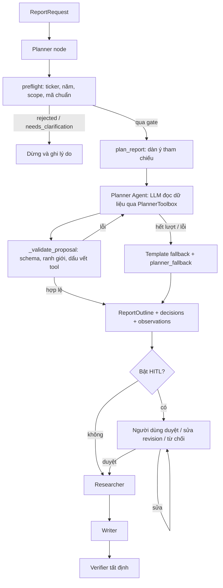

# Tổng quan Planner Agent

Tài liệu mô tả **Planner đang được cài đặt** cho báo cáo tài chính của một ticker. Đối tượng đọc là người cần hiểu kiến trúc, giải thích luồng graph và đánh giá dàn ý trước khi giao cho Researcher. Hướng dẫn chạy từng lệnh nằm trong [Planner Operations Guide](planner-operations.md).

## 1. Planner làm gì?

Planner nhận `ReportRequest` gồm ticker, khoảng năm, scope, đối tượng đọc và hướng dẫn. Nó trả `PlannerOutput`: trạng thái xử lý và, khi có thể lập kế hoạch, một `ReportOutline` gồm các section, task đọc dữ liệu và phép tính dự kiến.

Planner quyết định **cần nghiên cứu và trình bày điều gì**. Nó được đọc dữ liệu để chỉnh dàn ý, nhưng không viết nội dung báo cáo, không sửa dữ liệu nguồn, không tự đổi scope và không quyết định một dòng fact mơ hồ là số liệu cuối cùng. Researcher thực thi task, Writer soạn thảo, Verifier kiểm tra bản nháp.

Một Planner Agent được đặt **bên trong node `planner` của LangGraph**. Node là vị trí trong luồng; Agent là phần gọi LLM, sử dụng tool và đề xuất dàn ý. Graph nhận Planner dưới dạng hàm `plan(request)`, nên cũng chạy được với `plan_report()` tất định để demo, kiểm thử hoặc làm phương án dự phòng.

## 2. Luồng xử lý

Graph bật Human in the Loop khi `require_outline_approval=True` và có checkpointer. Cấu hình mặc định của `build_report_graph()` hiện là `False`; hàm `build_agent_report_graph()` nối Planner Agent và Researcher với duyệt outline bắt buộc. `rejected` và `needs_clarification` kết thúc luồng ở Planner.

## 3. Hai lớp kiểm duyệt quanh quyền quyết định của LLM

| Lớp | Thời điểm | Câu hỏi nó trả lời | Kết quả |
|---|---|---|---|
| `preflight()` | Trước khi gọi LLM | Ticker có trong DuckDB không? Các năm có ít nhất một fact không nghi vấn trong scope yêu cầu không? Có dấu hiệu bộ mã chuẩn được hỗ trợ không? | Qua gate, `rejected` hoặc `needs_clarification` kèm `PlannerNote`. |
| `_validate_proposal()` | Sau khi LLM đề xuất | Dàn ý có đúng schema và phép tính tường minh không? Các section tham chiếu đã được thể hiện hoặc giải thích chưa? Task và quyết định dựa trên dữ liệu có dấu vết tool phù hợp không? | Chấp nhận proposal hoặc trả lỗi cho LLM sửa trong số lượt cho phép. |

`preflight()` kiểm tra **khả năng bắt đầu**. Hiện `check_coverage()` chỉ yêu cầu ít nhất một fact không nghi vấn cho mỗi năm của ticker/scope; `has_standard_codes` kiểm tra sự hiện diện của mã `270` trong `BALANCE_SHEET`. Đây không phải cam kết mọi chỉ tiêu hay note đều có dữ liệu. Ticker ngoài corpus bị từ chối. Sáu mã ngân hàng ABB, ACB, BAB, MSB, NAB, NVB và nhóm tài chính chưa duyệt bị dừng theo quy tắc hiện tại. Nếu scope yêu cầu thiếu năm, Planner đưa `available_scopes` và chờ người dùng chọn lại; nó không tự chuyển sang scope khác.

`_validate_proposal()` kiểm tra **proposal có thể chuyển tiếp**. Nó yêu cầu ít nhất một quan sát; `OutlineDecision` dựa trên dữ liệu phải dẫn đến observation ID có thật và không thể chỉ dựa vào `error`/`invalid_input`. S1–S5 phải có section tương ứng hoặc quyết định rõ ràng; S2–S5 cần task hoặc quyết định. Task fact/time series phải có tên, mã, loại báo cáo khớp duy nhất với resolver và đã được đọc bằng tool tương ứng trong khoảng năm cần dùng. Task note phải khớp truy vấn, năm và nhóm tài liệu đã tìm. Outline cần ID và `calculation_policy="explicit"`.

Kiểm tra này xác nhận **cấu trúc và dấu vết truy vấn**, không xác nhận rằng lý do phân tích của LLM đúng, nguồn đã đầy đủ hoặc section nên được bỏ. Đó là lý do proposal còn đi qua bước duyệt của người dùng khi bật HITL.

## 4. LLM được quyết định đến đâu?

`plan_report()` tạo khung tham chiếu S1–S5; S6/S7 xuất hiện theo đối tượng đọc hoặc hướng dẫn. Prompt chuyên biệt giải thích B01/B02/B03, thuyết minh, kiểm toán, ý nghĩa trạng thái tool, điều kiện phép tính và cách xử lý thiếu dữ liệu. LLM thấy request, khung tham chiếu và các scope có sẵn; sau đó chủ động gọi `observe` để khảo sát trước khi trả `propose`.

Khi dữ liệu đủ, LLM được hướng dẫn bám khung. Khi dữ liệu thiếu hoặc đối tượng đọc cần trọng tâm khác, LLM có thể giữ, bỏ, gộp, tách hoặc thêm section/mục con. Mỗi thay đổi được trình bày bằng `OutlineDecision`: hành động, các section tham chiếu, section kết quả, lý do và observation ID nếu quyết định dựa trên dữ liệu. Thiếu một phép tính riêng lẻ không mặc nhiên làm mất cả section.

Ví dụ giả định: S5 cần phân tích dòng tiền ba năm, nhưng truy vấn time series trả `partial` và thiếu năm 2023. LLM có thể giữ S5 với phạm vi phân tích hẹp hơn và ghi giới hạn, hoặc gộp phần có dữ liệu vào section khác. Nó phải thể hiện quyết định bằng observation ID. Nếu truy vấn trả `error`, Planner không được coi đó là bằng chứng rằng dòng tiền không tồn tại.

## 5. Dữ liệu Planner được phép đọc

`PlannerToolbox` là cổng chỉ đọc của LLM. Nó cho phép `metric_name_resolver`, `query_fact_tool`, `query_time_series_tool` và `search_notes_tool`. Toolbox khóa ticker, scope và khoảng năm theo request; truy vấn fact nhận `metric_name`, rồi resolver điền `item_code` và `report_type`. LLM không được tự đưa mã chỉ tiêu vào lệnh truy vấn. Note được tìm trong các nhóm `NOTES`, `AUDIT_REPORT`, `MANAGEMENT_REPORT` theo năm và scope; phản hồi rút gọn tối đa 5 chunk, 300 ký tự đầu mỗi chunk.

Mỗi lần đọc tạo `PlannerObservation` có ID, tham số, kết quả tool và snapshot nguồn. Planner dùng bản rút gọn trong ngữ cảnh LLM; kết quả đầy đủ được lưu trong state. Các trạng thái `not_found`, `partial`, `ambiguous`, `invalid_input` và `error` có ý nghĩa khác nhau. `not_found` chỉ nói rằng truy vấn cụ thể không thấy dữ liệu; `error` là lỗi truy vấn hoặc nguồn, không phải chứng cứ vắng mặt. Researcher có thể dùng lại quan sát đã đọc nếu tham số và snapshot khớp.

Planner chỉ **khai báo** `CalculationSpec` (`yoy`, `cagr`, `difference`, `trend`) hoặc `RatioTask`; Researcher mới tính trên dữ liệu thật và ghi `cannot_compute` khi thiếu điều kiện. Phép so sánh nhiều năm còn phải xét cảnh báo `period_inconsistency`.

## 6. Hợp đồng dữ liệu và trạng thái

| Đối tượng | Vai trò |
|---|---|
| `ReportRequest` | Ticker, `start_year`, `end_year`, `scope`, `audience`, ngôn ngữ, hướng dẫn. Schema giới hạn năm 2022–2025. |
| `PlannerOutput` | `status` (`ready`, `needs_clarification`, `rejected`), outline nếu `ready`, notes, available scopes, observations, decisions, prompt version và cờ fallback. |
| `ReportOutline` / `SectionPlan` | ID dàn ý, các section, mục con, research task và calculation spec. ID section/task/calculation phải duy nhất và các tham chiếu phải hợp lệ. |
| `PlannerObservation` | Kết quả đọc dữ liệu có ID và snapshot để giải thích proposal, kiểm tra lại và dùng lại ở Researcher. |
| `OutlineDecision` / `PlannerNote` | Lý do điều chỉnh dàn ý và giới hạn hoặc quyết định dừng cần hiển thị cho người duyệt. |

Trong graph, dàn ý bắt đầu ở revision 1. `approve` chỉ chấp nhận revision đang chờ. `revise` giữ `outline_id`, tạo revision mới, lưu bản cũ và hủy trạng thái duyệt cũ; người dùng phải duyệt lại. `reject` chuyển sang `needs_clarification`. `can_complete()` chỉ đúng khi mọi section của revision hiện tại có bản nháp được duyệt và verification mức `full` đạt yêu cầu.

## 7. Mã nguồn cần trình bày

| File | Nội dung chính |
|---|---|
| [`planner.py`](../../src/agents/planner.py) | `preflight()` và `plan_report()` tạo template tất định. |
| [`planner_agent.py`](../../src/agents/planner_agent.py) | `build_planner_agent()` điều khiển vòng LLM/tool, sửa lỗi proposal, fallback; `_validate_proposal()` kiểm tra đầu ra. |
| [`planner_toolbox.py`](../../src/agents/planner_toolbox.py) | Giới hạn quyền đọc và lưu observation/snapshot. |
| [`planner_system.md`](../../src/agents/prompts/planner_system.md) | Ngữ cảnh chuyên biệt và giao thức JSON cho LLM. |
| [`planner_model.py`](../../src/agents/planner_model.py) | Adapter cấu hình `gemini-3.8-flash`, suy luận `MEDIUM`, JSON output. |
| [`report_schema.py`](../../src/schemas/report_schema.py) | Các model Pydantic của request, outline, task, decision và output. |
| [`report_graph.py`](../../src/agents/report_graph.py) | Node `planner`, điều hướng dừng/duyệt/Researcher và hàm ghép graph có Agent/HITL. |
| [`state.py`](../../src/agents/state.py) | Lưu revision, approval, observation và điều kiện hoàn thành. |
| [`researcher.py`](../../src/agents/researcher.py) | Thực thi task, dùng lại kết quả đọc phù hợp và tính toán. |

`plan_report()` được import trong graph làm Planner mặc định khi không truyền hàm `plan`. Khi truyền `build_planner_agent(GeminiPlannerModel(), tools)`, graph gọi Agent đó qua cùng hợp đồng `ReportRequest -> PlannerOutput`; `plan_report()` vẫn tạo template tham chiếu và fallback **bên trong Agent**.

## 8. Trạng thái hiện tại và giới hạn

- Có template, Agent dùng tool, schema/validator, fallback và cơ chế duyệt revision. Unit test dùng model giả không cần API key.
- Adapter Gemini đã được viết, nhưng chất lượng quyết định của model thật cần đánh giá sau khi cấu hình API key. `ready` có thể đi cùng `used_fallback=True`; cần xem cả hai.
- Graph nhận Researcher và Writer qua hàm được truyền vào. Luồng kiểm chứng hiện có là tất định; `verifier_node` để `run_status="incomplete"`. Muốn hoàn thành báo cáo phải bổ sung bước kiểm chứng ngữ nghĩa mức `full` và Writer thực tế trong tích hợp ứng dụng.
- Preview note chỉ gửi 300 ký tự đầu của mỗi chunk vào ngữ cảnh LLM. Khi duyệt quyết định định tính quan trọng, cần xem kết quả nguồn đầy đủ trong observation/evidence.

Kiểm thử và ví dụ gọi Planner/HITL: [Planner Operations Guide](planner-operations.md). Các bài kiểm thử liên quan nằm ở [`test_planner.py`](../../tests/planner/test_planner.py), [`test_planner_agent.py`](../../tests/planner/test_planner_agent.py), [`test_report_graph.py`](../../tests/report/test_report_graph.py) và [`test_report_state.py`](../../tests/report/test_report_state.py).
