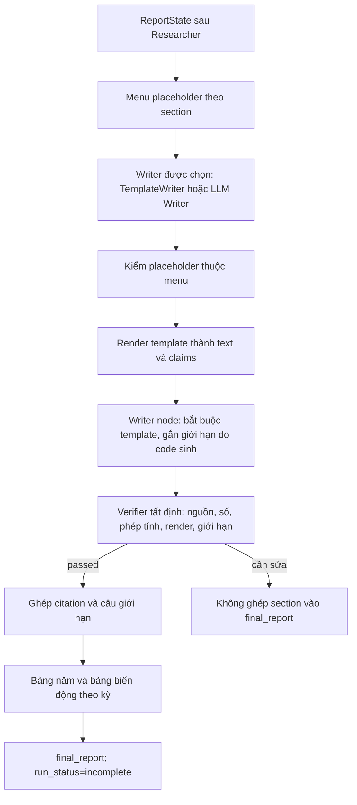

# Tổng quan Writer Agent

Tài liệu mô tả **Writer đang được cài đặt** cho báo cáo tài chính của một ticker. Đối tượng đọc là người cần hiểu ranh giới giữa soạn câu, chèn số, trình bày nguồn và kiểm chứng bản nháp. `TemplateWriter` tất định là đường dự phòng; `build_llm_writer()` dùng model cho S3–S5 và có thêm nhánh chọn nội dung thuyết minh cho S1, S2, S6, S7.

## 1. Writer làm gì?

Writer nhận `ReportState` sau Researcher: dàn ý, kết quả truy vấn, evidence, bí danh nguồn và kết quả tính toán. Nó trả các `SectionDraft` theo section và revision. Mỗi block mới chứa `template` là câu với placeholder; code render thành `text` và tạo `claims`. Writer chọn câu và chỉ tiêu được nêu, không tự gõ số, năm, đơn vị hoặc citation.

Trong LangGraph, node `writer` gọi hàm `write(state)` được truyền vào `build_report_graph()`. `build_template_writer()` và `build_llm_writer()` đều cung cấp hàm cùng chữ ký; `build_agent_report_graph()` vẫn yêu cầu bên gọi truyền Writer. Researcher quyết định dữ liệu và phép tính nào khả dụng; Verifier kiểm draft; code dựng bảng, citation và câu giới hạn sau khi kiểm chứng.

## 2. Luồng xử lý



Graph lấy draft mới nhất của từng section thuộc outline revision hiện tại. Draft qua kiểm tra được đưa vào `final_report`. Khi không truyền `verifier_model`, graph chỉ kiểm tất định và đặt `run_status="incomplete"`. Nhánh Verifier ngữ nghĩa mức `full` đã có trong mã nhưng đang được đánh giá riêng; báo cáo chỉ được đánh dấu hoàn tất khi mọi section của revision hiện tại qua mức `full`.

## 3. Hợp đồng template và menu

| Placeholder | Giá trị code chèn | Ví dụ cách dùng |
|---|---|---|
| `{{E3}}`, `{{E3\|abs}}` | Fact kèm đơn vị, hoặc trị tuyệt đối của fact | Mức năm cuối kỳ. |
| `{{Y:E3}}` | Năm của fact `E3` | Câu định lượng phải nêu năm. |
| `{{C:revenue:yoy:2025}}` | Giá trị của phép tính `ok` | YoY, CAGR, chênh lệch, tỷ lệ. |
| `{{P:C:revenue:yoy:2025}}` | Năm hoặc giai đoạn của phép tính | “năm 2025 so với năm 2024”. |
| `{{T:revenue:trend}}` | Cụm diễn giải hướng xu hướng | “tăng”, “đi ngang”, “diễn biến không đều”. |

`build_placeholder_menu(section, state)` trả fact alias cùng nhãn, năm, đơn vị; phép tính `ok` trong `section.calculations_allowed`; và token xu hướng hợp lệ. Fact được lấy từ task của section hoặc đầu vào của phép tính được cho phép. Một alias dùng chung giữa hai section giữ cùng ID, nhưng evidence chỉ thuộc section khác không xuất hiện trong menu này. Bí danh trong state được cấp theo hướng append-only; menu không đánh số lại khi có evidence mới.

`validate_template_menu()` từ chối placeholder lạ hoặc ngoài menu, kể cả alias có thật ở section khác. Với note, menu cũng chấp nhận đoạn trích nguyên văn đủ độ dài do LLM chọn ở vị trí khác trong chunk thuộc section; `allowed_tokens` vẫn liệt kê các đoạn gợi ý của TemplateWriter. `render_template()` từ chối chữ số viết trực tiếp trong template. Nó lấy giá trị từ `EvidenceRecord` và `CalculationResult`, định dạng số/đơn vị, rồi sinh `Claim` cho từng fact hoặc phép tính. Nếu một câu có nhiều giá trị tiền, renderer chọn cùng một thang cho cả câu; validator còn kiểm kết quả như lưới an toàn. Placeholder `Y:` và `P:` chèn năm/kỳ, không tự tạo claim riêng; claim của câu gắn với fact hoặc phép tính tương ứng. Ví dụ:

```text
Template: Mức thay đổi của Doanh thu thuần {{P:C:revenue:yoy:2025}} là {{C:revenue:yoy:2025}}.
Text:     Mức thay đổi của Doanh thu thuần năm 2025 so với năm 2024 là 11,56%.
```

Ví dụ `Text` lấy từ fixture FPT. Cả năm lẫn tỷ lệ đều do renderer lấy từ state.

## 4. TemplateWriter chọn nội dung như thế nào?

Với S3, S4 và S5, `TemplateWriter` chọn tối đa năm nhận định định lượng từ các phép tính `ok` theo nhóm chỉ tiêu của section. Mẫu câu hiện hỗ trợ YoY, CAGR, tỷ lệ, chênh lệch và xu hướng. Câu phép tính dùng `P:` để nêu kỳ; xu hướng doanh thu dùng `T:`. CAGR được gọi là “tốc độ tăng trưởng kép hằng năm” và được nêu nếu tính được, không lược vì YoY lớn. Các câu chỉ nhắc lại mức cuối kỳ trong bảng đã được bỏ.

Các số liệu theo từng năm nằm trong bảng do `report_tables.py` tạo từ state: một thang **tỷ đồng** với hai chữ số thập phân cho fact tiền tệ, bảng riêng cho tỷ lệ phần trăm. Bảng “Biến động theo kỳ” trình bày YoY và chênh lệch từng cặp năm đã được Planner cho phép. Ô thiếu, mơ hồ, nghi vấn hoặc phép tính không thực hiện được là `—`; ô có số mang citation của đúng nguồn. Phần văn xuôi chỉ nêu vài điểm chính. Cách chọn câu hiện là quy tắc cố định; chưa có chọn lọc nhận định bằng LLM hoặc diễn giải nguyên nhân biến động.

## 5. Giới hạn dữ liệu và citation

`SectionDraft.limitations` có ba loại neo khác nhau:

| Loại | Neo | Nơi sinh |
|---|---|---|
| `period_inconsistency` | Ít nhất một `evidence_id` và mã cảnh báo hai kỳ | Writer khai từ cảnh báo Researcher. |
| `cannot_compute` | `calculation_id` có `status="cannot_compute"` | Code tự sinh. |
| `data_gap` | `research_task_id` có dữ liệu thiếu | Code tự sinh. |

Node Writer yêu cầu mọi block mới có `template` (`missing_template`) rồi gọi `attach_code_limitations()`. Hàm này giữ khai báo `period_inconsistency` và tái tạo hai loại còn lại từ state. Verifier kiểm neo đúng trạng thái và đòi đủ limitation cho các phép tính hoặc task thiếu dữ liệu thuộc section.

Sau khi Verifier chấp nhận, `render_section_citations()` lấy citation từ metadata của evidence, không lấy citation do Writer gõ. Nó gộp giới hạn theo nguyên nhân gốc, dùng nhãn tiếng Việt cho task và phép tính, rồi nêu các phép tính bị ảnh hưởng. Nếu một năm hoàn toàn không có fact, câu nói về năm thiếu không mượn citation của năm có số; nếu nguồn có ô trống, citation trỏ vào nguồn chứa ô đó.

Với `period_inconsistency`, câu giới hạn nêu tên chỉ tiêu, giá trị năm trước theo báo cáo cũ và giá trị cột năm trước theo báo cáo mới. Bảng biến động cho người đọc thấy thay đổi của các kỳ theo cùng quy tắc ở mọi ticker, không gắn cờ ngưỡng riêng cho một mã.

## 6. Kiểm chứng và trạng thái

`DraftBlock.template` còn tùy chọn trong schema để đọc draft cũ; **draft mới từ node Writer bắt buộc phải có template**. Với draft có template, Verifier render lại và so `text` cùng `claims` (`render_mismatch`), kiểm placeholder theo section (`placeholder_out_of_menu`), đối chiếu số, đơn vị, phép tính, evidence và citation. Một chữ số bị sửa sau render sẽ làm draft không khớp. Kiểm tra nguồn của mọi chuỗi số và kiểm tra mỗi câu định lượng có năm đã được thêm vào test cho HUT, GMD, FPT.

Đây vẫn là kiểm chứng **tất định**. Nó không chứng minh câu văn đủ ý, diễn giải kinh tế đúng, hoặc một nhận định định tính được note hỗ trợ. Cơ chế `can_complete()` đòi verification mức `full` cho đúng section/revision; hiện graph chỉ tạo mức `deterministic`. Báo cáo mẫu vì vậy là bản nháp có nguồn, chưa là báo cáo hoàn tất.

## 7. Mã nguồn cần trình bày

| File | Nội dung chính |
|---|---|
| [`template_writer.py`](../../src/agents/template_writer.py) | Chọn câu mẫu và tạo `SectionDraft` cho phần định lượng. |
| [`writer_menu.py`](../../src/agents/writer_menu.py) | Tạo và kiểm menu placeholder theo section. |
| [`draft_rendering.py`](../../src/agents/draft_rendering.py) | Render số, năm, kỳ, xu hướng và tạo claim. |
| [`report_tables.py`](../../src/agents/report_tables.py) | Bảng năm và bảng biến động theo kỳ. |
| [`verification.py`](../../src/agents/verification.py) | Gắn giới hạn do code sinh, kiểm chứng draft, ghép citation và câu giới hạn. |
| [`report_schema.py`](../../src/schemas/report_schema.py) | `DraftBlock`, `Claim`, `SectionDraft`, ba loại limitation và `CalculationResult`. |
| [`report_graph.py`](../../src/agents/report_graph.py) | Node Writer, gate `missing_template`, Verifier và ghép `final_report`. |
| [`state.py`](../../src/agents/state.py) | Lưu draft theo section/revision, đọc JSON cũ và điều kiện hoàn thành. |
| [`llm_writer.py`](../../src/agents/llm_writer.py) | `SectionView`, validate, retry và fallback theo section. |
| [`qualitative_llm_writer.py`](../../src/agents/qualitative_llm_writer.py) | Chọn đoạn note theo task, kiểm quote và nhận định, tạo draft định tính. |
| [`writer_contract.py`](../../src/agents/writer_contract.py) | `WriterModel`, JSON narrative và `WriterRunLog`. |
| [`writer_model.py`](../../src/agents/writer_model.py) | Adapter Gemini cho Writer. |
| [`citation_recall.py`](../../src/agents/citation_recall.py) | Quét ứng viên nhân quả, so sánh và dự báo bằng quy tắc. |

## 8. Trạng thái hiện tại và giới hạn

- Đã có ba báo cáo mẫu [HUT](../../data/report_output/hut_template_report.md), [GMD](../../data/report_output/gmd_template_report.md) và [FPT](../../data/report_output/fpt_template_report.md), đều dùng dữ liệu Researcher đã lưu và qua Verifier tất định cho S3–S5. FPT thể hiện các năm thiếu và phép tính không thể thực hiện.
- Đã có Writer gọi LLM cho S3–S5 theo hợp đồng định lượng hiện tại. Với S1, S2, S6, S7, nhánh LLM riêng nhận các note chunk thuộc task của section và chọn thông tin để viết; nếu không có output hợp lệ, section dùng trích đoạn do `TemplateWriter` chọn. Cả hai nhánh có log và fallback theo section. Bảng vẫn được ghép vào Markdown sau khi draft qua kiểm chứng tất định. Verifier ngữ nghĩa đang được phát triển và đánh giá riêng.
- Trend hiện dùng ngưỡng `flat_absolute_threshold="0"`: “đi ngang” chỉ khi giá trị bằng nhau tuyệt đối. Renderer dùng “tăng/giảm” cho chuỗi hai điểm và “tăng liên tục/giảm liên tục” từ ba điểm. Chi tiết hợp đồng và ngưỡng nằm ở [Writer Contract Decisions](../decisions/writer-contract-decisions.md).

Các test liên quan: [`test_writer_w0.py`](../../tests/writer/test_writer_w0.py), [`test_template_writer.py`](../../tests/writer/test_template_writer.py), [`test_writer_w3.py`](../../tests/writer/test_writer_w3.py), [`test_llm_writer.py`](../../tests/writer/test_llm_writer.py), [`test_report_calculation_verification.py`](../../tests/report/test_report_calculation_verification.py) và [`test_report_graph.py`](../../tests/report/test_report_graph.py).

## 9. WriterModel và vòng sửa W4

`WriterModel.generate(WriterRequest) -> WriterResponse` nhận prompt, view của một section, feedback các lượt trước và schema JSON. Với S3–S5, `NarrativeOutput` chỉ có `blocks[{block_id, template}]` và khai báo `period_limitations` tùy chọn; `text`, `claims`, bảng và hai loại giới hạn dữ liệu được code sinh. `GeminiWriterModel` dùng cùng cách đọc key với Planner, nhiệt độ 0, mức suy luận `LOW` và JSON schema. Prompt định lượng hiện có version `w4-v6`; view nhận thêm mục con đã được duyệt để hướng dẫn chọn nội dung.

Trước Verifier, validator kiểm JSON, ID block, menu placeholder, chữ số viết tay, đơn vị viết sau placeholder, năm/kỳ, định danh nội bộ, một câu mỗi block, mỗi câu có claim, không trộn hai thang tiền trong một câu và cụm nhân quả/dự báo/so sánh bằng chữ. “Cao hơn/thấp hơn” và “tương ứng” mới ở mức cảnh báo để đo. `Y:` render cả “năm”; `P:C:` render cả “năm” hoặc “giai đoạn”. Sau tối đa hai lượt sửa, section lỗi dùng TemplateWriter; các section khác vẫn dùng kết quả model. `writer_run_logs` lưu số lượt, lỗi và cảnh báo từng lượt, token, thời gian và cờ fallback theo section/revision; chế độ Dev còn lưu output thô và thời gian từng lần gọi.

Kết quả thử trên HUT/GMD Dev và các câu chưa tự nhiên của model được ghi trong [Writer W4 Dev Evaluation](../evaluation/quantitative-writer-evaluation.md). Kết quả này chưa đủ để đổi Writer mặc định.

## 10. Writer định tính ở chế độ trích đoạn

Với task note của S1, S2, S6 và S7, nhánh LLM `w6-v2` nhận query, trạng thái Researcher, mục con đã duyệt và toàn bộ note chunk đã truy xuất cho từng task trong section. Model chọn tối đa một đoạn cho mỗi task, trả alias evidence, trích dẫn nguyên văn và một câu nhận định ngắn. Code kiểm alias thuộc task, trích dẫn là chuỗi con nguyên văn đủ nội dung và câu nhận định không chứa chữ số, năm, đơn vị hay citation tự gõ. Sau đó renderer chèn năm bằng `Y:`, trích dẫn bằng `N:`, sinh `qualitative` claim và citation từ metadata. Verifier tất định kiểm draft trước khi nhận. Mục con là hướng dẫn chọn nội dung, chưa bảo đảm heading riêng trong bản báo cáo.

Khi model lỗi, trả JSON sai hoặc draft không qua kiểm chứng, Writer thử sửa tối đa hai lượt rồi dùng `TemplateWriter` cho section đó. Đường dự phòng chọn tối đa một trích đoạn cho mỗi task theo menu và cũng dùng `N:`/`Y:`; các giới hạn dữ liệu vẫn do code sinh. Khi không có note chunk cho section, Writer dùng ngay đường dự phòng và không gọi model. Log lưu số lượt, lỗi, số block, token, thời gian và output thô nếu bật chế độ Dev. Các test với model giả đã kiểm đoạn hợp lệ, trích dẫn không thuộc nguồn, alias ngoài task, năm viết tay và lỗi model. Đánh giá Gemini trên S1/S2/S6/S7 của FPT, HUT, GMD Dev đã lưu ở [Writer W6 Qualitative LLM Evaluation](../evaluation/qualitative-writer-evaluation.md): 12/12 section qua Verifier tất định, 10/12 ngay lượt đầu, không fallback. Nội dung vẫn cần Verifier ngữ nghĩa và đánh giá người đọc.

Trên 20 cặp S7 đã có nhãn người thứ nhất, bộ chọn giữ bốn đoạn `direct` và bỏ 16 đoạn còn lại; đây là **test hồi quy trên mẫu đã dùng để thiết kế quy tắc**, không phải kết quả hold-out. Đã chạy Researcher thật cho S6–S7 của HUT/GMD/FPT trên v2.1 và đóng gói ba bản nháp S1–S7 tại `data/report_output/v2_1_fixtures/writer_verifier_samples`. Cả 21 section qua Verifier tất định; mỗi section có SectionView cùng evidence gốc để thử Verifier ngữ nghĩa. Các chủ đề chưa có trích đoạn đủ nội dung được nêu trong báo cáo. Việc chọn đoạn vẫn phụ thuộc cổng Researcher và top 5: đoạn FPT về phòng ngừa rủi ro tỷ giá ở cặp 03 hiện được cổng Researcher giữ lại để Writer có thể xét trích đoạn. Tiêu chí W6 đã chốt `direct` là đoạn đủ cho một nhận định cụ thể có citation. Cổng Researcher ưu tiên giữ các đoạn ứng viên; Verifier ngữ nghĩa mức `full` chịu trách nhiệm đối chiếu claim với text nguồn. Vẫn cần đo recall ngoài top 5 và đánh giá ngoài mẫu trước khi coi S7 là đủ độ tin cậy cho báo cáo hoàn chỉnh.
